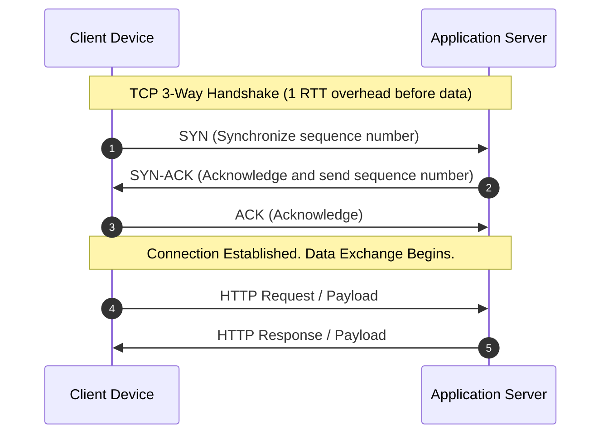
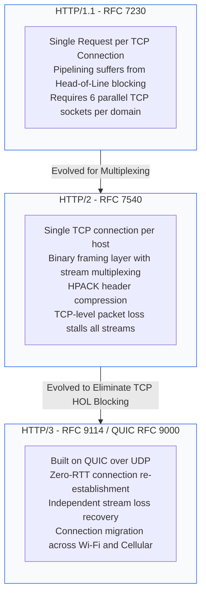
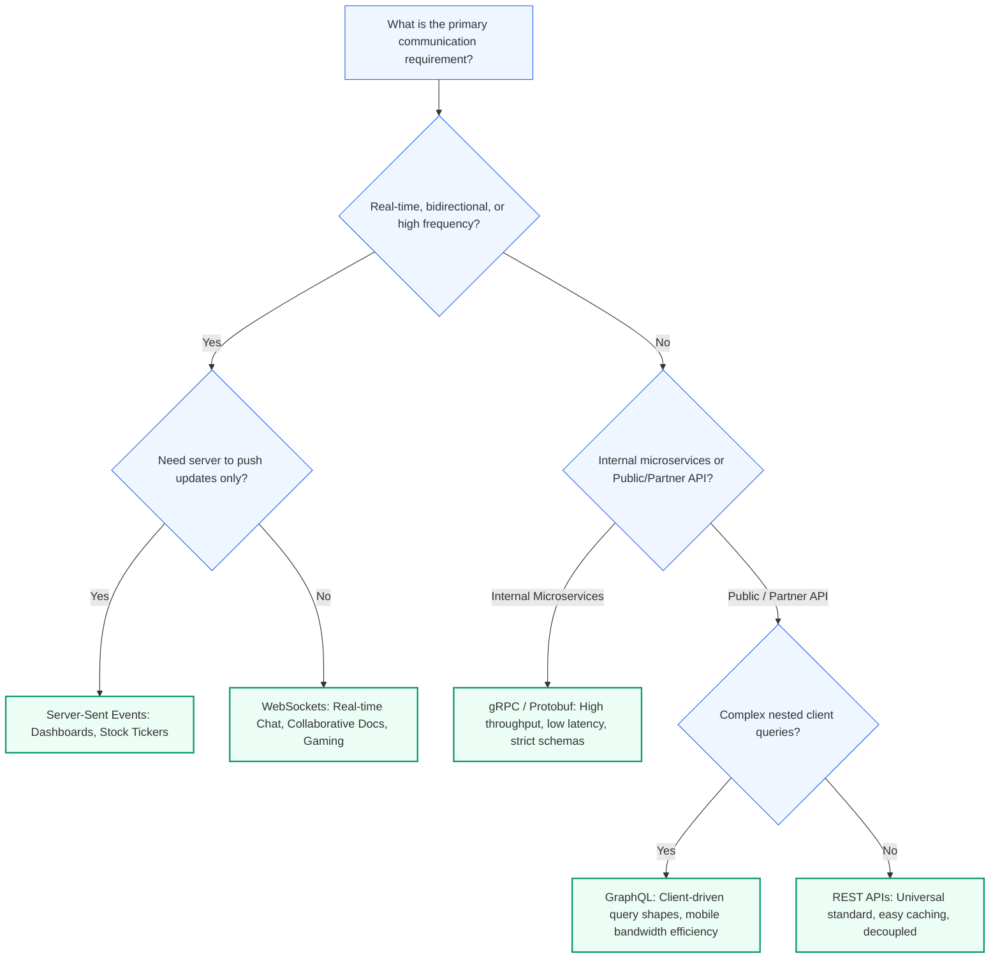
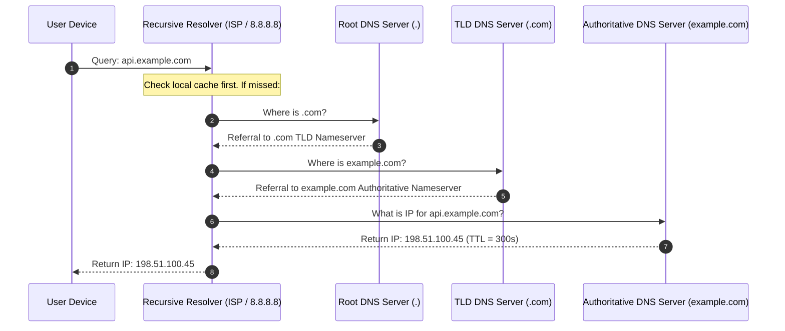
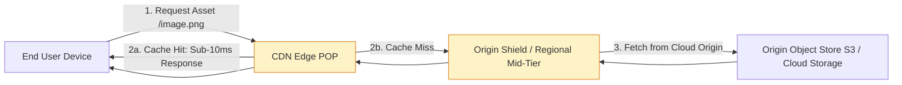

# Module 1.1: Client-Server Networking and Communication Protocols

[Home](../README.md) > [Module 1: Foundations](./README.md) > **Chapter 1.1: Networking & Protocols**

---

Communication protocols define how distributed components exchange data, negotiate connections, and maintain reliability. As a Technical Program Manager, choosing the right protocol impacts system latency, infrastructure costs, battery life on mobile devices, and cross-team interface contracts.

---

## 1. Network Protocol Fundamentals

Modern distributed architectures operate across multiple layers of the Open Systems Interconnection (OSI) and TCP/IP models. Program managers should understand the trade-offs between transport-layer protocols (TCP vs UDP) and application-layer protocols (HTTP, WebSockets, gRPC).

### Transport Layer: TCP vs UDP

| Feature | TCP (Transmission Control Protocol) | UDP (User Datagram Protocol) | Architectural Impact |
| :--- | :--- | :--- | :--- |
| **Connection Model** | Connection-oriented (3-way handshake) | Connectionless (fire and forget) | TCP adds 1 RTT before data transfer; UDP starts instantly |
| **Reliability** | Guaranteed in-order packet delivery via ACKs and retransmissions | Best effort; packet loss and out-of-order arrival possible | TCP prevents corrupted/missing data; UDP eliminates retransmit latency |
| **Flow & Congestion** | Built-in flow control (sliding window) and congestion avoidance | None at protocol level; must be handled by application | TCP prevents network saturation; UDP streams at arbitrary rates |
| **Header Overhead** | 20 to 60 bytes per packet | 8 bytes per packet | UDP conserves bandwidth and packet processing CPU |
| **Primary Use Cases** | APIs, financial ledgers, transactional databases, file storage | Live video streaming (WebRTC), VoIP, DNS lookups, gaming | Choose TCP for correctness; choose UDP for real-time speed |

---

## 2. Evolution of HTTP: HTTP/1.1 to HTTP/3

Understanding the HTTP evolution helps TPMs evaluate migration programs and justify client infrastructure upgrades.

### Protocol Comparison for Engineering Roadmaps

1. **HTTP/1.1**:
   - *Mechanics*: Persistent connections (`Keep-Alive`), chunked transfer encoding.
   - *Limitation*: Head-of-Line (HoL) blocking at application level. Browsers open 6 parallel TCP connections per host to bypass this, multiplying server memory overhead and handshake latency.

2. **HTTP/2**:
   - *Mechanics*: Binary framing layer, multiplexing multiple request/response streams over a single TCP connection, server push, header compression (HPACK).
   - *Limitation*: TCP-level HoL blocking. Because TCP enforces strict packet order, if a single packet drops on a flaky mobile connection, all multiplexed HTTP/2 streams stall until TCP retransmits the missing segment.

3. **HTTP/3 (QUIC)**:
   - *Mechanics*: Runs over UDP instead of TCP. QUIC moves stream management into the transport layer. Packet loss on Stream A does not pause Stream B.
   - *TPM Business Impact*: 0-RTT connection resumption accelerates page load times for returning mobile users; **Connection Migration** allows mobile users to transition from home Wi-Fi to cellular data without dropping active streams or re-authenticating.

---

## 3. Communication Styles: API Decision Framework

Different program initiatives require distinct API paradigms. Below is the decision framework for technical program managers:

### Detailed Protocol Evaluation Table

| Pattern | Transport | Data Format | Directionality | Ideal Use Case | Operational Considerations for TPMs |
| :--- | :--- | :--- | :--- | :--- | :--- |
| **REST** | HTTP/1.1, HTTP/2 | JSON, XML | Request / Response | Public APIs, CRUD microservices | Universal client compatibility, standard edge caching, simple API versioning |
| **gRPC** | HTTP/2, HTTP/3 | Protocol Buffers (Binary) | Bidirectional Streaming & RPC | Low-latency internal microservices | 5x to 10x faster serialization than JSON; requires Protobuf schema governance tooling |
| **GraphQL** | HTTP | JSON | Request / Response | Mobile applications with variable screen layouts | Prevents over/under-fetching; query complexity risks backend database CPU exhaustion |
| **WebSockets** | TCP (Upgraded from HTTP) | Text / Binary | Full-Duplex (Bidirectional) | Chat apps, trading desks, driver location tracking | Stateful connections complicate auto-scaling; requires sticky sessions or socket broker fleets |
| **Server-Sent Events** | HTTP | Text / Event-Stream | Unidirectional (Server to Client) | Live dashboards, notifications, LLM token streaming | Reuses standard HTTP/2 infrastructure; traverses corporate firewalls with zero special proxy configuration |

---

## 4. DNS (Domain Name System) Resolution Mechanics

DNS translates human-readable hostnames (e.g. `api.example.com`) into routable IP addresses. Understanding DNS resolution is critical when managing global deployments, zero-downtime cutovers, and disaster recovery failovers.

### DNS Routing Policies for TPMs

- **Latency-Based Routing**: Directs user traffic to the cloud region with the lowest round-trip network latency.
- **Geolocation Routing**: Directs users based on geographical origin (essential for enforcing European GDPR data residency).
- **Weighted Round-Robin**: Splits traffic proportionately across endpoints (ideal for multi-week canary rollouts).
- **Health Check & Failover Routing**: Automatically diverts DNS queries away from impaired regions when automated synthetic health probes fail.
- **Time-to-Live (TTL) Strategy**:
  - *Migration Phase (Low TTL: 60s)*: Ensures rapid rollback and swift DNS propagation if the new cluster experiences issues.
  - *Steady-State Phase (High TTL: 3600s)*: Maximizes resolver cache hits, reducing lookup latency and DNS hosting costs.

---

## 5. Content Delivery Networks (CDNs)

A CDN is a geographically distributed network of proxy servers (Points of Presence, or POPs) that cache content near end users.

### CDN Capabilities Beyond Static Caching

1. **Static Asset Caching**: Images, CSS, JavaScript bundles, video segments.
2. **Dynamic Site Acceleration (DSA)**: Optimizes route calculation over private cloud backbones, keeping TCP connections pre-warmed between CDN edge POPs and origin servers.
3. **Edge Compute (Workers / Cloudflare Workers / Lambda@Edge)**: Header rewriting, A/B testing splits, authentication validation, and geolocation personalization at the perimeter.
4. **DDoS Protection & Web Application Firewall (WAF)**: Absorbs volumetric Layer 3/4 flood attacks and filters Layer 7 injection attacks (SQLi, XSS) before hitting internal clusters.

### Critical CDN Metrics for Program Reviews

- **Cache Hit Ratio (CHR)**: Target greater than 90% for static media. Formula: $\text{CHR} = \frac{\text{Cache Hits}}{\text{Cache Hits} + \text{Cache Misses}}$.
- **Origin Offload**: Percentage of bandwidth absorbed by the CDN instead of origin servers. Directly reduces cloud egress bandwidth bills.
- **Purge Latency**: Time required to invalidate cached assets globally when deploying breaking client releases.

---

## 6. TPM Review Checklist

When leading architectural discussions on networking and communication:

- [ ] Does the chosen protocol support the required latency and throughput SLAs?
- [ ] Are public-facing endpoints secured behind HTTPS (TLS 1.3) with HTTP Strict Transport Security (HSTS) enabled?
- [ ] For real-time features, did the team evaluate Server-Sent Events before defaulting to stateful WebSockets?
- [ ] What is the planned DNS TTL setting during steady-state versus migration phases?
- [ ] Is CDN caching configured with appropriate `Cache-Control` headers and cache-busting version hashes?
- [ ] Are internal microservices leveraging gRPC with strict Protocol Buffer definitions for schema governance?

---

## 7. Primary Sources and Further Reading

- **RFC 9000**: QUIC: A UDP-Based Multiplexed and Secure Transport (IETF, 2021).
- **RFC 9114**: HTTP/3 (IETF, 2022).
- **RFC 7540**: Hypertext Transfer Protocol Version 2 (HTTP/2) (IETF, 2015).
- **RFC 6455**: The WebSocket Protocol (IETF, 2011).
- **RFC 1034 & RFC 1035**: Domain Names - Concepts and Facilities (IETF, 1987).
- *Designing Data-Intensive Applications* by Martin Kleppmann (O'Reilly Media, 2017) - Chapter 1: Reliable, Scalable, and Maintainable Systems.
