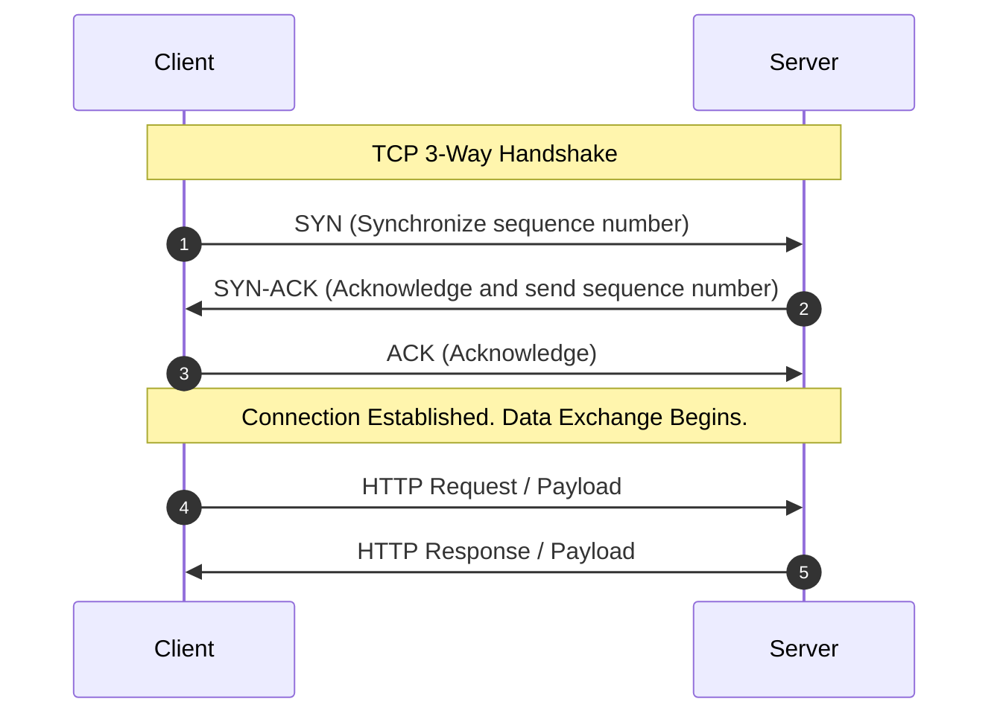
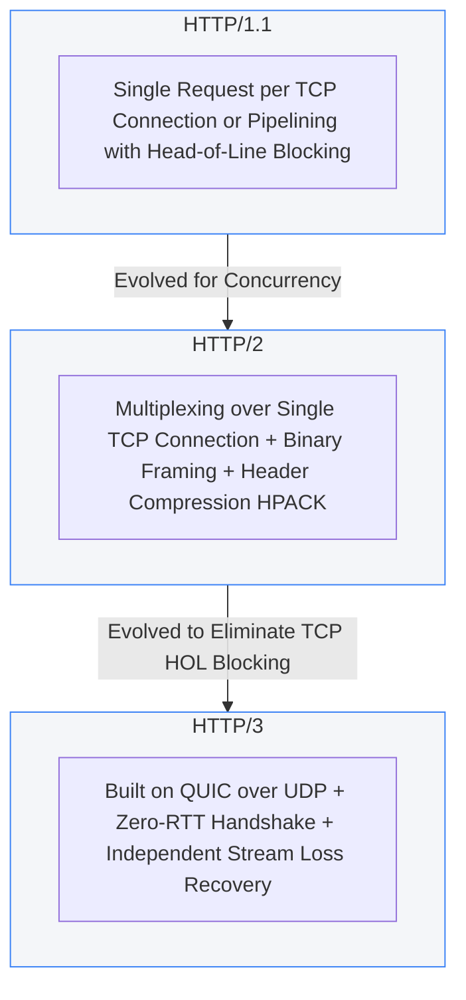
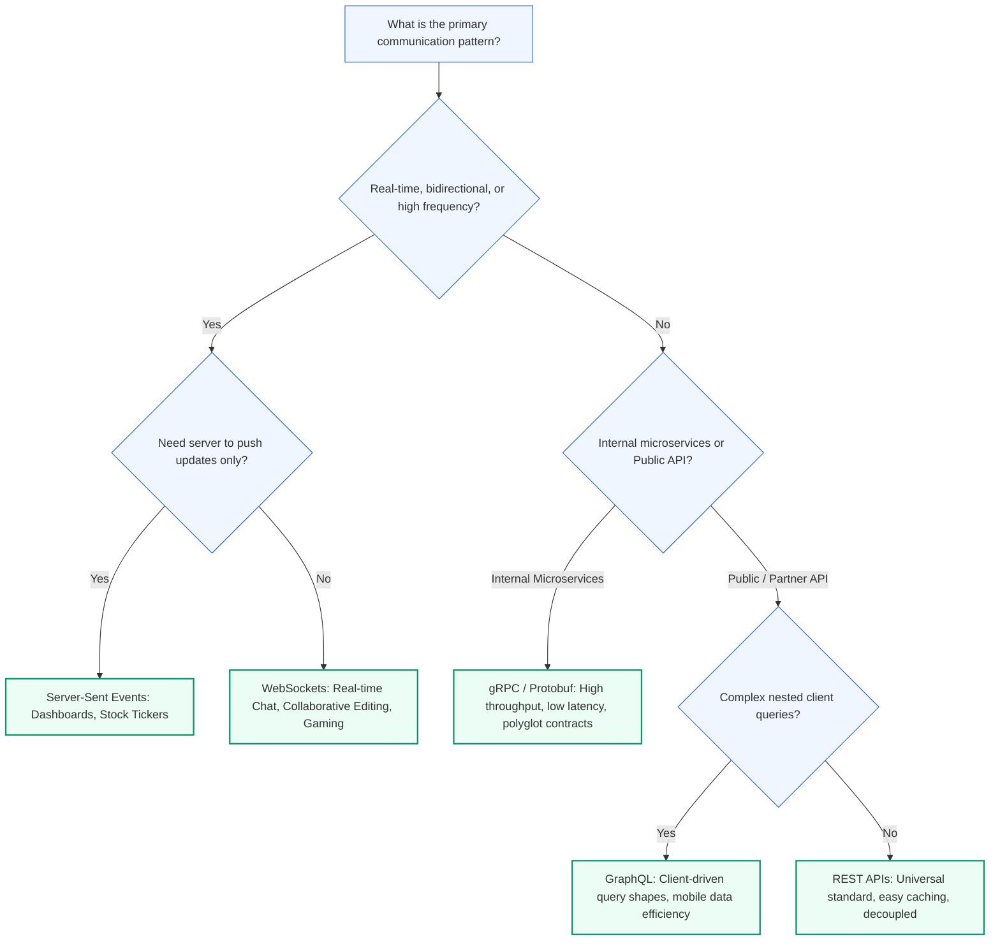
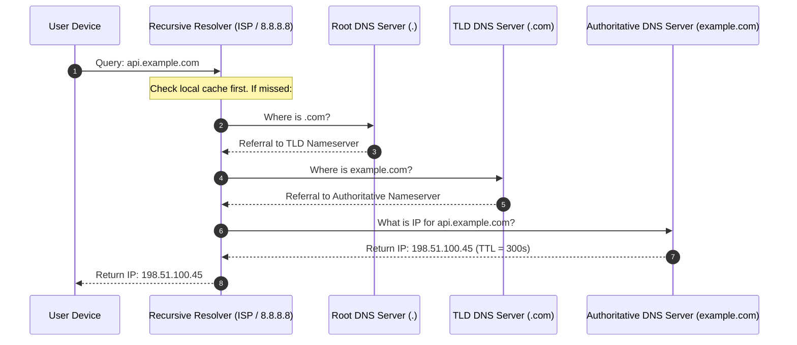
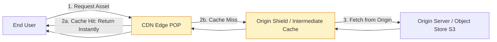

# Module 1.1: Client-Server Networking and Communication Protocols

Communication protocols define how distributed components exchange data, negotiate connections, and maintain reliability. As a Technical Program Manager, choosing the right protocol impacts system latency, infrastructure costs, battery life on mobile devices, and cross-team interface contracts.

---

## 1. Network Protocol Fundamentals

Modern distributed architectures operate across multiple layers of the Open Systems Interconnection (OSI) and TCP/IP models. Program managers should understand the trade-offs between transport-layer protocols (TCP vs UDP) and application-layer protocols (HTTP, WebSockets, gRPC).

### Transport Layer: TCP vs UDP

| Feature | TCP (Transmission Control Protocol) | UDP (User Datagram Protocol) |
| :--- | :--- | :--- |
| **Connection** | Connection-oriented (3-way handshake) | Connectionless (fire and forget) |
| **Reliability** | Guaranteed delivery, in-order packets | Best effort, packet loss possible |
| **Flow & Congestion** | Built-in flow control and congestion avoidance | None |
| **Overhead** | Higher latency (handshake + ack overhead) | Minimal latency, lightweight header |
| **Use Cases** | Web traffic, APIs, file transfers, financial transactions | Live streaming, VoIP, online gaming, DNS queries |

---

## 2. Evolution of HTTP: HTTP/1.1 to HTTP/3

Understanding the HTTP evolution helps TPMs evaluate migration programs and justify client infrastructure upgrades.

### Protocol Comparison

1. **HTTP/1.1**:
   - Features: Persistent connections (`Keep-Alive`), chunked transfer.
   - Limitation: Head-of-Line (HoL) blocking at application level. Browsers open 6 parallel TCP connections per host to bypass this, increasing server memory overhead.

2. **HTTP/2**:
   - Features: Binary framing layer, multiplexing multiple streams over a single TCP connection, server push, header compression (HPACK).
   - Limitation: TCP-level HoL blocking. If a single packet drops, all multiplexed streams stall until TCP retransmits the missing packet.

3. **HTTP/3 (QUIC)**:
   - Features: Runs over UDP instead of TCP. Solves transport-level HoL blocking because packet loss on one stream does not pause other streams.
   - Benefits: 0-RTT connection re-establishment, connection migration when users switch between Wi-Fi and cellular networks without dropping sessions.

---

## 3. Communication Styles: Choosing the Right API Style

Different program initiatives require distinct API paradigms. Below is the decision framework for technical program managers.

### Detailed Comparison Table

| Pattern | Transport | Data Format | Directionality | Ideal Use Case | TPM Consideration |
| :--- | :--- | :--- | :--- | :--- | :--- |
| **REST** | HTTP/1.1, HTTP/2 | JSON, XML | Request/Response | Public APIs, CRUD services | Standard tooling, easy edge caching, broad ecosystem |
| **gRPC** | HTTP/2, HTTP/3 | Protocol Buffers (Binary) | Bidirectional Streaming & RPC | Low-latency microservices | Strict schema contracts, requires Protobuf compiler tooling |
| **GraphQL** | HTTP | JSON | Request/Response | Mobile apps with variable view models | Avoids over/under-fetching; query complexity risks backend CPU |
| **WebSockets** | TCP (Upgraded from HTTP) | Text / Binary | Full-Duplex (Bidirectional) | Chat apps, live trading desks | Stateful connections complicate horizontal auto-scaling |
| **Server-Sent Events** | HTTP | Text/Event-Stream | Unidirectional (Server to Client) | Live notifications, log streaming | Reuses HTTP infra; simple firewall traversal compared to WebSockets |

---

## 4. DNS (Domain Name System) Resolution

DNS translates human-readable hostnames (e.g. `api.example.com`) into routable IP addresses. Understanding DNS resolution is critical when managing global deployments, zero-downtime cutovers, and disaster recovery failover.

### DNS Routing Policies for TPMs

- **Latency-based routing**: Directs traffic to the AWS/GCP region with lowest round-trip time for the caller.
- **Geolocation / Geo-proximity routing**: Routes users to servers inside their legal jurisdiction (vital for GDPR data residency).
- **Weighted round-robin**: Useful for canary rollouts (e.g. 5% to new region, 95% to current region).
- **Failover routing**: Health checks trigger DNS record updates to route traffic away from an impaired region.
- **Time-to-Live (TTL) Trade-off**:
  - *Low TTL (60s)*: Fast failover and agile rollbacks, but increases query load and latency for clients.
  - *High TTL (86400s)*: Excellent caching and fast client resolutions, but slow propagation during emergency migrations.

---

## 5. Content Delivery Networks (CDNs)

A CDN is a geographically distributed network of proxy servers (Points of Presence, or POPs) that cache static and dynamic content closer to end-users.

### CDN Capabilities Beyond Static Caching

1. **Static Asset Caching**: Images, CSS, JavaScript bundles, video segments.
2. **Dynamic Site Acceleration (DSA)**: Optimizes route calculation over private backbones, keeping TCP connections warm between CDN edge and origin.
3. **Edge Compute (Workers / Lambda@Edge)**: Header rewriting, A/B testing splits, authentication validation, and geolocation personalization at the perimeter.
4. **DDoS Protection & WAF**: Absorbs volumetric Layer 3/4 flood attacks and filters Layer 7 attacks (SQLi, XSS) before hitting internal clusters.

### Critical CDN Metrics for Program Reviews

- **Cache Hit Ratio (CHR)**: Target greater than 90% for static assets. Formula: `Hits / (Hits + Misses)`.
- **Origin Offload**: Percentage of bandwidth absorbed by the CDN instead of origin servers. Directly impacts egress cloud cost.
- **Purge Latency**: Time required to invalidate cached assets globally when releasing new client assets.

---

## 6. TPM Review Checklist

When leading architectural discussions on networking and communication:

- [ ] Does the proposed communication pattern support the required latency SLA?
- [ ] Are public-facing endpoints secured behind HTTPS (TLS 1.3) with HSTS enabled?
- [ ] For real-time features, did the team evaluate Server-Sent Events before defaulting to stateful WebSockets?
- [ ] What is the DNS TTL setting during steady-state versus migration phases?
- [ ] Is CDN caching configured with appropriate `Cache-Control` headers and cache-busting version hashes?
- [ ] Are internal microservices leveraging gRPC with strict Protocol Buffer definitions for schema governance?
