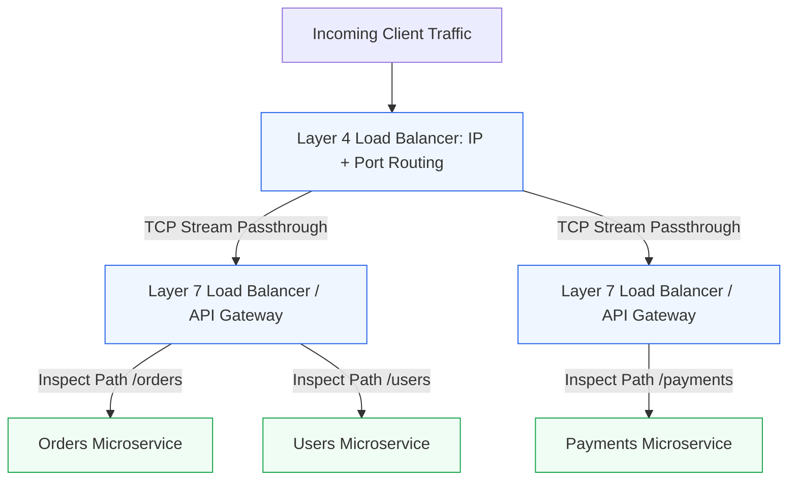
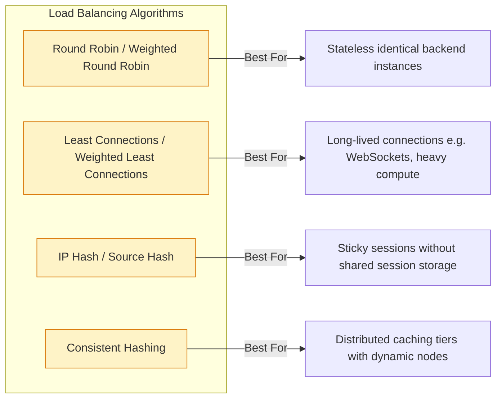
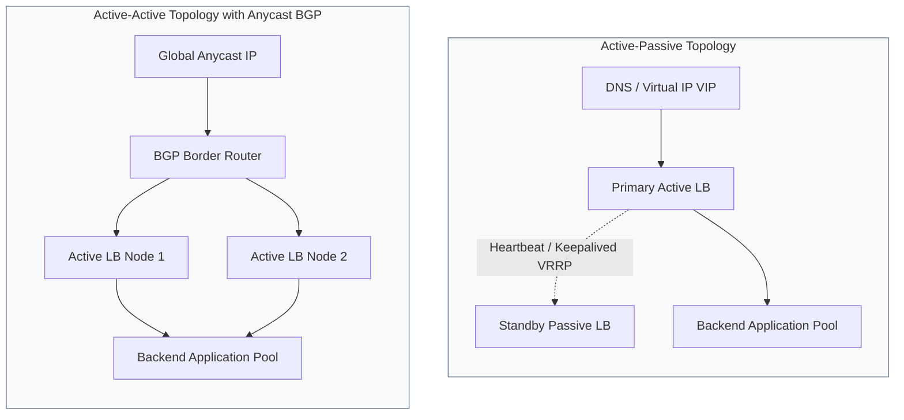
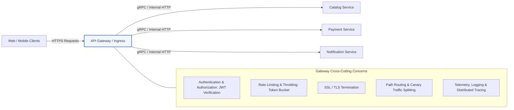
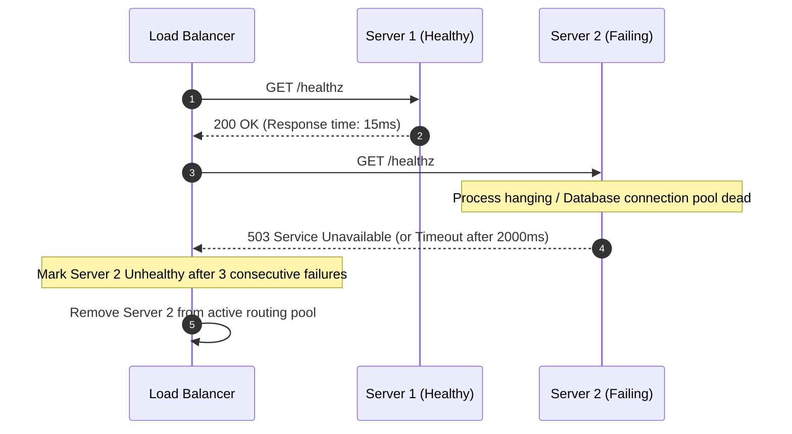

# Module 1.2: Load Balancing and API Gateways

[Home](../README.md) > [Module 1: Foundations](./README.md) > **Chapter 1.2: Load Balancing & API Gateways**

---

Load balancers and API gateways form the front door of modern distributed architectures. They ensure high availability, prevent server saturation, enforce security policies, and route requests efficiently across fleet instances. For technical program managers, these components represent critical single points of failure (SPOFs) and cost drivers.

---

## 1. Layer 4 vs Layer 7 Load Balancing

Load balancers operate at different layers of the OSI model, trading inspection depth for raw packet throughput.

### Deep-Dive Comparison

| Dimension | Layer 4 (Transport Layer) | Layer 7 (Application Layer) | Architectural Guidance |
| :--- | :--- | :--- | :--- |
| **Routing Criteria** | Source IP, Source Port, Dest IP, Dest Port, TCP/UDP protocol | HTTP URI, HTTP Headers, Cookies, Request Body, Content-Type | L4 for raw protocol speed; L7 for path/header routing |
| **Payload Inspection** | No inspection; forwards raw packets directly | Full inspection; terminates TCP and parses HTTP payload | L7 allows security scanning; L4 preserves end-to-end privacy |
| **Performance** | Ultra-high throughput, sub-millisecond latency, minimal CPU | Higher CPU and memory consumption per request | Size L7 clusters with 3x compute buffer compared to L4 |
| **SSL/TLS Termination** | Passes encrypted packets or decrypts without HTTP inspection | Full SSL/TLS termination and re-encryption to backends | Centralize TLS at L7 to offload CPU from backend pods |
| **Smart Routing** | Cannot route based on URL path or session cookies | Supports canary traffic splitting, path routing, header filtering | Essential for microservice service discovery |
| **Representative Technologies** | AWS NLB (Network Load Balancer), HAProxy (TCP mode), IPVS, Maglev | AWS ALB, NGINX, Envoy Proxy, Traefik, Kong, HAProxy (HTTP mode) | Combine L4 at edge with L7 for microservice ingress |

---

## 2. Load Balancing Algorithms

Choosing the right distribution algorithm directly impacts p99 tail latency and resource utilization.

1. **Round Robin**:
   - Cycles through servers sequentially.
   - *Limitation*: Assumes all servers have identical capacity and all requests require equal processing time. Can cause queue pile-ups on slower instances.
2. **Weighted Round Robin**:
   - Assigns a numeric weight reflecting hardware capacity (e.g. an 8-core node receives 2x the requests of a 4-core node).
3. **Least Connections**:
   - Routes to the server with fewest active concurrent connections. Essential for variable-duration transactions like report generation or video encoding.
4. **Consistent Hashing**:
   - Maps requests and servers to a virtual ring. Minimizes cache misses when backends scale up or down dynamically.

---

## 3. High Availability Topologies: Active-Passive vs Active-Active

High availability eliminates single points of failure at the network ingress layer.

### Architectural Trade-offs

- **Active-Passive (Failover via VRRP / Keepalived)**:
  - Simple to implement; standby node consumes idle compute cost.
  - Failover takes 1 to 5 seconds while virtual IP address migrates, which may cause brief connection drops for active TCP streams.
- **Active-Active (BGP Anycast / DNS Multi-A Records)**:
  - Full resource utilization; traffic is load-balanced across all gateways simultaneously.
  - Requires automated health-checking to withdraw BGP routes instantly if a node crashes to avoid routing traffic to a dead host.

---

## 4. The API Gateway Pattern

In a microservice architecture, client applications should never interact directly with hundreds of internal microservices. The API Gateway acts as a unified reverse proxy and policy enforcement point.

### Core API Gateway Responsibilities

1. **Request Routing & Path Translation**:
   - Routes `/api/v1/checkout` to the Checkout cluster and `/api/v1/search` to the Search cluster.
2. **Security & Authentication Offload**:
   - Validates OAuth2 / OpenID Connect tokens, decodes JWT signatures, and passes verified user claims as internal HTTP headers (`X-User-ID`, `X-User-Role`) to backends.
3. **Rate Limiting & Abuse Prevention**:
   - Enforces tier-based quotas (e.g. 100 requests per minute for free tier, 5000 for enterprise) using Redis-backed token buckets.
4. **SSL/TLS Termination**:
   - Manages certificates centrally, decrypts incoming traffic, and communicates with internal services over high-speed private virtual private clouds (VPCs).
5. **Observability Injection**:
   - Injects correlation IDs (`X-Correlation-ID` or W3C `traceparent`) to enable end-to-end distributed tracing across microservices.

---

## 5. Reverse Proxy vs API Gateway vs Ingress Controller

Technical program managers often hear these terms used interchangeably. Here is the architectural distinction:

| Component | Primary Scope | Typical Technology |
| :--- | :--- | :--- |
| **Reverse Proxy** | Handles single-site traffic, static asset serving, compression, basic load balancing | NGINX, Apache, HAProxy |
| **API Gateway** | Rich business-aware API management: rate limiting, auth, mocking, developer portals, monetization | Kong, Apigee, AWS API Gateway, Envoy |
| **Ingress Controller** | Bridges external traffic into Kubernetes cluster pods based on Ingress resource definitions | NGINX Ingress, Traefik, Istio Gateway |

---

## 6. Health Checks and Failover Mechanics

Load balancers rely on active and passive health checks to detect failing servers and avoid routing user requests to dead nodes.

### Health Check Strategy Best Practices

- **Shallow Health Check (`/ping`)**: Confirms the web process is running. Fast and lightweight, but does not verify downstream database connectivity.
- **Deep Health Check (`/healthz`)**: Verifies database connection, cache connectivity, and disk space.
- *Caution for TPMs*: Deep health checks can cause cascading failures. If a shared database slows down, all app servers fail health checks simultaneously, causing the load balancer to pull the entire fleet out of service. Use shallow health checks for load balancing routing and deep checks for synthetic monitoring alerts.

---

## 7. TPM Review Checklist

When scoping and reviewing ingress architecture programs:

- [ ] Is Layer 4 or Layer 7 load balancing selected based on throughput vs routing needs?
- [ ] Are active and passive health checks configured with sensible timeouts and failure thresholds?
- [ ] Is the API Gateway protected against distributed denial of service (DDoS) via rate limiting?
- [ ] Is SSL termination centralized to save backend compute cycles?
- [ ] Are correlation IDs generated at the gateway and forwarded through all downstream hops?
- [ ] Does the gateway support graceful connection-drained canary deployments (traffic splitting by percentage or header)?

---

## 8. Primary Sources and Further Reading

- **Google Maglev Paper**: *Maglev: A Fast and Reliable Software Network Load Balancer* by Eisenbud et al. (USENIX NSDI, 2016).
- **Envoy Proxy Architecture**: Official Envoy Documentation (https://www.envoyproxy.io/docs/envoy/latest/intro/arch_overview/arch_overview).
- **HAProxy Configuration Guide**: *HAProxy Architecture and Load Balancing Fundamentals* (HAProxy Technologies).
- *Building Microservices: Designing Fine-Grained Systems* (2nd Edition) by Sam Newman (O'Reilly Media, 2021) - Chapter 5: Integration.
