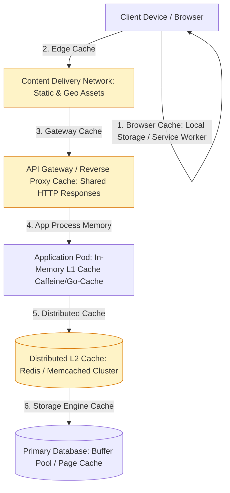
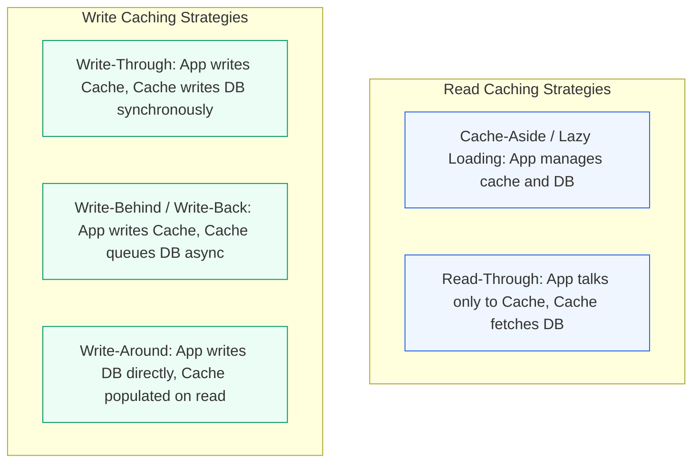
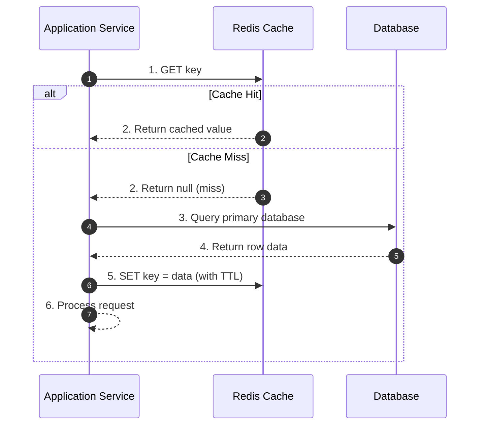
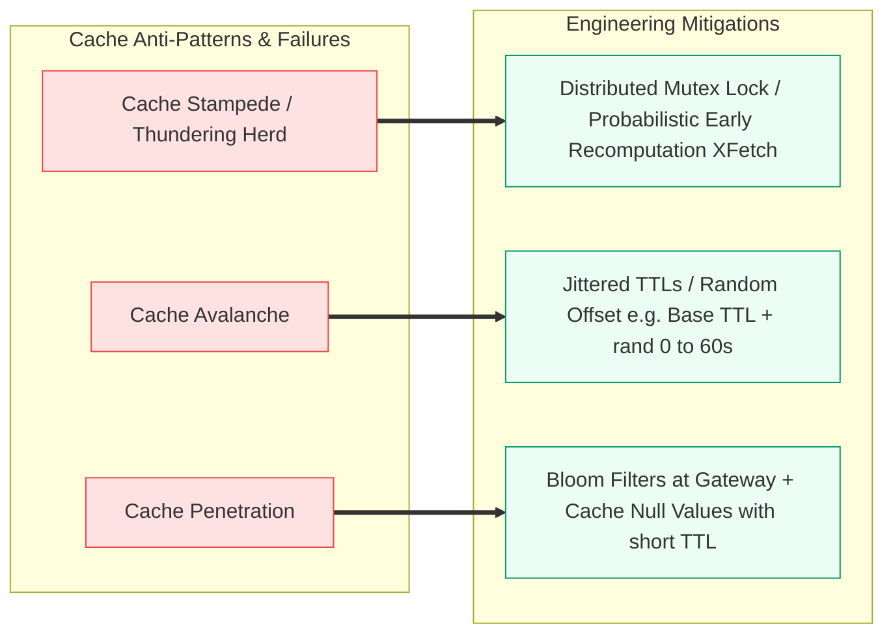

# Module 1.3: Distributed Caching Strategies

Caching is one of the most effective techniques to reduce latency, protect downstream databases from traffic spikes, and optimize cloud infrastructure costs. For technical program managers, understanding cache design patterns, invalidation strategies, and failure modes prevents costly production outages.

---

## 1. Multi-Tier Caching Architecture

Caching operates across every layer of the modern technology stack. A well-architected system leverages multiple cache boundaries to maximize hit rates and minimize database IOPS.

---

## 2. Read and Write Caching Patterns

The choice of caching pattern defines the consistency contract between the application, the cache, and the underlying database.

### 1. Cache-Aside (Lazy Loading)

The application code directly coordinates between the cache and the database.

- **Pros**: Only requested data is cached (memory efficient); cache failure does not crash the system (falls back to DB).
- **Cons**: High latency on cache miss (3 network hops); potential stale data if database is updated directly without cache invalidation.

### 2. Write-Through vs Write-Behind (Write-Back)

| Dimension | Write-Through | Write-Behind (Write-Back) | Write-Around |
| :--- | :--- | :--- | :--- |
| **Data Flow** | App writes to Cache; Cache writes to DB synchronously before returning success | App writes to Cache; Cache writes to DB asynchronously in batches | App writes directly to DB; Cache is bypassed and populated on next read |
| **Write Latency** | High (waits for both Cache and DB write to finish) | Ultra-low (returns immediately after memory write) | Normal DB write latency |
| **Consistency** | High consistency between cache and DB | Eventual consistency; risk of data loss if cache node crashes before flush | Cache may hold stale data unless explicitly invalidated |
| **Ideal For** | Financial balances, user permissions, security tokens | Heavy write workloads, clickstream tracking, IoT telemetry | Infrequently read logs, large batch file uploads |

---

## 3. Cache Eviction Policies

When memory reaches capacity limits, the cache engine must evict items to make room for new entries.

- **LRU (Least Recently Used)**: Evicts items that have not been accessed for the longest time. Standard default for general-purpose workloads.
- **LFU (Least Frequently Used)**: Tracks access counts and evicts items with the lowest access frequency. Ideal for stable, predictable hot-keys.
- **FIFO (First In, First Out)**: Evicts the oldest created items regardless of recent usage.
- **TTL (Time-to-Live)**: Automatically marks keys as expired after a configured duration (e.g. 300 seconds).

---

## 4. Redis vs Memcached

Program managers frequently navigate vendor and technology selections between Redis and Memcached.

| Feature | Redis | Memcached |
| :--- | :--- | :--- |
| **Data Structures** | Strings, Hashes, Lists, Sets, Sorted Sets, Bitmaps, HyperLogLogs, Geospatial | Pure Key-Value (Strings and byte arrays only) |
| **Threading Model** | Single-threaded core engine (with multithreaded I/O since v6) | Pure Multi-threaded architecture (scales linearly across CPU cores) |
| **Persistence** | RDB snapshots, AOF (Append-Only File) logging | In-memory only (no native disk persistence) |
| **Replication & HA** | Redis Sentinel, Redis Cluster (automatic sharding and failover) | No native clustering; requires client-side consistent hashing |
| **Advanced Features** | Pub/Sub, Lua scripting, Transactions, Redis Streams | Simple, lightweight get/set memory cache |
| **Best Used For** | Rich data caching, leaderboards, rate limiters, session stores | Simple high-throughput memory caching across many CPU cores |

---

## 5. Critical Cache Failure Modes and Mitigations

These three failure modes are staple topics in architecture reviews and system design interviews.

### 1. Cache Stampede (Thundering Herd)
- **Problem**: A high-traffic key (e.g. homepage banner) expires. Thousands of concurrent requests experience a cache miss simultaneously and hammer the database with identical queries.
- **Mitigation**:
  - *Distributed Mutex*: Only the first thread that misses the cache acquires a lock to query the DB and update the cache; other threads wait or return previous stale data.
  - *Probabilistic Early Expiration (XFetch)*: Recomputes the cache value in the background before the key actually expires based on request probability.

### 2. Cache Avalanche
- **Problem**: Hundreds of thousands of keys are configured with the exact same TTL (e.g. 1 hour) during a bulk sync. All keys expire at the same second, causing the entire traffic volume to fall back on the database.
- **Mitigation**: Add random jitter to key expirations (e.g. `TTL = 3600 + random(0, 300)` seconds).

### 3. Cache Penetration
- **Problem**: Clients query non-existent keys (e.g. malicious requests for `user_id = -9999`). The cache misses, queries the database, finds nothing, and does not store a result. Every subsequent request hits the database.
- **Mitigation**:
  - *Cache Null Objects*: Store a null value with a short TTL (e.g. 60 seconds).
  - *Bloom Filters*: Position an in-memory Bloom filter in front of the cache. If the filter indicates the item definitely does not exist, return 404 immediately without touching cache or database.

---

## 6. Back-of-the-Envelope Cache Sizing (The 80/20 Rule)

In system design reviews, TPMs must estimate memory requirements:

1. **Apply Pareto Principle (80/20 Rule)**: 20% of items generate 80% of read traffic. You only need to cache that hot 20%.
2. **Formula**:
   $$\text{Daily Total Reads} \times 0.20 \times \text{Average Object Size} = \text{Target Cache Working Set}$$
3. **Memory Headroom Rule**: Add 25% to 30% buffer for metadata, indexing structures, and Redis engine overhead.

---

## 7. TPM Review Checklist

When validating caching designs in your program:

- [ ] Is there an explicit invalidation strategy for mutable data?
- [ ] Are all cache keys set with a Time-To-Live (TTL) to prevent unbounded memory growth?
- [ ] Are TTLs randomized with jitter to eliminate cache avalanche risks?
- [ ] What happens to application SLAs when the cache cluster restarts or fails?
- [ ] Is cache hit ratio (CHR) tracked as a critical service-level indicator (SLI)? Target CHR: 95%+ for read-heavy tiers.
