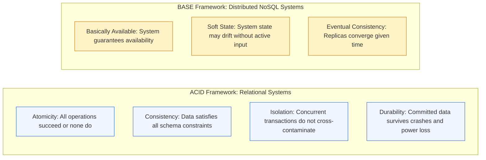
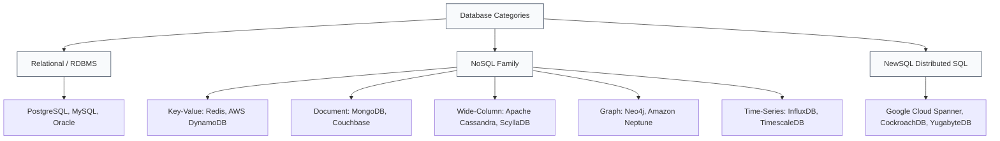
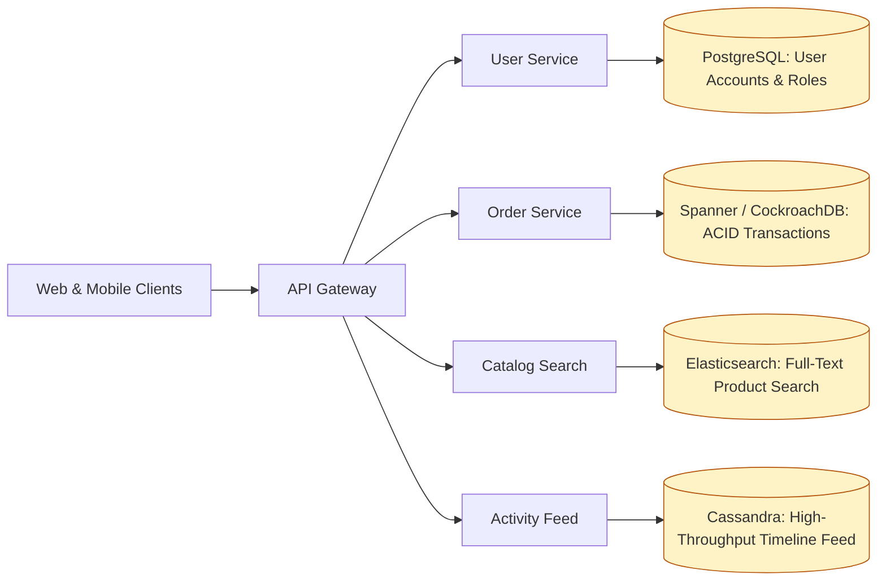

# Module 2.1: Databases: Relational vs NoSQL vs NewSQL

[Home](../README.md) > [Module 2: Data Architecture](./README.md) > **Chapter 2.1: Databases SQL vs NoSQL vs NewSQL**

---

Data architecture is the foundation of any software system. Choosing the right database technology affects developer velocity, schema migration complexity, query performance, and long-term operating costs. Technical program managers must navigate trade-offs between structured consistency and horizontal elasticity.

---

## 1. ACID vs BASE Philosophy

Database systems operate under two distinct philosophical frameworks governing transactions and consistency.

---

## 2. The Database Landscape

Modern architectures employ specialized databases tailored to specific access patterns rather than forcing a single engine to solve all problems.

### Comprehensive Database Comparison

| Database Type | Primary Data Model | Strengths | Weaknesses | Best Use Cases |
| :--- | :--- | :--- | :--- | :--- |
| **Relational (RDBMS)** | Tables, Rows, Foreign Keys | Strict ACID transactions, complex SQL joins, mature tooling | Difficult to shard horizontally; rigid schema migrations | Financial ledgers, ERP, CRM, core user accounts |
| **Key-Value** | Opaque Key mapped to Value | Single-digit millisecond latency, massive scale, simple API | No rich querying on values; limited aggregation | Session stores, user shopping carts, cache lookup |
| **Document** | Hierarchical JSON / BSON documents | Flexible schema, rapid prototyping, nested document queries | Memory hungry, potential document duplication | Content management systems, product catalogs, user profiles |
| **Wide-Column** | Keyspace, Column Families, Sparse Rows | Linear write scalability across hundreds of nodes, high availability | No ACID transactions across partitions; no joins | IoT telemetry, clickstream logging, messaging history |
| **Graph** | Nodes, Edges, Properties | Ultra-fast traversal of deep relationships ($O(1)$ pointer hops) | Difficult to partition across clusters; niche query languages | Social networks, fraud detection graphs, recommendation engines |
| **NewSQL** | Relational SQL with Distributed Consensus | Global ACID transactions, horizontal scale, automated sharding | High operational complexity, higher write latency (consensus overhead) | Global multi-region banking, large-scale order checkout |

---

## 3. Storage Engine Internals: B-Trees vs LSM-Trees

Understanding how databases write data to disk explains why certain engines excel at reads while others excel at writes.

### Core Takeaway for TPMs
- Use **B-Tree engines** (PostgreSQL, MySQL) when your application has high read ratios (e.g. 90% reads, 10% writes) and requires predictable query performance.
- Use **LSM-Tree engines** (Cassandra, RocksDB, ScyllaDB) when your application handles high-velocity write streams (e.g. 100,000 writes/sec of IoT sensors or log ingestion) because all disk writes are sequential.

---

## 4. Indexing Fundamentals and Trade-offs

Indexes are separate data structures created to accelerate read queries. However, they introduce hidden operational costs.

### Index Mechanics
- **Clustered / Primary Index**: Determines the physical ordering of data on disk (usually the Primary Key). Each table can have only one clustered index.
- **Non-Clustered / Secondary Index**: A separate tree structure containing the indexed column value and a pointer back to the primary row.
- **Composite Index**: An index spanning multiple columns (e.g. `(tenant_id, created_at)`). Follows the Leftmost Prefix Rule; queries must filter by `tenant_id` to utilize the index.

### The Index Penalty
Every write (INSERT, UPDATE, DELETE) must synchronously update all defined secondary indexes on the table.
- A table with 10 secondary indexes experiences up to 10x write amplification.
- Program managers should audit indexes before major feature launches to drop unused indexes and preserve write throughput.

---

## 5. Polyglot Persistence: The Modern Standard

Enterprise applications rarely rely on a single database. Instead, they implement polyglot persistence: routing specific domains to purpose-built data stores.

---

## 6. TPM Review Checklist

When reviewing data store proposals:

- [ ] Does the business domain require strict ACID transactional guarantees (e.g. financial ledgers)?
- [ ] What is the read-to-write ratio (e.g. 10:1 vs 1:5)?
- [ ] Is the data structure relational with frequent joins, or hierarchical document data?
- [ ] How will schema migrations be managed without locking tables or degrading production latency?
- [ ] Are secondary indexes audited and restricted to high-frequency query paths?
- [ ] Has the team defined retention and archival policies for older records (e.g. cold storage partitioning)?

---

## 7. Primary Sources and Further Reading

- **Google Spanner Paper**: *Spanner: Google's Globally-Distributed Database* by James C. Corbett et al. (OSDI, 2012).
- **Amazon Dynamo Paper**: *Dynamo: Amazon's Highly Available Key-value Store* by Giuseppe DeCandia et al. (SOSP, 2007).
- **Relational Model Foundation**: *A Relational Model of Data for Large Shared Data Banks* by E. F. Codd (Communications of the ACM, 1970).
- *Designing Data-Intensive Applications* by Martin Kleppmann (O'Reilly Media, 2017) - Chapter 3: Storage and Retrieval.
