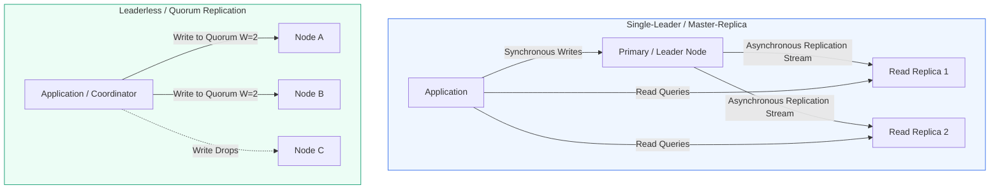
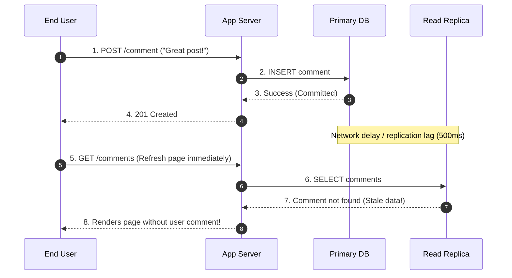
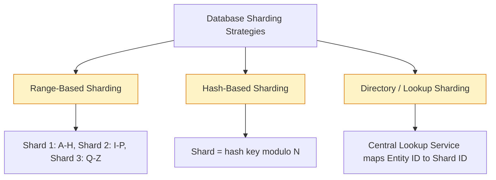

# Module 2.2: Database Replication, Sharding, and Consistent Hashing

When data volumes exceed the capacity of a single physical server, or read traffic threatens to overwhelm a single database instance, systems must scale horizontally. Technical program managers must understand how replication provides fault tolerance and read scale, while sharding partitions write workloads.

---

## 1. Database Replication Topologies

Replication creates redundant copies of data across multiple physical machines to ensure high availability and survivability during hardware failures.



### Replication Topology Comparison

| Model | Write Mechanism | Read Mechanism | Strengths | Operational Risks | Example Systems |
| :--- | :--- | :--- | :--- | :--- | :--- |
| **Single-Leader** | Single master node accepts all writes | Master or read replicas accept read queries | Simple write ordering; no write conflict resolution required | Master node is single point of failure; replication lag | MySQL, PostgreSQL, Redis |
| **Multi-Leader** | Multiple master nodes in different data centers accept writes | Local master or local replicas serve reads | Low write latency across continents; survives DC outages | Complex write conflicts require resolution (LWW or CRDTs) | Multi-region Couchbase, DynamoDB Global Tables |
| **Leaderless** | Writes sent to multiple peers simultaneously | Reads query multiple peers; resolves versions via quorum | Highly available; no failover pauses; tolerates node drops | Inconsistent reads if quorum formula not met; repair overhead | Apache Cassandra, AWS DynamoDB, ScyllaDB |

---

## 2. Replication Lag and Consistency Guarantees

In asynchronous replication, replicas inevitably lag behind the primary node. This delay causes common user-visible bugs:



### Critical Consistency Patterns for TPMs
1. **Read-Your-Own-Writes Consistency**: Guarantees that if a user updates data, their subsequent reads reflect that update.
   - *Implementation*: Route reads for the updating user to the primary database for 10 seconds post-write, while routing other users to read replicas.
2. **Monotonic Reads**: Guarantees that a user will never see time move backward (e.g. reading from an up-to-date replica on request 1, then hitting a lagging replica on request 2).
   - *Implementation*: Hash the user ID to consistently route a given user to the same replica.

---

## 3. Data Partitioning / Sharding Strategies

When dataset size exceeds the disk limit of a single machine or write throughput saturates CPU cores, the database must be partitioned (sharded).



### Sharding Trade-off Matrix

| Strategy | Logic | Pros | Cons |
| :--- | :--- | :--- | :--- |
| **Range-Based** | Partitions by value ranges (e.g. dates: 2024-Q1, 2024-Q2) | Efficient range queries (e.g. all transactions in March) | Leads to hot spots when writes target current timestamp |
| **Hash-Based** | Partitions using hash function: `hash(user_id) % N` | Uniform write distribution; eliminates date hot spots | Range queries require querying every single shard (Scatter-Gather) |
| **Directory-Based** | Lookup service maintains mapping table of key to shard | Maximum flexibility; shards can be moved dynamically | Directory lookup service becomes a single point of failure and bottleneck |

---

## 4. Consistent Hashing

Traditional modulo hashing (`hash(key) % N`) breaks down when nodes are added or removed: almost 100% of keys must be reshuffled, causing massive cache misses and database thrashing. Consistent hashing solves this problem.

```mermaid
flowchart TD
    subgraph HashRing [Consistent Hashing Ring: 0 to 2^32 - 1]
        direction TB
        NodeA[Node A (Virtual Nodes: A1, A2, A3)]
        NodeB[Node B (Virtual Nodes: B1, B2, B3)]
        NodeC[Node C (Virtual Nodes: C1, C2, C3)]
    end

    Key1[Key 1] -->|Hashes to Ring -> Moves Clockwise| NodeA
    Key2[Key 2] -->|Hashes to Ring -> Moves Clockwise| NodeB
    Key3[Key 3] -->|Hashes to Ring -> Moves Clockwise| NodeC

    classDef ring fill:#eff6ff,stroke:#2563eb,stroke-width:1px;
    class HashRing ring;
```

### Key Principles of Consistent Hashing

1. **Circular Hash Ring**: The output of the hash function is mapped to a circular range (from 0 to $2^{32} - 1$).
2. **Clockwise Assignment**: Both servers and data keys are hashed onto the ring. A key is assigned to the first server encountered moving clockwise.
3. **Minimal Key Rebalancing**: When a new server is added, only $K/N$ keys need to be reassigned (where $K$ is total keys, and $N$ is number of servers).
4. **Virtual Nodes (vnodes)**: To prevent uneven data distribution, each physical machine is assigned multiple virtual nodes (e.g. 100 to 256 points on the ring). This ensures uniform distribution and prevents hot spots.

---

## 5. Sharding Risks and the TPM Mitigation Matrix

Sharding introduces substantial architectural complexity. Technical program managers should ensure teams have evaluated the following risks:

| Sharding Risk | Description | Engineering Mitigation |
| :--- | :--- | :--- |
| **The Celebrity Problem (Hot Shard)** | A single high-volume entity (e.g. a celebrity with 50M followers) overloads a single shard | Append random salt to partition keys (e.g. `celebrity_id + "_" + rand(0, 10)`); scatter reads and aggregate |
| **Cross-Shard Joins** | SQL queries requiring joins across data sitting on different physical shards cause extreme latency | Denormalize data, duplicate reference tables across all shards, or execute joins at the application layer |
| **Distributed Transactions** | Updating records across multiple shards requires Two-Phase Commit (2PC), which kills throughput | Colocate related entities on the same shard using composite shard keys (e.g. `tenant_id:order_id`) |
| **Re-sharding Operations** | Splitting an existing shard into two under live production traffic | Dual-writing to old and new shards, running background backfill, validating data consistency, and cutting over |

---

## 6. TPM Review Checklist

Before signing off on database scaling architectures:

- [ ] Has the team confirmed that vertical scaling, indexing optimization, and caching are exhausted before committing to sharding?
- [ ] Is the partition key chosen with high cardinality to prevent uneven data skews?
- [ ] What is the planned re-sharding trigger (e.g. when any shard exceeds 70% storage capacity)?
- [ ] Does the application support Read-Your-Own-Writes consistency for critical user paths?
- [ ] Is cross-datacenter replication monitoring configured with alert thresholds for replication lag (e.g. alert if lag > 1000ms)?
