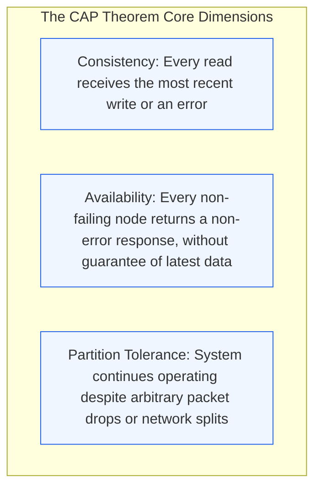
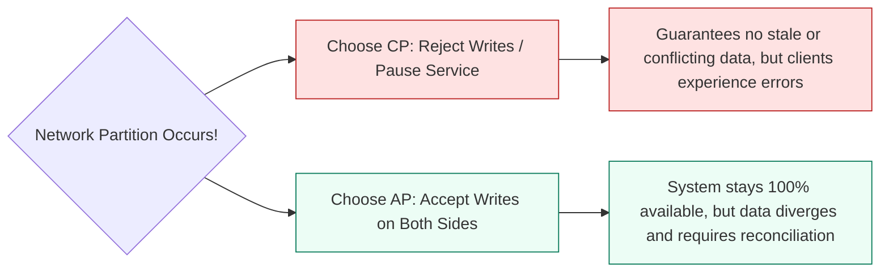
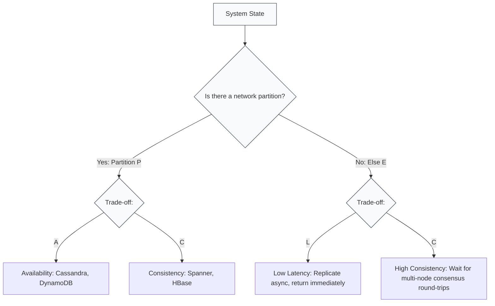
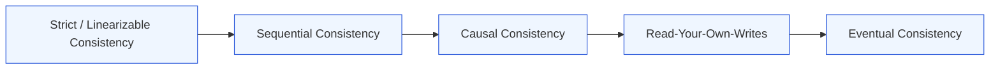

# Module 2.3: The CAP and PACELC Theorems

Distributed systems must navigate fundamental trade-offs imposed by the laws of physics and network unreliability. The CAP and PACELC theorems provide the theoretical foundation for explaining why no distributed database can offer both instantaneous global consistency and 100% availability during network splits.

---

## 1. The CAP Theorem Explained

Formulated by Eric Brewer and later proved by Seth Gilbert and Nancy Lynch, the CAP theorem states that a distributed data store can guarantee at most two out of three properties simultaneously:

### The Fundamental Reality: Partition Tolerance is Non-Negotiable
In physical networks, routers fail, optical fiber cables get cut, and network switches drop packets. Therefore, a distributed system **must** tolerate partitions ($P$). The real choice is not "pick two out of three", but rather:

> **In the presence of a network partition ($P$), does the system choose Consistency ($CP$) or Availability ($AP$)?**

---

## 2. CP Systems vs AP Systems

| System Type | Core Behavior during Network Split | Representative Databases | Typical Use Cases |
| :--- | :--- | :--- | :--- |
| **CP (Consistency + Partition Tolerance)** | Unreachable nodes reject requests or time out until the partition heals to prevent data divergence | Google Cloud Spanner, CockroachDB, HBase, Redis Sentinel, ZooKeeper | Financial balances, stock inventory, flight seat booking, identity tokens |
| **AP (Availability + Partition Tolerance)** | All nodes accept reads and writes, even if disconnected from other nodes. Nodes reconcile data later | Apache Cassandra, AWS DynamoDB (default), Couchbase, ScyllaDB | Social feeds, video view counts, shopping cart items, telemetry logs |

---

## 3. The PACELC Theorem: Beyond Failure States

The CAP theorem only describes what happens when the system fails (during a network partition). But distributed systems spend 99.9% of their time operating in a healthy state. 

Daniel Abadi developed the **PACELC theorem** to address this limitation:

$$\text{If } \mathbf{P} \text{ (Partition): Choose } \mathbf{A} \text{ or } \mathbf{C}; \quad \text{EL} \text{se: Choose } \mathbf{L} \text{ (Latency) or } \mathbf{C} \text{ (Consistency)}$$

### PACELC Database Classification

| Database | PACELC Classification | Explanation |
| :--- | :--- | :--- |
| **DynamoDB** | **PA / EL** | If partitioned: Availability over Consistency. Else: Low Latency over strong consistency (asynchronous replication by default). |
| **Cassandra** | **PA / EL** | Tunable consistency, but defaults to high availability and low latency with eventual consistency. |
| **Cloud Spanner** | **PC / EC** | TrueTime atomic clocks enforce strict serializability. Consistency is prioritized during partitions and normal operations. |
| **MongoDB** | **PC / EC** | Routes primary writes with replica acknowledgement. Defaults to consistency over availability and latency. |
| **PostgreSQL (Async Replica)** | **PC / EL** | Single master enforces consistency on writes. Replicas accept lag for low latency read queries. |

---

## 4. The Consistency Spectrum

Consistency in distributed systems is not binary (strong vs eventual). It exists on a spectrum:

1. **Linearizability (Strongest)**: Every read sees the latest globally committed write instantaneously, as if there were only one copy of data in the universe. Highest latency penalty.
2. **Sequential Consistency**: Operations appear in the order defined by the program, and all nodes see the same sequence of operations.
3. **Causal Consistency**: Causally related events (e.g. Question $\rightarrow$ Answer) appear in order across all nodes; unrelated operations can be observed in different orders.
4. **Eventual Consistency (Weakest)**: If no new writes occur, all replicas eventually converge to the same value. Lowest latency and highest throughput.

---

## 5. TPM Decision Framework: Aligning Business with Architecture

As a program manager, you must translate business requirements into distributed consistency parameters:

| Business Domain | Required Behavior | Recommended Choice | Rationale |
| :--- | :--- | :--- | :--- |
| **Core Banking Ledger** | Prevent negative balance and double-spending | **CP / EC** | Financial balance errors destroy trust and violate regulatory compliance. |
| **E-Commerce Product Reviews** | Show newly posted reviews to shoppers | **AP / EL** | A shopper seeing a review 2 seconds late has zero business impact. Availability and low page latency drive sales. |
| **Collaborative Document Editing** | Avoid losing keystrokes during connection drops | **AP with CRDTs** | Local updates render with zero latency; Conflict-free Replicated Data Types merge edits deterministically. |
| **Inventory Reservation** | Ensure item is not sold to two buyers | **CP / EC** | Overselling generates customer support escalations, cancellation penalties, and logistical overhead. |

---

## 6. TPM Review Checklist

When evaluating distributed storage trade-offs:

- [ ] Does the product experience tolerate eventual consistency (stale reads of 50ms to 2000ms)?
- [ ] For AP systems, how are write conflicts resolved (Last-Write-Wins, vector clocks, or application-level merges)?
- [ ] What is the exact customer experience when a network partition forces a CP system to reject requests?
- [ ] Has the engineering team configured timeout thresholds and circuit breakers for quorum reads?
- [ ] Are business metrics (conversion rates, revenue) balanced against the latency penalty of strong consistency?
