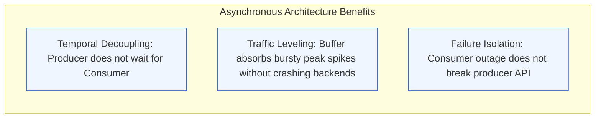
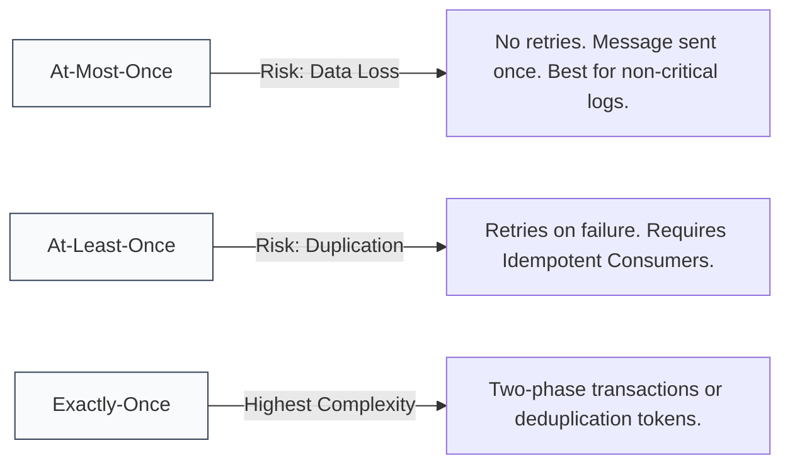
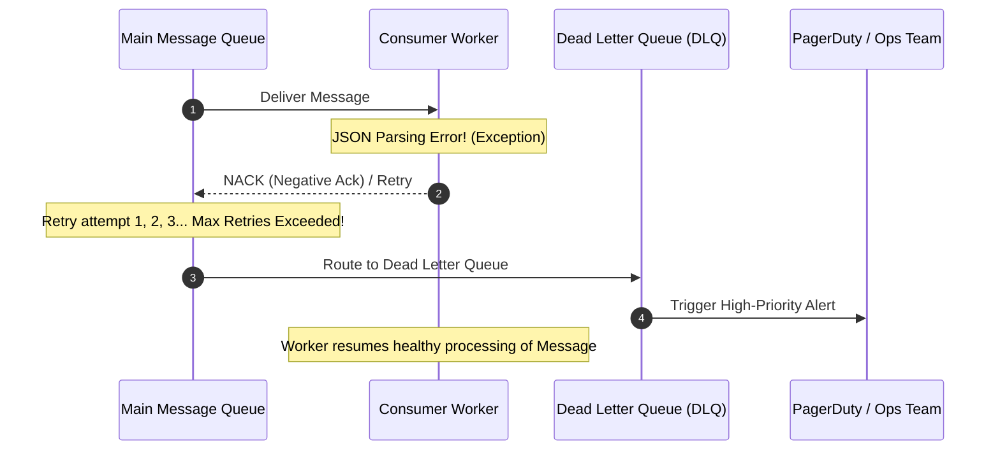

# Module 2.4: Asynchronous Messaging and Event Streaming

Synchronous HTTP calls couple distributed microservices in time and availability: if Service B is slow or down, Service A fails as well. Asynchronous messaging decouples systems, absorbs traffic bursts, and enables event-driven architectures. Technical program managers must distinguish between traditional message queues and distributed event streaming platforms.

---

## 1. Why Asynchronous Messaging Matters

Asynchronous communication provides three foundational benefits for large-scale architectures:



---

## 2. Message Queues vs Distributed Event Streams

While both technologies pass data asynchronously, their architectural models and consumption semantics are fundamentally different.

```mermaid
flowchart TD
    subgraph TraditionalQueue [Traditional Message Queue: RabbitMQ, AWS SQS]
        direction TB
        P1[Producer] --> Q[Queue: FIFO Buffer]
        Q --> C1[Consumer A: Pulls Message 1]
        Q --> C2[Consumer B: Pulls Message 2]
        Note over Q: Message is deleted immediately once acknowledged
    end

    subgraph EventStream [Distributed Event Stream: Apache Kafka, AWS Kinesis]
        direction TB
        P2[Producer] --> Log[(Append-Only Commit Log / Partitions)]
        Log --> CG1[Consumer Group 1: Analytics Offset = 4]
        Log --> CG2[Consumer Group 2: Notifications Offset = 8]
        Note over Log: Messages are retained for days/weeks. Multiple groups read independently.
    end

    classDef tq fill:#fef3c7,stroke:#d97706,stroke-width:1px;
    classDef es fill:#ecfdf5,stroke:#047857,stroke-width:1px;
    class TraditionalQueue tq;
    class EventStream es;
```

### Direct Technology Comparison

| Dimension | Message Queues (RabbitMQ, SQS) | Event Streams (Kafka, Kinesis) |
| :--- | :--- | :--- |
| **Data Retention** | Ephemeral: Messages deleted upon consumer acknowledgement | Persistent: Retained on disk by duration (e.g. 7 days) or size limit |
| **Message Ordering** | Strict per-queue (or best-effort in standard SQS) | Strict total order within a single partition |
| **Consumption Model** | Point-to-point work distribution: one consumer consumes each message | Publish-Subscribe log: multiple independent consumer groups read at their own pace |
| **Replayability** | Cannot rewind and replay past messages | Consumers can reset offsets and replay historic events |
| **Peak Throughput** | Thousands of messages per second | Millions of events per second via sequential disk I/O and batching |
| **Best Used For** | Asynchronous task execution, long-running batch jobs, simple workflows | Real-time event streams, clickstream tracking, financial ledgers, event sourcing |

---

## 3. Message Delivery Semantics

Understanding delivery guarantees is critical when designing payment processing, order fulfillment, and user notifications.



### The Pragmatic Reality: At-Least-Once + Idempotency
Achieving true end-to-end "exactly-once" delivery across multiple network hops is computationally expensive and complex. 

The industry gold standard for high-throughput distributed systems is:

$$\text{At-Least-Once Delivery} + \text{Idempotent Consumer Processing} = \text{Effective Exactly-Once Business Outcome}$$

- **Idempotency Key**: The producer generates a unique transaction UUID (e.g. `idem_key_987213`).
- **Consumer Deduplication**: The consumer checks a fast key-value store (e.g. Redis) before processing. If the key was already processed, it acknowledges the message and returns the previous result without repeating side effects.

---

## 4. Resilience Patterns: Dead Letter Queues (DLQ) and Poison Pills

A **Poison Pill** is a malformed message (e.g. invalid JSON syntax or corrupted payload) that causes the consumer application to crash every time it attempts processing.



### Operational Rules for DLQs
1. **Never drop poison pills silently**: Always route unprocessable messages to a DLQ for offline inspection.
2. **Alerting on DLQ depth**: Any message entering a DLQ should generate an alert for engineering investigation.
3. **Replay capability**: Provide automated tooling or scripts to redrive corrected messages from the DLQ back to the main queue once the bug is resolved.

---

## 5. Kafka Core Architecture: Partitions and Consumer Groups

To achieve horizontal scalability, Apache Kafka partitions topics across multiple broker machines.

```mermaid
flowchart TD
    subgraph TopicOrders [Topic: orders (3 Partitions)]
        P0[Partition 0: Events for User ID hash % 3 == 0]
        P1[Partition 1: Events for User ID hash % 3 == 1]
        P2[Partition 2: Events for User ID hash % 3 == 2]
    end

    subgraph ConsumerGroup [Consumer Group: Order Processing Fleet]
        C1[Pod 1 reads Partition 0]
        C2[Pod 2 reads Partition 1]
        C3[Pod 3 reads Partition 2]
    end

    P0 --> C1
    P1 --> C2
    P2 --> C3

    classDef part fill:#eff6ff,stroke:#2563eb,stroke-width:1px;
    classDef pod fill:#ecfdf5,stroke:#047857,stroke-width:1px;
    class P0,P1,P2 part;
    class C1,C2,C3 pod;
```

### Partition Sizing and Scaling Rules
- **Concurrency Unit**: The number of partitions determines the maximum number of parallel consumers in a consumer group. If a topic has 3 partitions, adding a 4th consumer pod results in the 4th pod sitting idle.
- **Partition Key Selection**: Always partition by entity ID (e.g. `order_id` or `user_id`) to ensure all events for that specific entity arrive in strict chronological order at the same consumer pod.

---

## 6. TPM Review Checklist

When leading programs involving asynchronous messaging infrastructure:

- [ ] Is asynchronous communication selected for tasks that do not require instant synchronous user response?
- [ ] Are consumers engineered to be strictly idempotent to handle duplicate deliveries?
- [ ] Is a Dead Letter Queue (DLQ) configured with a retry policy (e.g. max 3 retries with exponential backoff)?
- [ ] Is consumer lag tracked as a tier-1 operational metric with automated alerts?
- [ ] Has the team sized topic partitions appropriately to match projected peak consumer parallelism?
- [ ] What is the data retention policy (e.g. 7 days vs 30 days) and how does disk growth impact cloud storage budgets?
