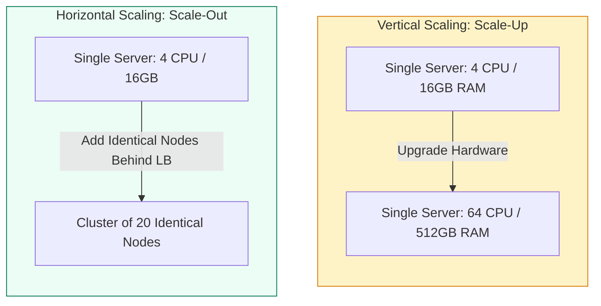
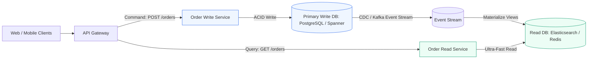
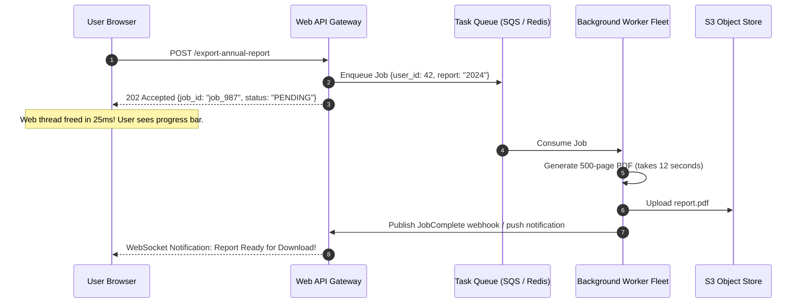

# Module 3.1: Architectural Scalability Patterns

Scalability describes a system's capacity to handle increased workload without compromising performance or linearly exploding operational costs. For technical program managers, scaling is not just an engineering problem; it dictates cloud budget predictability, headcount planning, and customer SLA compliance during business growth.

---

## 1. Vertical vs Horizontal Scaling

Every system design journey begins with deciding between scaling up or scaling out.



### Comprehensive Comparison

| Metric | Vertical Scaling (Scale-Up) | Horizontal Scaling (Scale-Out) |
| :--- | :--- | :--- |
| **Hardware Limit** | Hard ceiling: finite physical RAM and CPU sockets per motherboard | Theoretically infinite: add commodity virtual machines or containers |
| **Downtime Impact** | Often requires machine reboot or maintenance window to resize | Zero-downtime rolling additions and removals |
| **Failure Domain** | Single point of failure: if the box dies, everything goes down | High fault tolerance: loss of one node is absorbed by the cluster |
| **Architectural Complexity** | Zero code changes: runs the exact same software on larger specs | Requires stateless code, distributed locking, and network routing |
| **Cost Profile** | Non-linear cost curve: high-end hardware becomes exponentially expensive | Linear cost curve: pay for commodity cloud instances dynamically |

---

## 2. The Stateless Application Tier

The prerequisite for true horizontal scalability is making application servers **stateless**. If an application server stores user sessions, uploaded files, or websocket state in local memory, requests from the same user cannot be routed freely to other instances.

```mermaid
flowchart TD
    subgraph StatefulAntiPattern [Stateful Anti-Pattern: Sticky Sessions Required]
        ClientA[User A] --> LBA[Load Balancer]
        LBA -->|Session in Node 1 Memory| Node1[App Server 1]
        Note over Node1: If Server 1 crashes, User A is logged out!
    end

    subgraph StatelessPattern [Stateless Best Practice: Externalized State]
        ClientB[User B] --> LBB[Load Balancer]
        LBB --> AnyNode[Any App Server Pod 1, 2, or N]
        AnyNode <--> SharedCache[(Shared Redis Cluster: Session Store)]
        AnyNode <--> SharedStore[(Shared Object Store S3: File Uploads)]
    end

    classDef bad fill:#fee2e2,stroke:#ef4444,stroke-width:1px;
    classDef good fill:#ecfdf5,stroke:#059669,stroke-width:1px;
    class StatefulAntiPattern bad;
    class StatelessPattern good;
```

### Eliminating State from Application Nodes
1. **User Authentication**: Use self-contained JSON Web Tokens (JWT) verified via cryptographic keys, or store session IDs in an external, highly available Redis cluster.
2. **File Storage**: Never save uploaded files to local disk paths (e.g. `/var/uploads`). Write directly to distributed object storage (AWS S3, Google Cloud Storage).
3. **Background Tasks**: Offload long-running computations from web threads to dedicated asynchronous worker pools.

---

## 3. Read vs Write Optimization: The CQRS Pattern

In most consumer applications, read traffic dwarfs write traffic by factors of 10:1 to 100:1. Coupling reads and writes to the same database model creates contention and slows down response times.

**CQRS (Command Query Responsibility Segregation)** separates read operations from mutation operations into independent models:



### CQRS Programmatic Benefits
- **Optimized Schemas**: Write DB is normalized for transaction integrity; Read DB is denormalized and pre-indexed for single-lookup UI rendering.
- **Independent Scaling**: Read replicas or search indexes can scale to 50 nodes during peak shopping hours while the write database remains stable.
- **Resilience**: A temporary slowdown or outage in read indexing does not block customers from placing new orders.

---

## 4. Asynchronous Task Offloading and Worker Fleets

Synchronous web request threads should never execute work taking longer than 200 milliseconds. Any heavy computation must be offloaded to background workers.



---

## 5. Auto-Scaling Policies and Strategies

Horizontal auto-scaling dynamically adjusts the number of active server instances to match incoming traffic demand.

### Auto-Scaling Types
1. **Target Metric Scaling**:
   - Maintains an average resource utilization target (e.g. adjust pod count to maintain 60% average CPU utilization or 1,000 active connections per node).
2. **Step Scaling**:
   - Triggers aggressive additions during sharp spikes (e.g. if CPU > 80%, add 5 nodes; if CPU > 90%, add 15 nodes).
3. **Scheduled Scaling**:
   - Pre-provisions resources ahead of known business events (e.g. scaling up 30 minutes before Super Bowl kickoff or Black Friday midnight).
4. **Predictive Scaling**:
   - Leverages historical machine learning traffic patterns to spin up instances before daily commuter spikes.

### The Scale-In Cooldown Rule
- Always configure an asymmetric cooldown period: scale out rapidly (e.g. 1-minute evaluation window) to prevent latency spikes, but scale in slowly (e.g. 10 to 15-minute cooldown) to avoid **flapping** (rapid oscillating between spinning up and destroying instances).

---

## 6. TPM Review Checklist

When auditing scalability readiness for key launches:

- [ ] Are all web application instances completely stateless?
- [ ] Has the team validated auto-scaling cooldown periods to prevent instance thrashing?
- [ ] Is long-running or CPU-intensive work offloaded to asynchronous background workers?
- [ ] Are database read-heavy workloads segregated using read replicas or CQRS patterns?
- [ ] What is the projected cloud infrastructure cost at 2x, 5x, and 10x current transaction volumes?
- [ ] Has load testing verified that horizontal scaling does not shift the bottleneck to a shared downstream database connection pool?
