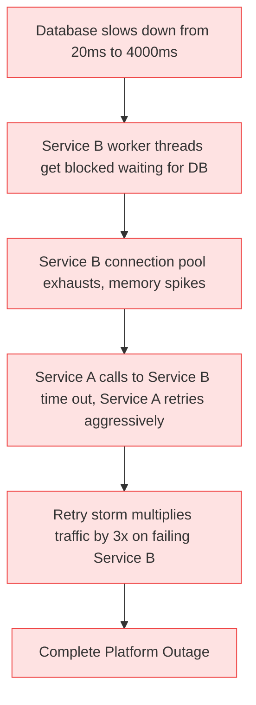
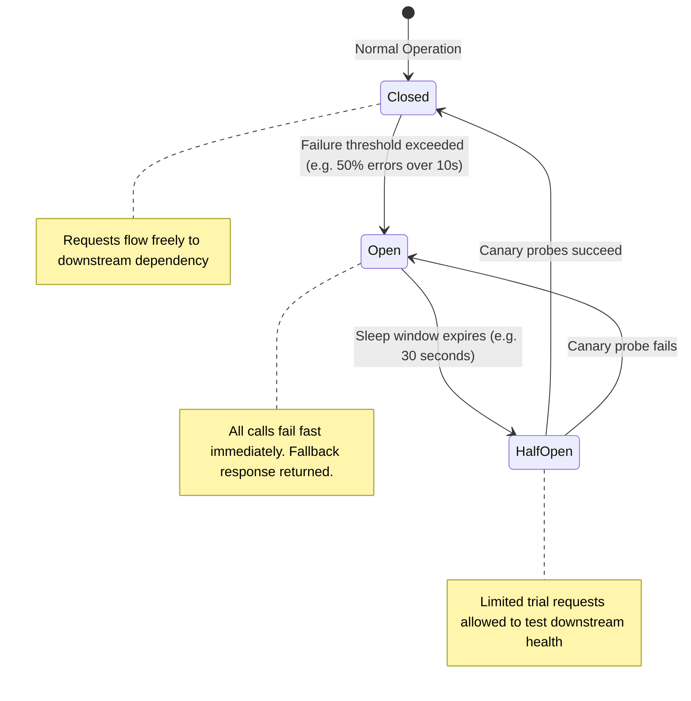
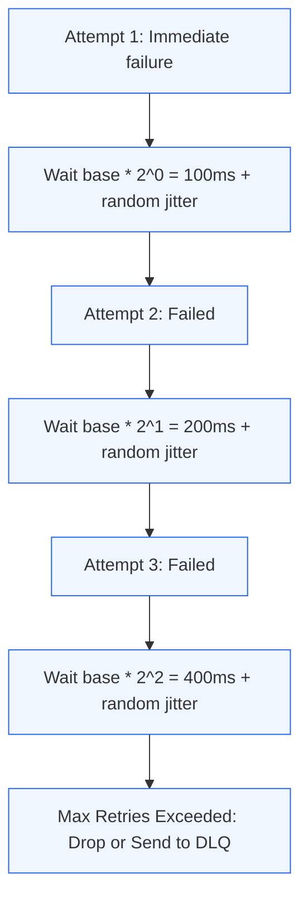
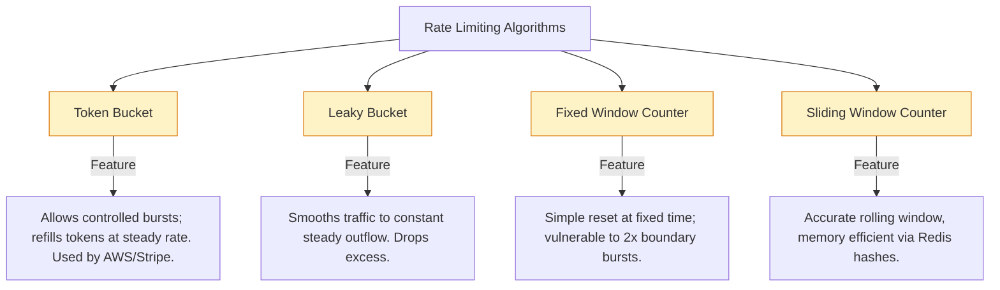
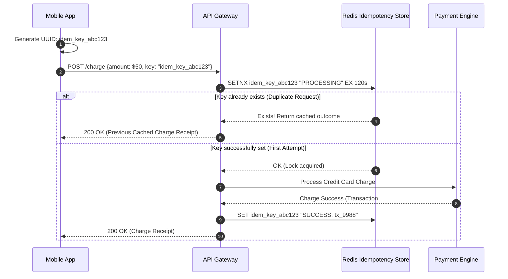

# Module 3.2: Fault Tolerance, Resilience, and Rate Limiting

[Home](../README.md) > [Module 3: Resilience & Scale](./README.md) > **Chapter 3.2: Fault Tolerance & Rate Limiting**

---

In large distributed systems, hardware failures, network timeouts, and software bugs are not anomalies: they are guaranteed daily occurrences. Resilience is the ability of a system to gracefully degrade, isolate failures, and self-heal without cascading into a catastrophic platform outage.

---

## 1. Cascading Failures: The Anatomy of a System Collapse

A cascading failure occurs when a small, isolated issue in one component triggers failures across downstream services, ultimately bringing down the entire platform.



---

## 2. The Circuit Breaker Pattern

Inspired by electrical circuit breakers in residential homes, this software pattern stops execution when a downstream service is struggling, allowing it time to recover.



### Circuit Breaker States Explained
1. **Closed (Normal)**: All requests flow through. If consecutive errors or latency exceed defined thresholds, the breaker trips to *Open*.
2. **Open (Failing Fast)**: All calls return immediately with a predefined fallback error or cached default response. No network traffic reaches the struggling downstream service.
3. **Half-Open (Canary Testing)**: After a configured sleep timeout, the breaker permits a small percentage of trial requests. If they succeed, it resets to *Closed*. If they fail, it trips back to *Open*.

---

## 3. Retries and Exponential Backoff with Jitter

Blindly retrying failed network requests creates a **Retry Storm** that overwhelms recovering services. Resilient systems employ exponential backoff with randomized jitter.



### Why "Full Jitter" is Essential
Without jitter, thousands of clients that failed at time $T_0$ will all retry at exactly $T_0 + 100\text{ms}$, and again at $T_0 + 300\text{ms}$, creating periodic waves of destructive traffic (the thundering herd). Adding random jitter spreads retries uniformly across time.

$$\text{Sleep Time} = \text{random}(0, \; \text{min}(\text{MaxSleep}, \; \text{BaseSleep} \times 2^{\text{Attempt}}))$$

---

## 4. Rate Limiting and Throttling Algorithms

Rate limiting protects APIs against abusive scrapers, denial of service attacks, and accidental client loops.



### Algorithm Comparison Table

| Algorithm | Handles Bursts? | Memory Footprint | Edge Case Vulnerability | Production Standard |
| :--- | :--- | :--- | :--- | :--- |
| **Token Bucket** | Yes (up to bucket capacity) | Minimal ($O(1)$ per user: timestamp + token count) | None | Industry default (AWS API Gateway, Envoy) |
| **Leaky Bucket** | No (enforces strict constant rate) | Minimal ($O(1)$ per user: queue size) | Can delay legitimate bursty traffic | Great for outbound third-party integrations |
| **Fixed Window** | No | Ultra-low ($O(1)$: single counter) | **Boundary Burst Problem**: 2x quota allowed at boundary reset | Only for coarse non-critical quotas |
| **Sliding Window Counter** | Yes | Low (smooth approximation across adjacent windows) | Low error margin (< 0.1%) | Cloudflare, high-scale distributed APIs |

---

## 5. The Bulkhead Pattern

Named after the watertight compartments in a ship's hull: if one compartment is breached and fills with water, the ship remains afloat because the damage is isolated.

```mermaid
flowchart TD
    subgraph NonIsolated [Non-Isolated Shared Thread Pool: High Risk]
        ReqA[User Auth Requests] --> PoolShared[Single Shared Thread Pool: 100 Threads]
        ReqB[Heavy PDF Export Requests] --> PoolShared
        Note over PoolShared: Slow PDF exports consume all 100 threads.<br/>Auth requests get blocked completely!
    end

    subgraph BulkheadIsolated [Bulkhead Isolation: Resilient]
        ReqA2[User Auth Requests] --> PoolA[Auth Pool: 50 Threads]
        ReqB2[Heavy PDF Export Requests] --> PoolB[Export Pool: 20 Threads]
        ReqC2[Payment Requests] --> PoolC[Payment Pool: 30 Threads]
        Note over PoolB: PDF pool maxes out; Auth and Payment remain 100% healthy.
    end

    classDef dangerStyle fill:#fee2e2,stroke:#ef4444,stroke-width:1px;
    classDef safeStyle fill:#ecfdf5,stroke:#047857,stroke-width:1px;
    class NonIsolated dangerStyle;
    class BulkheadIsolated safeStyle;
```

---

## 6. Idempotency Keys in Distributed Mutations

Network timeouts create ambiguity: when a payment request times out, did the bank process the transaction or fail before execution? If the client retries blindly, the customer may be billed twice.



---

## 7. TPM Review Checklist

When leading operational readiness and architecture reviews:

- [ ] Does every external synchronous network call define a strict timeout (e.g. 1000ms max)?
- [ ] Are retry mechanisms governed by exponential backoff with randomized full jitter?
- [ ] Are circuit breakers instrumented on all third-party external APIs (e.g. payment processors, SMS providers)?
- [ ] Are mutating endpoints (checkout, funds transfer) protected by distributed idempotency keys?
- [ ] Are critical microservices isolated using bulkhead patterns for thread pools and database connections?
- [ ] Has the organization conducted Chaos Engineering drills (Game Days) to validate failover behaviors under simulated stress?

---

## 8. Primary Sources and Further Reading

- *Release It!: Design and Deploy Production-Ready Software* (2nd Edition) by Michael T. Nygard (Pragmatic Bookshelf, 2018) - Chapters on Circuit Breakers, Bulkheads, and Timeouts.
- **Backoff and Jitter**: *Exponential Backoff And Jitter* by Marc Brooker (AWS Architecture Blog, 2015).
- **Stripe Idempotency Architecture**: *Designing robust and predictable APIs with idempotency* (Stripe Engineering Blog, 2017).
- *Chaos Engineering: System Resiliency in Practice* by Casey Rosenthal and Nora Jones (O'Reilly Media, 2020).
