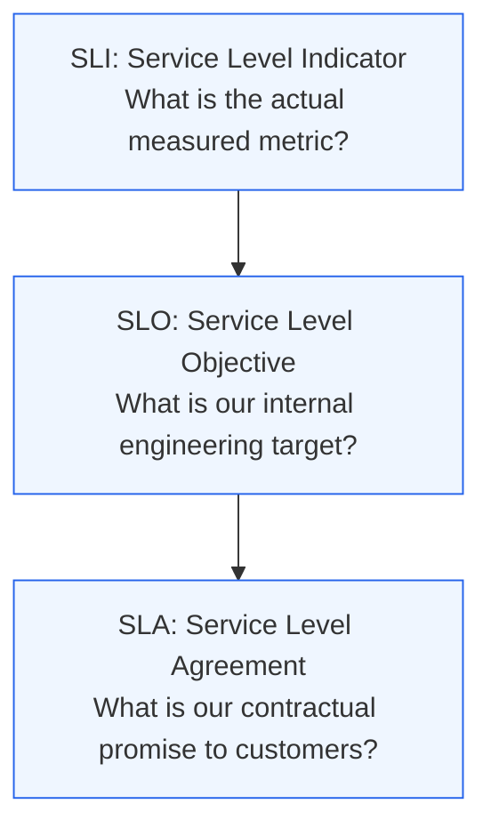
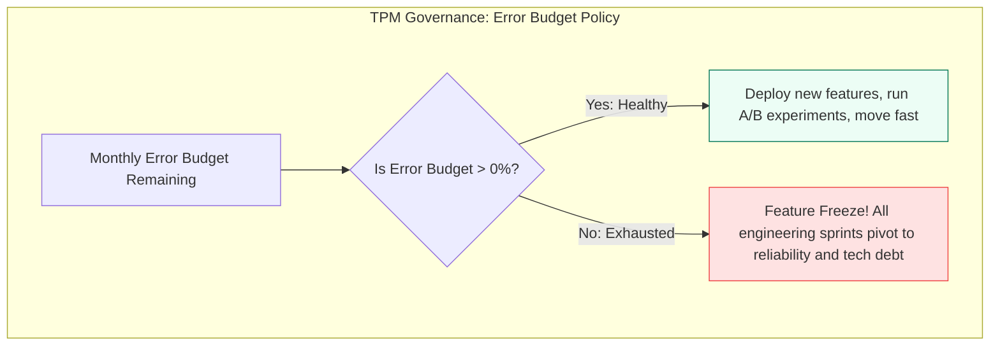
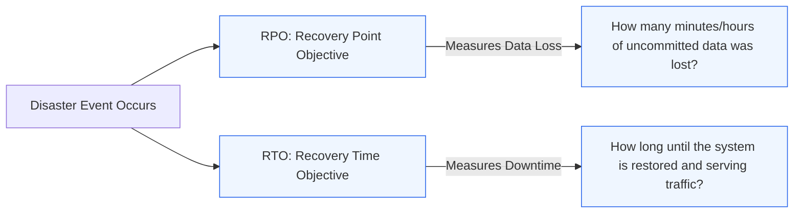

# Module 3.3: High Availability, NFRs, and Disaster Recovery

[Home](../README.md) > [Module 3: Resilience & Scale](./README.md) > **Chapter 3.3: SLAs, SLOs, SLIs & Disaster Recovery**

---

Non-Functional Requirements (NFRs) define system qualities rather than specific business features: how fast, how reliable, how secure, and how recoverable a system is. For technical program managers, mastering Service Level Objectives (SLOs), High Availability math, and Disaster Recovery (DR) models is essential for managing executive expectations and preventing contractual breach penalties.

---

## 1. The Reliability Trinity: SLI, SLO, and SLA

Program managers often confuse these three acronyms. Here is the operational hierarchy:



### Definitions and Examples

1. **SLI (Service Level Indicator)**:
   - A quantifiable metric tracking service health in real time.
   - *Example*: The percentage of successful HTTP GET requests responding in under 200ms over a rolling 30-day window.
2. **SLO (Service Level Objective)**:
   - The internal reliability target agreed upon between Product, TPM, and Engineering.
   - *Example*: 99.9% of requests must succeed with latency under 200ms over 30 days.
3. **SLA (Service Level Agreement)**:
   - The formal legal agreement with customers specifying financial or contractual consequences (e.g. service credits, refunds) if the service underperforms.
   - *Example*: If availability drops below 99.5%, customers receive a 15% billing credit.
   - *Golden Rule for TPMs*: Always keep your internal SLO stricter than your customer-facing SLA to create an operational safety buffer.

---

## 2. High Availability: The Math of "The Nines"

Availability is mathematically calculated as:

$$\text{Availability} = \frac{\text{Uptime}}{\text{Uptime} + \text{Downtime}} \times 100\%$$

Each additional "nine" of availability reduces tolerable downtime by a factor of 10, while exponentially multiplying cloud infrastructure costs and engineering overhead.

| Availability | Downtime per Year | Downtime per Month | Downtime per Day | Typical Architecture Requirement |
| :--- | :--- | :--- | :--- | :--- |
| **99% (Two Nines)** | 3.65 days | 7.31 hours | 14.4 minutes | Single instance with scheduled backups; manual recovery |
| **99.9% (Three Nines)** | 8.76 hours | 43.8 minutes | 1.44 minutes | Multi-AZ redundant instances with automated failover behind load balancer |
| **99.99% (Four Nines)** | 52.6 minutes | 4.38 minutes | 8.64 seconds | Fully automated multi-AZ active-active tier, read replicas, automated circuit breaking |
| **99.999% (Five Nines)** | 5.26 minutes | 26.3 seconds | 0.86 seconds | Multi-region active-active deployment, global anycast, automated rollouts with connection draining |

```mermaid
flowchart LR
    Cost[Infrastructure & Engineering Cost]
    N2[99% - $] --> N3[99.9% - $$]
    N3 --> N4[99.99% - $$$$]
    N4 --> N5[99.999% - $$$$$$$$]

    classDef costStyle fill:#fef3c7,stroke:#d97706,stroke-width:1px;
    class N2,N3,N4,N5 costStyle;
```

---

## 3. Error Budgets and Burn Rates

An **Error Budget** is the allowable unreliability of a service over a given period:

$$\text{Error Budget} = 100\% - \text{SLO}$$

For a service with a **99.9% SLO**, the error budget is **0.1%**. Out of 10,000,000 requests per month, up to 10,000 requests are permitted to fail without breaching the objective.



### Burn Rate Monitoring
- **Burn Rate 1**: Consumes 100% of the monthly error budget in exactly 30 days (steady baseline).
- **Burn Rate 14.4**: Consumes 100% of the budget in 2 days. Triggers a high-priority on-call page to prevent SLA breach.

---

## 4. Disaster Recovery: RPO vs RTO

In the event of a catastrophic regional datacenter failure (e.g. power grid collapse or network severance), two metrics define the recovery strategy:



1. **RPO (Recovery Point Objective)**:
   - Maximum acceptable data loss measured in time backward from the outage.
   - *Example*: If RPO is 15 minutes, snapshots or replication streams must guarantee no more than 15 minutes of transactional data is lost.
2. **RTO (Recovery Time Objective)**:
   - Maximum acceptable duration of downtime required to restore normal operations.
   - *Example*: If RTO is 1 hour, the secondary infrastructure must be fully operational within 60 minutes.

---

## 5. Disaster Recovery Strategies Continuum

The choice of disaster recovery topology is a direct trade-off between RTO/RPO targets and operating expenditure.

```mermaid
flowchart TD
    subgraph Strategies [Disaster Recovery Strategies Continuum]
        direction LR
        S1[Backup & Restore<br/>RTO: Hours to Days<br/>RPO: 24 Hours<br/>Cost: $]
        S2[Pilot Light<br/>RTO: 1 to 2 Hours<br/>RPO: Minutes<br/>Cost: $$]
        S3[Warm Standby<br/>RTO: 5 to 15 Minutes<br/>RPO: Seconds<br/>Cost: $$$]
        S4[Multi-Region Active-Active<br/>RTO: Near Zero<br/>RPO: Zero to Sub-second<br/>Cost: $$$$$]
    end

    S1 --> S2 --> S3 --> S4

    classDef s1Style fill:#f8fafc,stroke:#94a3b8,stroke-width:1px;
    classDef s2Style fill:#fef3c7,stroke:#f59e0b,stroke-width:1px;
    classDef s3Style fill:#dbeafe,stroke:#3b82f6,stroke-width:1px;
    classDef s4Style fill:#dcfce7,stroke:#10b981,stroke-width:2px;
    class S1 s1Style;
    class S2 s2Style;
    class S3 s3Style;
    class S4 s4Style;
```

### Strategy Breakdown

1. **Backup & Restore**:
   - Data is regularly backed up to cloud object storage (e.g. S3 Glacier) in another region.
   - In a disaster, new compute instances and databases are provisioned from scratch and restored from backup. Slowest, but lowest cost.
2. **Pilot Light**:
   - Critical core data is continuously replicated to the standby region. Core databases run at minimal spec, but application compute clusters are kept turned off.
   - In a disaster, compute clusters are provisioned via Infrastructure as Code (Terraform) and database instances are scaled up.
3. **Warm Standby**:
   - A fully functional, scaled-down duplicate environment runs continuously in the secondary region.
   - In a disaster, DNS or global load balancers redirect traffic, and the standby environment auto-scales to 100% capacity.
4. **Multi-Region Active-Active**:
   - Both regions simultaneously serve live production traffic. If Region A collapses, global traffic automatically shifts to Region B without human intervention.
   - Highest cost and operational complexity; requires distributed databases and multi-region routing.

---

## 6. TPM Review Checklist

When establishing operational standards and NFR baselines:

- [ ] Are SLIs defined around user-centric experience rather than raw server metrics?
- [ ] Is the internal SLO more restrictive than the customer SLA to provide an error buffer?
- [ ] Is an Error Budget Policy documented and signed off by Product and Engineering leaders?
- [ ] Are RPO and RTO targets explicitly documented for tier-1 critical systems?
- [ ] Has the disaster recovery failover process been tested in production within the last 12 months?
- [ ] Did the team calculate the financial ROI before committing to a 99.99% or 99.999% availability goal?

---

## 7. Primary Sources and Further Reading

- *Site Reliability Engineering: How Google Runs Production Systems* by Betsy Beyer, Chris Jones, Jennifer Petoff, and Niall Richard Murphy (O'Reilly Media, 2016) - Chapter 3: Embracing Risk & Chapter 4: Service Level Objectives.
- *The Site Reliability Workbook: Practical Ways to Implement SRE* by Betsy Beyer et al. (O'Reilly Media, 2018) - Chapter 2: Implementing SLOs.
- **AWS Reliability Pillar**: *AWS Well-Architected Framework: Reliability Pillar Whitepaper* (Amazon Web Services, 2023).
- **Disaster Recovery Guidance**: *Disaster Recovery of Workloads on AWS: Recovery in the Cloud* (AWS Whitepaper, 2022).
