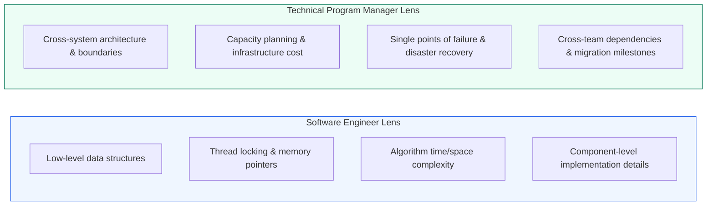
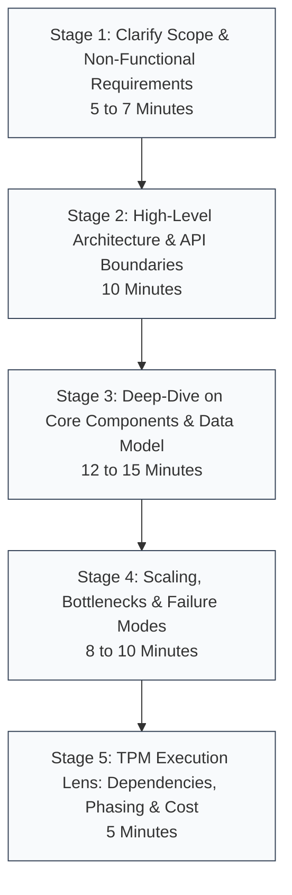

# Module 4.1: The TPM System Design Framework

System design interviews and architecture design reviews evaluate Technical Program Managers differently than Software Engineers. While software engineers are assessed on code constructs, concurrency primitives, and algorithmic efficiency, TPMs are evaluated on **architectural breadth, trade-off evaluation, cross-functional risk mitigation, capacity planning, and project delivery roadmaps**.

---

## 1. SWE vs TPM System Design Lens

Understanding the evaluation criteria is critical for succeeding in TPM interviews at top technology firms (Google, Meta, Amazon, Microsoft, Uber).

---

## 2. The 5-Stage TPM System Design Blueprint

Use this structured five-stage framework to drive any 45-minute architectural interview or cross-functional architecture review.

---

## 3. Step-by-Step Blueprint Breakdown

### Stage 1: Clarify Scope and Requirements (5 to 7 Minutes)
Never jump straight into drawing boxes. Clarify functional and non-functional requirements to set clear boundaries.

- **Functional Requirements (What the system does)**:
  - Identify 2 or 3 core use cases (e.g. "Users can upload video segments; users can stream video adaptively").
  - Explicitly state out-of-scope features (e.g. "Video comments and recommendations are out of scope for today").
- **Non-Functional Requirements (How well it performs)**:
  - Scale: Monthly active users (MAU), daily active users (DAU), read/write ratio.
  - Latency: Target p95 / p99 response times (e.g. p99 < 200ms).
  - Availability: Target "nines" (e.g. 99.99% availability).
  - Data Retention & Compliance: Data durability, GDPR, data residency constraints.

### Stage 2: High-Level Architecture (10 Minutes)
Establish the end-to-end data flow before zooming into details.

- Draw the client ingress path: Client $\rightarrow$ DNS $\rightarrow$ CDN $\rightarrow$ Load Balancer $\rightarrow$ API Gateway.
- Partition the backend into logical domain services (e.g. Ingestion Service, Processing Service, Query Service).
- Define primary data storage tiers (Transactional DB, Cache, Object Storage).
- Define core API contracts (e.g. `POST /api/v1/trips`, `GET /api/v1/drivers/nearby`).

### Stage 3: Deep-Dive and Data Modeling (12 to 15 Minutes)
Zoom in on the 1 or 2 most complex components in the design.

- **Data Model**:
  - Relational vs NoSQL selection with rationale.
  - Primary keys, foreign keys, partition keys, and secondary indexing.
- **Data Flow Mechanics**:
  - Walk through an end-to-end read and write sequence step-by-step.
  - Explain cache population, invalidation triggers, and asynchronous messaging queues.

### Stage 4: Scaling, Bottlenecks, and Failure Modes (8 to 10 Minutes)
Proactively attack your own architecture before the interviewer or team points out flaws.

- **Single Points of Failure (SPOFs)**: What happens if the load balancer, primary database, or Redis master dies?
- **Hot Partitions**: How do we handle sudden traffic surges from viral events or celebrity accounts?
- **Resilience Controls**: Where are circuit breakers, rate limiters, DLQs, and fallback mechanisms placed?

### Stage 5: The TPM Execution Lens (5 Minutes)
This stage distinguishes strong TPM candidates from engineers:

- **Cross-Team Dependencies**: Identify teams involved (e.g. Infrastructure, Security, Mobile Client, Data Platform).
- **Migration & Phasing**: How do we transition from legacy systems without downtime (Strangler Fig pattern, dark launching)?
- **Infrastructure Cost Sizing**: Rough cloud budget estimation (compute, network egress, storage tiering).
- **Launch Risks & Rollback Criteria**: Specific telemetry metrics that trigger an automated abort of the rollout.

---

## 4. Time Allocation Breakdown (45-Minute Interview)

| Stage | Activity | Time Target | Goal |
| :--- | :--- | :--- | :--- |
| **Stage 1** | Scope, NFRs & Calculations | 5 to 7 mins | Eliminate ambiguity; establish agreed scale parameters |
| **Stage 2** | High-Level Architecture Diagram | 10 mins | Establish full end-to-end flow without getting bogged down |
| **Stage 3** | Component Deep-Dive & Data Model | 12 to 15 mins | Demonstrate technical depth on primary system challenges |
| **Stage 4** | Bottlenecks, Scale & Resilience | 8 to 10 mins | Prove operational durability and failure handling |
| **Stage 5** | Execution, Phasing & Trade-offs | 5 mins | Demonstrate program delivery, risk mitigation, and leadership |

---

## 5. Common Anti-Patterns to Avoid

| Anti-Pattern | Description | Correction |
| :--- | :--- | :--- |
| **The Immediate Box Drawer** | Drawing diagrams before asking clarifying scale or business questions | Spend the first 5 minutes agreeing on requirements, QPS, and scope |
| **The Pure SWE Trap** | Diving deep into single-machine thread concurrency or Python code | Elevate discussion to distributed architecture, data contracts, and scaling |
| **Buzzword Stacking** | Throwing "Kafka, Redis, and Kubernetes" at every problem without justification | Explain *why* a technology fits the specific read/write access pattern |
| **Silent Architect** | Designing in complete silence without narrating thought processes | Think out loud; present trade-offs transparently: "Option A gives X but costs Y" |
| **Ignoring Operational Cost** | Proposing infinite multi-region replication for non-critical features | Highlight cost vs reliability trade-offs: "99.9% is sufficient and saves 60% cloud spend" |

---

## 6. TPM Review Checklist

Before presenting an architecture to leadership or interview panels:

- [ ] Did I clarify both functional goals and non-functional targets (SLAs, scale, latency)?
- [ ] Is my data store selection justified by specific read/write access patterns?
- [ ] Have I proactively identified the top single points of failure (SPOFs)?
- [ ] Did I outline the rollout phases, cross-team dependencies, and rollback triggers?
- [ ] Am I prepared to defend the cost implications of high availability choices?
