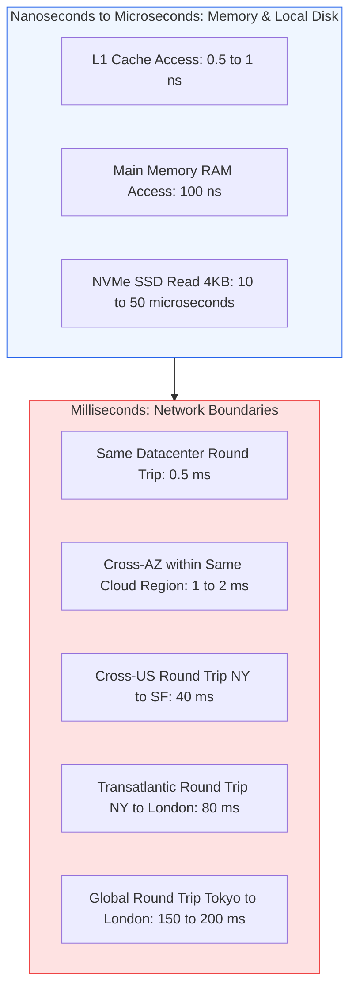

# Module 4.2: Back-of-the-Envelope Capacity Planning

Back-of-the-envelope calculations allow technical program managers to rapidly size infrastructure, sanity-check engineering proposals, estimate annual cloud expenditures, and determine whether a proposed architecture is physically feasible before writing code.

---

## 1. The Power-of-Two and Storage Units Cheat Sheet

Memorizing these approximations enables fast mental arithmetic during architecture reviews and interviews.

| Power of 2 | Exact Value | Approximation | Unit Equivalent |
| :--- | :--- | :--- | :--- |
| **$2^{10}$** | 1,024 | 1 Thousand ($10^3$) | 1 Kilobyte (KB) |
| **$2^{20}$** | 1,048,576 | 1 Million ($10^6$) | 1 Megabyte (MB) |
| **$2^{30}$** | 1,073,741,824 | 1 Billion ($10^9$) | 1 Gigabyte (GB) |
| **$2^{40}$** | 1,099,511,627,776 | 1 Trillion ($10^{12}$) | 1 Terabyte (TB) |
| **$2^{50}$** | 1,125,899,906,842,624 | 1 Quadrillion ($10^{15}$) | 1 Petabyte (PB) |

---

## 2. Time Conversion Approximations

| Time Horizon | Exact Seconds | Mental Math Approximation |
| :--- | :--- | :--- |
| **1 Hour** | 3,600 seconds | $\approx 4,000$ seconds |
| **1 Day** | 86,400 seconds | $\approx 100,000$ seconds ($10^5$) |
| **1 Month (30 days)** | 2,592,000 seconds | $\approx 2.5 \times 10^6$ seconds |
| **1 Year** | 31,536,000 seconds | $\approx 3 \times 10^7$ seconds |

> **Mental Math Pro-Tip**: Dividing a daily figure by $10^5$ gives a fast, conservative estimate of Queries Per Second (QPS). For example, 10 million daily actions $\approx 10,000,000 / 100,000 = 100\text{ QPS}$.

---

## 3. Modern Latency Numbers Every TPM Should Know

Understanding physical hardware and networking limits prevents proposing architectures that violate latency SLAs.

### Core Architecture Insights
1. **Memory is roughly 1,000x faster than SSD reads**, and SSD reads are roughly 1,000x faster than disk seeks.
2. **Datacenter network calls take 0.5ms to 2ms**. An API that chains 10 sequential synchronous microservice calls will incur 20ms of pure network round-trip overhead before doing any compute.
3. **Cross-ocean calls are bounded by the speed of light in fiber optic cables** ($\approx 200,000\text{ km/s}$). You cannot reduce London-to-New York latency below 60ms through software optimization.

---

## 4. Step-by-Step Worked Capacity Planning Example

Scenario: Design an image-sharing platform (e.g. Instagram-lite) for **100 Million Daily Active Users (DAU)**.

### Step 1: Calculate Queries Per Second (QPS)
- Each user views an average of 20 image posts per day.
- Each user uploads an average of 1 photo per day.

$$\text{Daily Read Requests} = 100\text{M} \times 20 = 2\text{ Billion reads/day}$$

$$\text{Average Read QPS} = \frac{2,000,000,000}{86,400} \approx 23,000\text{ QPS}$$

$$\text{Peak Read QPS (2x Multiplier)} = 23,000 \times 2 = 46,000\text{ QPS}$$

$$\text{Daily Write Requests} = 100\text{M} \times 1 = 100\text{ Million uploads/day}$$

$$\text{Average Write QPS} = \frac{100,000,000}{86,400} \approx 1,150\text{ QPS}$$

$$\text{Peak Write QPS (2x Multiplier)} = 1,150 \times 2 = 2,300\text{ QPS}$$

### Step 2: Storage Capacity Estimation (5-Year Horizon)
- Average compressed photo size: **200 KB**.
- Metadata size per post in database (user ID, timestamp, captions, URLs): **500 Bytes**.

$$\text{Daily Media Storage} = 100\text{M uploads} \times 200\text{ KB} = 20,000,000\text{ MB} = 20\text{ Terabytes/day}$$

$$\text{5-Year Media Storage} = 20\text{ TB/day} \times 365 \times 5 \approx 36.5\text{ Petabytes (S3 Object Storage)}$$

$$\text{Daily Metadata Storage} = 100\text{M} \times 500\text{ Bytes} = 50\text{ GB/day}$$

$$\text{5-Year Metadata Storage} = 50\text{ GB/day} \times 365 \times 5 \approx 91.25\text{ Terabytes (Distributed DB)}$$

### Step 3: Network Bandwidth Estimation
- Read bandwidth (serving photos to users):

$$\text{Read Bandwidth} = \text{Average Read QPS} \times \text{Average Photo Size}$$

$$\text{Read Bandwidth} = 23,000\text{ QPS} \times 200\text{ KB} = 4,600,000\text{ KB/s} = 4.6\text{ GB/s}$$

$$\text{In Gigabits per second (8 bits = 1 byte)} = 4.6 \times 8 \approx 36.8\text{ Gbps egress}$$

- Egress bandwidth at this scale dictates a Content Delivery Network (CDN) to avoid origin transit costs and saturation.

### Step 4: Memory / Cache Working Set Estimation
Applying the **80/20 Rule** (20% of photos generate 80% of daily read views):

$$\text{Daily Unique Photos Viewed} = 20\% \text{ of daily uploaded photos} = 20\% \times 100\text{M} = 20\text{ Million photos}$$

$$\text{Cache Memory Required} = 20\text{M photos} \times 200\text{ KB} = 4\text{ Terabytes of RAM}$$

- Adding a 25% buffer for Redis metadata and connection pools gives a target cluster size of **5 TB RAM** (e.g. 20 cache nodes of 256 GB RAM each).

---

## 5. Capacity Estimation Rules of Thumb

1. **The 70% Saturation Rule**: Never size compute or database clusters for 100% capacity. Plan for auto-scaling triggers at 70% CPU or connection pool saturation to allow headroom for traffic spikes.
2. **Replication Multiplier**: Total physical storage must account for replication factors. If raw data is 36.5 PB and the storage tier maintains 3x replication, total raw disk required is $36.5 \times 3 = 109.5\text{ PB}$.
3. **Write Amplification**: Remember that secondary indexes, write-ahead logs (WAL), and backup snapshots multiply database disk consumption by 1.5x to 2.5x the raw row payload size.

---

## 6. TPM Review Checklist

When validating capacity numbers in engineering proposals:

- [ ] Has the team calculated both average QPS and peak QPS (minimum 2x to 3x multiplier)?
- [ ] Is storage capacity projected for a realistic lifecycle horizon (e.g. 3 to 5 years)?
- [ ] Has storage growth accounted for replication factors and index overhead?
- [ ] Is network egress calculated in Gbps to evaluate bandwidth costs and CDN necessity?
- [ ] Is cache memory sized according to the 80/20 working set rule plus operational headroom?
