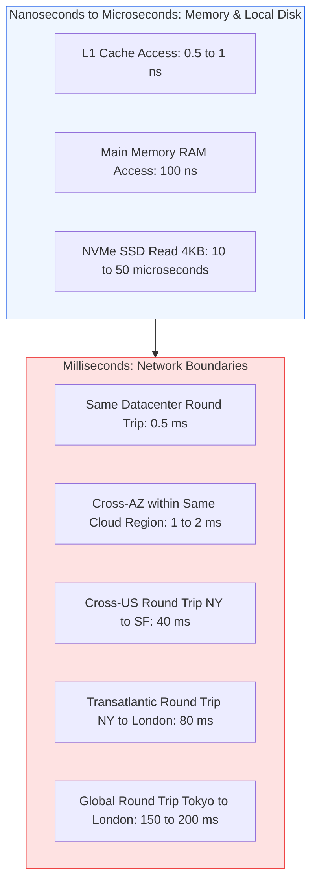
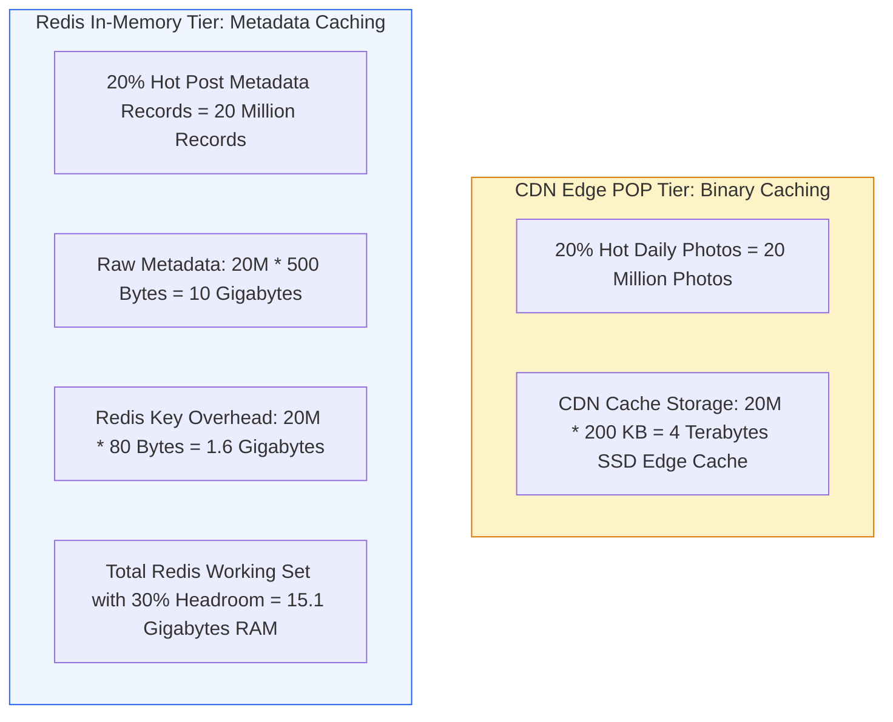

# Module 4.2: Back-of-the-Envelope Capacity Planning

[Home](../README.md) > [Module 4: TPM Execution Framework](./README.md) > **Chapter 4.2: Capacity Planning & Estimation**

---

Back-of-the-envelope calculations allow technical program managers to rapidly size infrastructure, sanity-check engineering proposals, estimate annual cloud expenditures, and determine whether a proposed architecture is physically feasible before writing code.

---

## 1. The Power-of-Two and Storage Units Cheat Sheet

Memorizing these approximations enables fast mental arithmetic during architecture reviews and interviews.

| Power of 2 | Exact Value | Approximation | Unit Equivalent |
| :--- | :--- | :--- | :--- |
| **$2^{10}$** | 1,024 | 1 Thousand ($10^3$) | 1 Kilobyte (KB) |
| **$2^{20}$** | 1,048,576 | 1 Million ($10^6$) | 1 Megabyte (MB) |
| **$2^{30}$** | 1,073,741,824 | 1 Billion ($10^9$) | 1 Gigabyte (GB) |
| **$2^{40}$** | 1,099,511,627,776 | 1 Trillion ($10^{12}$) | 1 Terabyte (TB) |
| **$2^{50}$** | 1,125,899,906,842,624 | 1 Quadrillion ($10^{15}$) | 1 Petabyte (PB) |

---

## 2. Time Conversion Approximations

| Time Horizon | Exact Seconds | Mental Math Approximation |
| :--- | :--- | :--- |
| **1 Hour** | 3,600 seconds | $\approx 4,000$ seconds |
| **1 Day** | 86,400 seconds | $\approx 100,000$ seconds ($10^5$) |
| **1 Month (30 days)** | 2,592,000 seconds | $\approx 2.5 \times 10^6$ seconds |
| **1 Year** | 31,536,000 seconds | $\approx 3 \times 10^7$ seconds |

> **Mental Math Pro-Tip**: Dividing a daily figure by $10^5$ gives a fast, conservative estimate of Queries Per Second (QPS). For example, 10 million daily actions $\approx 10,000,000 / 100,000 = 100\text{ QPS}$.

---

## 3. Modern Latency Numbers Every TPM Should Know

Understanding physical hardware and networking limits prevents proposing architectures that violate latency SLAs.

### Core Architecture Insights
1. **Memory is roughly 1,000x faster than SSD reads**, and SSD reads are roughly 1,000x faster than traditional spinning disk seeks.
2. **Datacenter network calls take 0.5ms to 2ms**. An API that chains 10 sequential synchronous microservice calls will incur 20ms of pure network round-trip overhead before doing any compute.
3. **Cross-ocean calls are bounded by the speed of light in fiber optic cables** ($\approx 200,000\text{ km/s}$). You cannot reduce London-to-New York round-trip latency below 60ms through software optimization.

---

## 4. Step-by-Step Worked Capacity Planning Example

Scenario: Design an image-sharing platform (e.g. Instagram-lite) for **100 Million Daily Active Users (DAU)**.

### Step 1: Calculate Queries Per Second (QPS)
- Each user views an average of 20 image posts per day.
- Each user uploads an average of 1 photo per day.

$$\text{Daily Read Requests} = 100\text{M} \times 20 = 2\text{ Billion reads/day}$$

$$\text{Average Read QPS} = \frac{2,000,000,000}{86,400} \approx 23,148\text{ QPS} \approx 23,000\text{ QPS}$$

$$\text{Peak Read QPS (2x Multiplier)} = 23,000 \times 2 = \mathbf{46,000\text{ QPS}}$$

$$\text{Daily Write Requests} = 100\text{M} \times 1 = 100\text{ Million uploads/day}$$

$$\text{Average Write QPS} = \frac{100,000,000}{86,400} \approx 1,157\text{ QPS} \approx 1,150\text{ QPS}$$

$$\text{Peak Write QPS (2x Multiplier)} = 1,150 \times 2 = \mathbf{2,300\text{ QPS}}$$

### Step 2: Storage Capacity Estimation (5-Year Horizon)
- Average compressed photo size: **200 KB**.
- Metadata size per post in database (user ID, post ID, timestamp, caption, CDN media URL): **500 Bytes**.

$$\text{Daily Media Storage (Object Store)} = 100\text{M uploads} \times 200\text{ KB} = 20,000\text{ GB/day} = 20\text{ Terabytes/day}$$

$$\text{5-Year Media Storage} = 20\text{ TB/day} \times 365 \times 5 \approx \mathbf{36.5\text{ Petabytes (S3 Object Storage)}}$$

$$\text{Daily Metadata Storage (Distributed DB)} = 100\text{M} \times 500\text{ Bytes} = 50\text{ GB/day}$$

$$\text{5-Year Metadata Storage} = 50\text{ GB/day} \times 365 \times 5 \approx \mathbf{91.25\text{ Terabytes (Distributed DB)}}$$

- Accounting for 3x database replication and secondary index overhead ($1.5\times$ multiplier):
  $$\text{Total Raw Database Provisioning} = 91.25\text{ TB} \times 3 \times 1.5 \approx \mathbf{410.6\text{ Terabytes}}$$

### Step 3: Network Bandwidth Estimation
- Read bandwidth (serving photos to end users):

$$\text{Average Read Bandwidth} = \text{Average Read QPS} \times \text{Average Photo Size}$$

$$\text{Average Read Bandwidth} = 23,000\text{ QPS} \times 200\text{ KB} = 4,600,000\text{ KB/s} = 4.6\text{ GB/s}$$

$$\text{In Gigabits per second (8 bits = 1 byte)} = 4.6 \times 8 \approx \mathbf{36.8\text{ Gbps egress}}$$

$$\text{Peak Read Bandwidth (2x Multiplier)} = 36.8\text{ Gbps} \times 2 \approx \mathbf{73.6\text{ Gbps egress}}$$

- An egress rate of 73.6 Gbps cannot be served directly from application origin servers without incurring massive cloud transit fees and risking server saturation. A global Content Delivery Network (CDN) is mandatory to absorb at least 90% of this bandwidth at edge POPs.

### Step 4: Storage Tiering & Cache Sizing: Media vs Metadata

A common pitfall in system design is attempting to cache 200 KB binary image files in Redis RAM. In a production architecture:
1. **Binary Media Blobs (200 KB)** are cached in **CDN Edge POPs** on fast NVMe SSDs.
2. **Post Metadata & URLs (500 Bytes)** are cached in **Redis In-Memory RAM** for ultra-fast timeline queries.

#### Redis In-Memory Working Set Calculation
- Total distinct active posts viewed in 24 hours: 100 Million daily uploads.
- Applying the Pareto Principle (top 20% of posts generate 80% of reads):
  $$\text{Hot Working Set Count} = 100,000,000 \times 0.20 = 20\text{ Million posts}$$
  $$\text{Raw Metadata Size} = 20,000,000 \times 500\text{ Bytes} = 10\text{ Gigabytes}$$
- Adding Redis key overhead (`dictEntry`, `robj`, jemalloc allocation padding $\approx 80\text{ bytes/key}$):
  $$\text{Key Overhead} = 20,000,000 \times 80\text{ Bytes} = 1.6\text{ Gigabytes}$$
- Adding a 30% buffer for connection memory, command buffers, and headroom:
  $$\text{Target Redis Cluster RAM} = (10\text{ GB} + 1.6\text{ GB}) \times 1.30 \approx \mathbf{15.1\text{ Gigabytes RAM}}$$
- *Conclusion*: A modest 3-node Redis cluster with 16 GB RAM per node (configured with 1 primary and 2 read replicas) easily handles the entire application metadata working set with full high availability.

---

## 5. Sensitivity Analysis for Capacity Modeling

In engineering reviews, assumptions change. A senior TPM must understand how shifts in core parameters impact infrastructure requirements:

| Variable Parameter | Baseline Assumption | High-Stress Scenario | Impact on Infrastructure |
| :--- | :--- | :--- | :--- |
| **Photo Compression Size** | 200 KB | 500 KB (High-res uncompressed) | Egress bandwidth jumps from 73.6 Gbps to 184 Gbps; CDN costs multiply 2.5x |
| **Read-to-Write Ratio** | 20:1 | 50:1 (Viral live event) | Read QPS surges from 23,000 to 57,800 QPS; requires scaling API Gateway and CDN POPs |
| **User Activity Multiplier** | 2x Peak Multiplier | 5x Peak Multiplier (Breaking news) | Peak write QPS jumps from 2,300 to 5,750 QPS; requires pre-provisioned database write capacity |
| **Media Retention Policy** | 5-Year Full Retention | 90-Day Cold Tiering | Moves 95% of S3 data to S3 Glacier Flexible, reducing cloud storage bills by up to 70% |

---

## 6. TPM Review Checklist

When validating capacity numbers in engineering proposals:

- [ ] Has the team calculated both average QPS and peak QPS (minimum 2x to 3x multiplier)?
- [ ] Is storage capacity projected for a realistic lifecycle horizon (e.g. 3 to 5 years)?
- [ ] Has storage growth accounted for replication factors and index write amplification?
- [ ] Is network egress calculated in Gbps to evaluate bandwidth costs and CDN necessity?
- [ ] Are binary media files cached at CDN edges and strictly separated from in-memory Redis metadata caches?
- [ ] Was a sensitivity analysis conducted for at least one critical traffic assumption?

---

## 7. Primary Sources and Further Reading

- **Latency Numbers Every Programmer Should Know**: Colin Scott's Interactive Visualization (https://colin-scott.github.io/personal_website/research/interactive_latency.html).
- **Jeff Dean's System Design Numbers**: *Building Large-Scale Distributed Systems: ACM SIGOPS Keynote* by Jeff Dean (Google, 2009).
- *Designing Data-Intensive Applications* by Martin Kleppmann (O'Reilly Media, 2017) - Chapter 1: Reliable, Scalable, and Maintainable Systems.
- **AWS S3 Storage Classes & Pricing**: Official AWS Documentation on Lifecycle Tiering.
