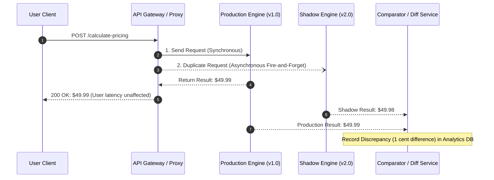
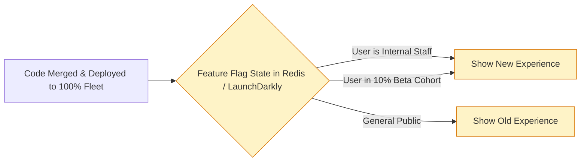
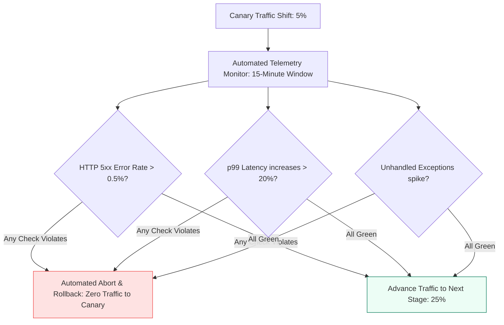

# Module 4.3: Migration and Safe Deployment Strategies

[Home](../README.md) > [Module 4: TPM Execution Framework](./README.md) > **Chapter 4.3: Migration & Deployment Strategies**

---

Large-scale distributed systems cannot be paused for a weekend maintenance window to deploy new features or replace legacy monoliths. Technical program managers must master zero-downtime migration patterns, progressive rollouts, and blast-radius containment strategies to modernize architectures safely under full production load.

---

## 1. The Strangler Fig Pattern

Named after the tropical strangler fig tree that seeds in the upper branches of a host tree, gradually grows downward, and eventually replaces the host. In software, this pattern incrementally migrates functionalities from a legacy monolith to new microservices until the monolith can be safely decommissioned.

```mermaid
flowchart TD
    subgraph Phase1 [Phase 1: Intercept Ingress]
        Client1[Client] --> Proxy1[API Gateway / Facade Proxy]
        Proxy1 -->|100% Traffic| Monolith1[Legacy Monolith Application]
    end

    subgraph Phase2 [Phase 2: Strangle First Service]
        Client2[Client] --> Proxy2[API Gateway / Facade Proxy]
        Proxy2 -->|Path /api/v1/auth| Micro2[New Auth Microservice]
        Proxy2 -->|Remaining Traffic| Monolith2[Legacy Monolith Application]
    end

    subgraph Phase3 [Phase 3: Full Replacement]
        Client3[Client] --> Proxy3[API Gateway / Facade Proxy]
        Proxy3 --> MicroAuth[Auth Microservice]
        Proxy3 --> MicroOrder[Order Microservice]
        Proxy3 --> MicroPay[Payment Microservice]
        Note over Monolith3: Legacy Monolith Decommissioned!
    end

    Phase1 --> Phase2 --> Phase3

    classDef pStyle fill:#f8fafc,stroke:#334155,stroke-width:1px;
    class Phase1,Phase2,Phase3 pStyle;
```

### Strangler Fig Migration Steps
1. **Deploy Ingress Facade**: Place an API Gateway or reverse proxy directly in front of the legacy monolith.
2. **Build New Service**: Implement a single, well-bounded domain (e.g. Authentication or Notifications) as a modern standalone microservice.
3. **Route Traffic via Facade**: Update gateway routing rules to direct the specific path to the new microservice while leaving all other traffic routed to the monolith.
4. **Repeat and Sunset**: Sequentially extract domains until the monolith is an empty shell, then decommission the legacy infrastructure.

---

## 2. Production Deployment Strategies

Choosing a deployment model involves balancing risk, release speed, infrastructure cost, and rollback complexity.

```mermaid
flowchart TD
    subgraph BlueGreen [Blue-Green Deployment]
        direction TB
        RouterBG[Router / Load Balancer] -->|100% Active Traffic| GreenEnv[Green Environment: v1.0 Live]
        RouterBG -.->|Zero Traffic: Staging| BlueEnv[Blue Environment: v2.0 Ready]
        Note over RouterBG: Router switches 100% traffic to Blue once verified!
    end

    subgraph Canary [Canary Deployment]
        direction TB
        RouterCanary[Router / Load Balancer] -->|95% Production Traffic| ProdEnv[Baseline Fleet: v1.0]
        RouterCanary -->|5% Sample Traffic| CanaryEnv[Canary Fleet: v2.0]
        Note over CanaryEnv: Telemetry verified for 30 mins before scaling to 100%
    end

    classDef bgStyle fill:#eff6ff,stroke:#2563eb,stroke-width:1px;
    classDef cnStyle fill:#ecfdf5,stroke:#047857,stroke-width:1px;
    class BlueGreen bgStyle;
    class Canary cnStyle;
```

### Detailed Strategy Comparison

| Strategy | How It Works | Downtime Profile | Cost Overhead | Rollback Speed | Operational Failure Modes | Best Suited For |
| :--- | :--- | :--- | :--- | :--- | :--- | :--- |
| **Rolling Deployment** | Replaces old pods with new pods incrementally (e.g. 20% at a time) | Near-zero downtime (conditional on connection draining) | Zero additional compute cost | Slow (requires rolling backward pod by pod) | **Connection Drops**: Occurs if `terminationGracePeriodSeconds` is too short or if DB schema is not backward compatible | Standard stateless microservice releases |
| **Blue-Green Deployment** | Provisions duplicate environment (Blue). Flips router from Green to Blue in one step | Near-zero downtime (sub-second router flip) | High (requires 2x hardware capacity during rollout) | Fast (flip router back to Green) | **State Drift**: Shared databases may diverge if v1 and v2 write incompatible schemas simultaneously | High-risk releases, major framework upgrades |
| **Canary Deployment** | Routes small fraction (e.g. 1% to 5%) of live traffic to new version to observe real-world metrics | Near-zero downtime | Minimal (1 to 2 canary instances) | Fast (drain canary routing rule) | **Session Contention**: Users bouncing between v1 and v2 experiencing inconsistent UI state | High-scale consumer platforms (Google, Meta, Netflix) |
| **Shadow / Dark Launch** | Duplicates production requests to new service asynchronously without returning result to user | Zero user-visible downtime | Medium (requires duplicate compute capacity) | N/A (no live user impact) | **Side-Effect Duplication**: If shadow service inadvertently sends real emails or charges credit cards | Algorithmic rewrites, pricing engine overhauls |

---

## 3. Shadow Traffic (Dark Launching)

When rewriting critical backend pipelines (such as a search ranking algorithm or billing calculator), synthetic tests cannot replicate real-world production nuances.



- **Safety**: End users never see shadow responses or errors.
- **Validation**: Program managers and engineers can run shadow traffic for weeks until the comparator reports 99.999% parity between old and new engines.

---

## 4. Feature Flags: Decoupling Deployment from Release

Traditional teams equate *deploying code to servers* with *releasing features to customers*. Feature flagging decouples these operations:

$$\text{Deployment (Technical Operation)} \neq \text{Release (Business Decision)}$$



### TPM Benefits of Feature Flags
1. **Kill Switches**: If a newly released feature causes an error spike, turn off the flag in 500 milliseconds without deploying code or executing a rollback.
2. **Targeted Beta Testing**: Roll out features exclusively to internal employees (`@company.com`), beta users, or specific geographic regions.
3. **Trunk-Based Development**: Engineers continuously merge small code snippets into the main branch behind a disabled flag, eliminating massive, painful merge conflicts.

---

## 5. Blast Radius Control and Automated Rollback Criteria

A safe migration program must establish clear, automated rollback thresholds before initiating traffic shifts.



---

## 6. TPM Review Checklist

When building migration roadmaps and deployment plans:

- [ ] Has the team selected a migration strategy (Strangler Fig, Blue-Green, or Canary) suited to the risk profile?
- [ ] Are automated rollback criteria defined with quantitative SLI thresholds?
- [ ] Can the deployment roll back in under 60 seconds without requiring a cold restart?
- [ ] Are feature flags guarded by fallback defaults if the configuration service fails?
- [ ] Has the cutover runbook been peer-reviewed with named owners for each step?
- [ ] Did the team test backward compatibility of database schemas with both old and new code versions?

---

## 7. Primary Sources and Further Reading

- **Strangler Fig Pattern**: *Strangler Fig Application* by Martin Fowler (martinfowler.com/bliki/StranglerFigApplication.html, 2004).
- *Continuous Delivery: Reliable Software Releases through Build, Test, and Deployment Automation* by Jez Humble and David Farley (Addison-Wesley, 2010).
- **Canary Releases**: *CanaryRelease* by Martin Fowler (martinfowler.com/bliki/CanaryRelease.html, 2014).
- **Google SRE Release Engineering**: *Site Reliability Engineering* (O'Reilly, 2016) - Chapter 8: Release Engineering.
