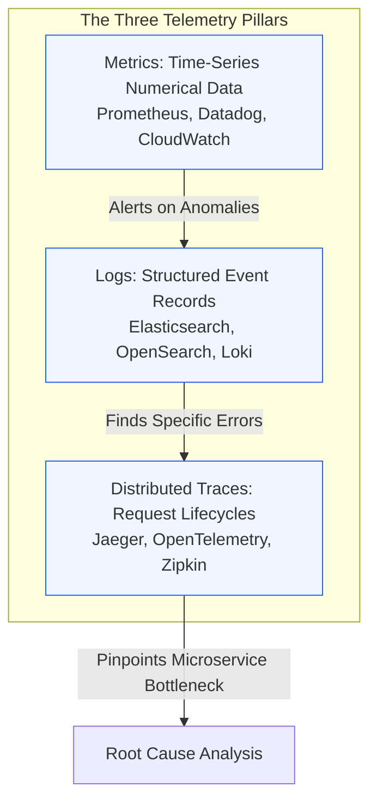
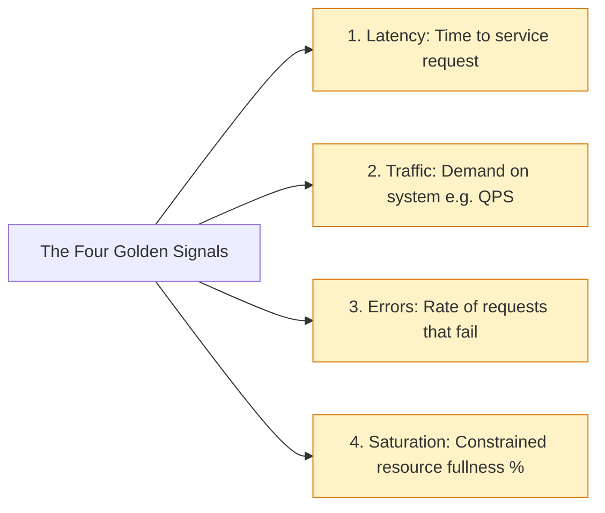
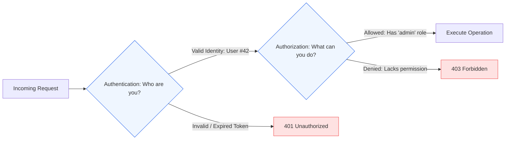

# Module 4.4: Observability, Security, and Governance

[Home](../README.md) > [Module 4: TPM Execution Framework](./README.md) > **Chapter 4.4: Observability, Security & Governance**

---

Building a scalable system is only half the battle; operating it reliably, securing user data, and maintaining regulatory compliance are what protect an organization from reputational damage and catastrophic financial fines. For technical program managers, observability and security governance are primary operational deliverables.

---

## 1. Monitoring vs Observability

- **Monitoring**: Tells you *that* a system is broken (e.g. "Error rate is 8%"). Focuses on known knowns and predefined threshold alerts.
- **Observability**: Allows you to infer the internal state of a system based on its external outputs. It enables you to diagnose *why* a system is broken during novel, unprecedented failure states (unknown unknowns).

---

## 2. The Three Pillars of Observability

Modern distributed systems rely on three telemetry data types to provide complete visibility.



### Pillar Comparison

| Telemetry Type | What It Measures | Storage Cost | Strengths | Weaknesses |
| :--- | :--- | :--- | :--- | :--- |
| **Metrics** | Aggregated numbers over time (e.g. CPU %, QPS, p99 latency) | Low (constant size aggregation) | Ultra-fast dashboarding and automated alerting | Lacks individual request context; cannot pinpoint specific user ID |
| **Logs** | Structured text records of discrete events (e.g. JSON log entries) | High (proportional to traffic volume) | Rich context, stack traces, and local debug information | Expensive to index; high query latency across billions of rows |
| **Traces** | End-to-end journey of a single request across multiple microservices | Medium (managed via adaptive sampling) | Identifies exact downstream hop causing latency spikes | Requires instrumenting every service with context propagation headers |

---

## 3. Distributed Tracing and OpenTelemetry (OTel)

When a single user click triggers calls across 15 microservices, traditional server logs cannot correlate the chain of events. Distributed tracing injects a unique **Trace ID** at the API gateway and propagates it across every downstream RPC call.

```mermaid
sequenceDiagram
    autonumber
    participant Client
    participant GW as API Gateway (Trace ID: abc-123)
    participant Auth as Auth Service (Span: auth-span)
    participant Order as Order Service (Span: order-span)
    participant DB as Postgres DB (Span: db-query)

    Client->>GW: POST /orders
    Note over GW: Generate Trace ID: abc-123, Parent Span ID: null
    GW->>Auth: Verify Token (Header: traceparent=abc-123;span=auth-01)
    Auth-->>GW: OK (20ms)
    GW->>Order: Create Order (Header: traceparent=abc-123;span=order-01)
    Order->>DB: INSERT into orders (Span: db-01)
    Note over DB: High Lock Contention! Latency = 850ms
    DB-->>Order: Committed
    Order-->>GW: Order Created
    GW-->>Client: 201 Created (Total Latency: 890ms)
```

- **Span**: A single unit of work (e.g. an HTTP call or database query) with a start time, duration, and metadata tags.
- **Trace**: A directed acyclic graph (DAG) of spans representing the end-to-end request.
- **OpenTelemetry (OTel)**: The vendor-neutral CNCF industry standard framework for collecting metrics, logs, and traces.

---

## 4. The Google SRE Four Golden Signals

Every production service should monitor these four foundational metrics:



1. **Latency**: Differentiate between the latency of successful requests and failed requests (a fast 500 error is not a good response).
2. **Traffic**: Measures current throughput (e.g. HTTP requests/sec or network I/O per second).
3. **Errors**: Tracks explicit failures (HTTP 500s) and implicit failures (HTTP 200 containing error message).
4. **Saturation**: Tracks how close the system is to capacity (e.g. memory at 85%, thread pool 90% utilized).

---

## 5. Security & Identity Governance for TPMs

Security architecture spans identity management, network segmentation, and data encryption.

### Authentication (AuthN) vs Authorization (AuthZ)



### Modern Authentication Standards

- **OAuth 2.0**: The authorization delegation framework allowing third parties to access user resources without passwords.
- **OpenID Connect (OIDC)**: An identity layer built directly on top of OAuth 2.0 providing federated single sign-on (SSO).
- **JSON Web Tokens (JWT)**: Cryptographically signed tokens (using HMAC or RSA/ECDSA) containing user claims and expiration timestamps.
- **RBAC vs ABAC**:
  - *RBAC (Role-Based Access Control)*: Permissions assigned to roles (e.g. Admin, Editor, Viewer).
  - *ABAC (Attribute-Based Access Control)*: Permissions evaluated dynamically on attributes (e.g. "Allow access if user department is Sales AND current location is USA AND time is during business hours").

---

## 6. Data Encryption and Regulatory Compliance

| Compliance Domain | Primary Requirements | Engineering Implementation |
| :--- | :--- | :--- |
| **Encryption in Transit** | Protect data traveling across networks | TLS 1.3 encryption on all public endpoints and internal mTLS (Mutual TLS) between microservices |
| **Encryption at Rest** | Protect physical hard drives and databases against theft | AES-256 encryption. Envelope encryption using Key Management Services (AWS KMS, Google Cloud KMS) |
| **GDPR (Right to be Forgotten)** | Ability to purge all personally identifiable information (PII) upon user request | Crypto-shredding: Encrypt user PII with an individual unique key. To "forget" the user, delete their key |
| **Data Residency** | Legal mandates requiring citizen data to remain inside national borders | Regional VPC partitioning, geolocation-based DNS routing, localized database shards |
| **SOC 2 Type II** | Continuous verification of security, availability, and confidential controls | Immutable audit logging, automated vulnerability scanning, least-privilege IAM policies |

---

## 7. TPM Review Checklist

When leading security and observability architecture sign-offs:

- [ ] Does every microservice emit the Four Golden Signals (Latency, Traffic, Errors, Saturation)?
- [ ] Is distributed tracing instrumented with W3C traceparent headers across all network boundaries?
- [ ] Are PII and sensitive credentials excluded from application log streams?
- [ ] Is data encrypted in transit using TLS 1.3 and at rest using KMS-managed envelope encryption?
- [ ] Is the Principle of Least Privilege enforced on all cloud IAM roles and service accounts?
- [ ] Does the design satisfy legal compliance mandates (GDPR, SOC 2, HIPAA) regarding data retention and residency?

---

## 8. Primary Sources and Further Reading

- *Site Reliability Engineering: How Google Runs Production Systems* (O'Reilly, 2016) - Chapter 6: Monitoring Distributed Systems.
- **OpenTelemetry Specification**: OpenTelemetry Documentation and W3C Trace Context Specification (https://opentelemetry.io/).
- **RFC 6749**: The OAuth 2.0 Authorization Framework (IETF, 2012).
- **RFC 7519**: JSON Web Token (JWT) (IETF, 2015).
- **NIST Special Publication 800-57**: *Recommendation for Key Management* (NIST, 2020).
