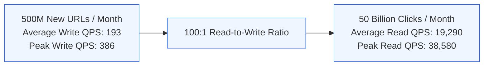
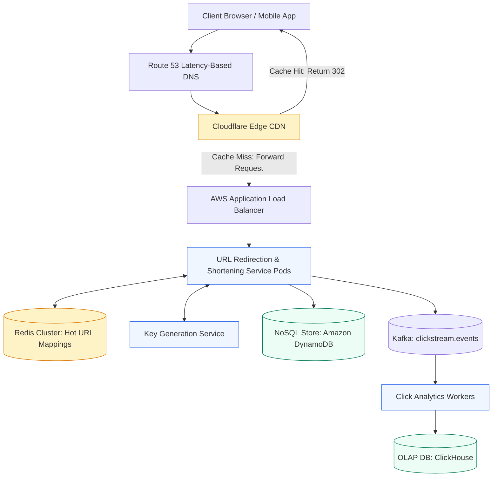
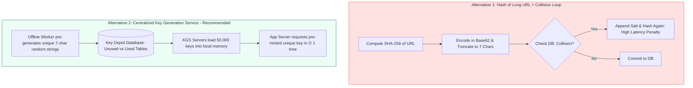
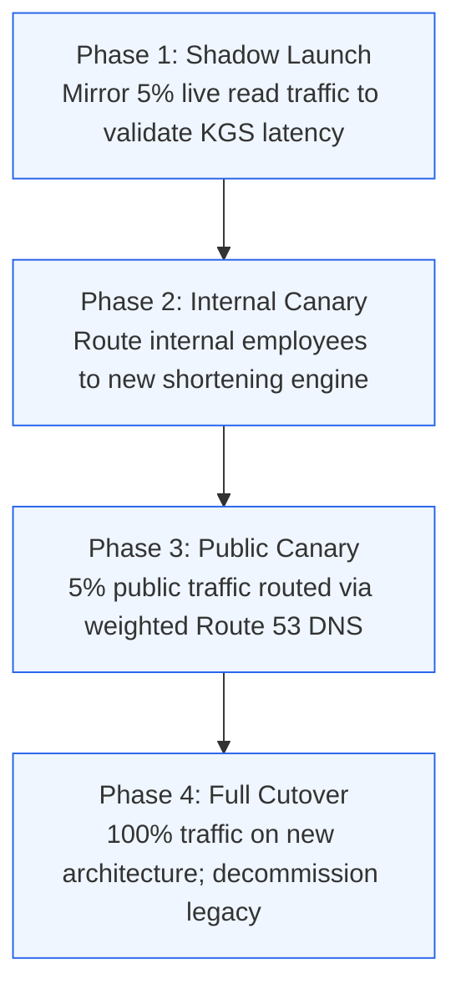

# Case Study 1: Global URL Shortener (TinyURL / Bitly)

[Home](../README.md) > [Module 5: Real-World Case Studies](./README.md) > **Case Study 5.1: URL Shortener**

---

## 1. Problem Statement and Scope

A URL shortener converts long URLs into compact aliases (e.g. `https://tiny.url/x7k9p2`) and redirects incoming client requests to the original destination. While conceptually straightforward, operating this service at internet scale requires handling massive read-to-write skews, sub-15ms redirection latencies, global high availability, and phishing abuse prevention.

### In-Scope Functional Capabilities
- Shortening long URLs into unique 7-character Base62 aliases.
- Redirecting incoming requests with HTTP 302/307 status codes.
- Custom alias support (e.g. `https://tiny.url/tpm-handbook`).
- URL expiration via configurable Time-to-Live (TTL).
- Click telemetry tracking (click count, referrer, timestamp, geographic country).

### Out-of-Scope (Explicit Boundaries)
- Private enterprise vanity domains (custom DNS CNAME onboarding).
- Deep link routing into native iOS/Android mobile apps (Universal Links).
- Real-time user billing and paid subscription tiers.

---

## 2. Requirements and SLAs

### Functional Requirements
1. **Alias Generation**: System accepts a valid URL and returns a unique 7-character alias.
2. **Redirection**: System redirects incoming alias requests to the original destination in under 15ms.
3. **Collision Resistance**: System must never assign the same alias to two different long URLs while active.

### Non-Functional Requirements & SLAs
- **Availability Target**: **99.99% Uptime** (Maximum allowable downtime: 52.6 minutes/year).
- **Latency SLO**: p99 redirection latency $< 15\text{ms}$; p99 alias creation $< 100\text{ms}$.
- **Durability**: 99.999999999% (11 nines) durability for URL mapping records.
- **Read-to-Write Ratio**: High read-heavy workload estimated between 50:1 and 100:1.

---

## 3. Capacity Planning and Calculations



### Traffic Estimates
- **New URLs Created**: 500 Million per month.
- **Average Write QPS**:
  $$\text{Write QPS} = \frac{500,000,000}{2,592,000\text{ seconds/month}} \approx \mathbf{193\text{ writes/sec}}$$
- **Peak Write QPS (2x Multiplier)**: $193 \times 2 \approx \mathbf{386\text{ writes/sec}}$.
- **Redirection Traffic (100:1 Ratio)**: 50 Billion clicks per month.
- **Average Read QPS**:
  $$\text{Read QPS} = \frac{50,000,000,000}{2,592,000\text{ seconds/month}} \approx \mathbf{19,290\text{ reads/sec}}$$
- **Peak Read QPS (2x Multiplier)**: $19,290 \times 2 \approx \mathbf{38,580\text{ reads/sec}}$.

### Storage Sizing (5-Year Horizon)
- Total URLs created over 5 years: $500\text{M/month} \times 12 \times 5 = \mathbf{30\text{ Billion records}}$.
- Data record breakdown:
  - `short_key`: 7 bytes (ASCII)
  - `original_url`: 500 bytes (average)
  - `user_id`: 16 bytes (UUID)
  - `created_at`: 8 bytes (Unix timestamp)
  - `expires_at`: 8 bytes (Unix timestamp)
  - Structural metadata and BSON/DynamoDB attribute overhead: $\approx 60\text{ bytes}$
  - **Total Record Size**: $\approx \mathbf{600\text{ bytes}}$.
- **Total Raw 5-Year Database Storage**:
  $$\text{Storage} = 30\text{ Billion} \times 600\text{ bytes} = 18,000,000,000\text{ KB} = \mathbf{18\text{ Terabytes}}$$
- Accounting for 3x multi-AZ replication and secondary index storage ($1.5\times$ factor):
  $$\text{Provisioned Storage} = 18\text{ TB} \times 3 \times 1.5 \approx \mathbf{81\text{ Terabytes}}$$

### Network Bandwidth Sizing
- **Read Ingress**: Negligible (HTTP GET headers $\approx 500\text{ bytes}$ per click $\times 19,290\text{ QPS} \approx 9.6\text{ MB/s}$).
- **Read Egress (HTTP 302 Header)**:
  $$\text{Egress Bandwidth} = 19,290\text{ QPS} \times 600\text{ bytes} \approx 11.57\text{ MB/s} = \mathbf{92.6\text{ Mbps}}$$
  $$\text{Peak Read Egress} = 92.6\text{ Mbps} \times 2 \approx \mathbf{185.2\text{ Mbps}}$$

### Cache Working Set Sizing (Zipfian Power-Law Distribution)
Clicks on shortened links follow a steep power-law (Zipfian) distribution: a small subset of viral links accounts for the vast majority of clicks.
- Rather than assuming 20% of all monthly clicks are distinct URLs, real-world telemetry shows that approximately **10 Million unique URLs** represent the active working set across any 24-hour window.
- **Raw Cache Data**: $10,000,000\text{ keys} \times 600\text{ bytes} = 6\text{ GB}$.
- **Redis Overhead**: Each key incurs $\approx 80\text{ bytes}$ (`robj`, `dictEntry`, jemalloc alignment):
  $$\text{Overhead} = 10,000,000 \times 80\text{ bytes} = 800\text{ MB}$$
- **Total Working Set with 30% Headroom**:
  $$\text{Cache RAM} = (6\text{ GB} + 0.8\text{ GB}) \times 1.30 \approx \mathbf{8.84\text{ GB RAM}}$$
- **Provisioned Cache Architecture**: A 3-shard Redis Cluster, each shard configured with 1 Primary (8 GB) and 1 Replica in an alternate Availability Zone (Total: 6 nodes of `cache.r6g.large`).

### Sensitivity Analysis
| Variable | Baseline | High Stress | Impact on Architecture |
| :--- | :--- | :--- | :--- |
| **Read Ratio** | 100:1 (38.5k peak QPS) | 500:1 (193k peak QPS) | Read tier requires scale-out of Redis cluster to 10 shards and CDN edge caching |
| **Average URL Length** | 500 bytes | 2,048 bytes (Max RFC) | Storage jumps from 18 TB to 61 TB; cache memory requirement jumps from 8.8 GB to 27 GB |

---

## 4. End-to-End System Architecture



---

## 5. API Contracts and Core Data Model

### API Contracts

#### 1. Create Shortened URL
- **Endpoint**: `POST /api/v1/urls`
- **Headers**:
  - `Content-Type: application/json`
  - `Idempotency-Key: <UUID>` (Client-generated UUID to prevent duplicate aliases on retry)
- **Request Payload**:
  ```json
  {
    "original_url": "https://www.example.com/products/electronics/item-98214?ref=campaign",
    "custom_alias": "spring-sale-2026",
    "ttl_days": 90
  }
  ```
- **Response Payload (HTTP 201 Created)**:
  ```json
  {
    "short_code": "spring-sale-2026",
    "short_url": "https://tiny.url/spring-sale-2026",
    "original_url": "https://www.example.com/products/electronics/item-98214?ref=campaign",
    "created_at": "2026-10-19T14:00:00Z",
    "expires_at": "2027-01-17T14:00:00Z"
  }
  ```
- **Error Codes**: `400 Bad Request` (Invalid URL), `409 Conflict` (Custom alias already in use), `429 Too Many Requests`.

#### 2. Redirect Short URL
- **Endpoint**: `GET /{short_code}`
- **Response**: `HTTP 302 Found` (or `307 Temporary Redirect`)
- **Headers**:
  - `Location: https://www.example.com/products/...`
  - `Cache-Control: private, max-age=300`

### Core Data Model (Amazon DynamoDB)

Table Name: `url_mappings`

| Attribute Name | Data Type | Key Type | Description |
| :--- | :--- | :--- | :--- |
| `short_code` | String | **Partition Key (PK)** | Unique 7-character Base62 string (e.g. `"x7k9p2"`) |
| `original_url` | String | Standard | Destination long URL (max 2,048 chars) |
| `account_id` | String | Standard | Creator account UUID |
| `created_at` | Number | Standard | Unix epoch timestamp in seconds |
| `expires_at` | Number | **TTL Attribute** | Unix epoch timestamp. DynamoDB native TTL auto-deletes expired records |
| `click_count` | Number | Standard | Coarse counter updated asynchronously |

Global Secondary Index (GSI): `account_id-created_at-index`
- **PK**: `account_id`
- **Sort Key (SK)**: `created_at`
- **Purpose**: Enables rapid retrieval of all links created by a specific user account.

---

## 6. Architectural Decision Records (ADRs) and Alternatives



### Architectural Comparison Matrix

| Criteria | Alternative 1: SHA-256 Hash + Retry | Alternative 2: Key Generation Service (KGS) | Alternative 3: Distributed ID + Base62 |
| :--- | :--- | :--- | :--- |
| **Write Latency** | Variable (15ms to 250ms during collision retries) | **Sub-millisecond** ($O(1)$ in-memory assignment) | Fast (1ms to 5ms via Snowflake generator) |
| **Collision Probability** | Moderate (birthday paradox increases as table fills) | **Zero runtime collisions** (pre-deduplicated) | Zero (Snowflake IDs are globally unique) |
| **Predictability** | Poor (collision loops consume unpredictable DB IOPS) | **Deterministic** | Deterministic |
| **Security Risk** | Low | Low | Sequential Snowflake IDs allow scrapers to guess URLs |
| **Operational Complexity** | Low (no extra services) | Moderate (requires managing KGS fleet & ZooKeeper) | Moderate (requires clock-drift synchronized daemons) |

### Decision Outcome
**Adopt Alternative 2 (Key Generation Service)**. KGS provides predictable, sub-millisecond write latency, completely decouples key generation from user web requests, and guarantees zero runtime database collision checks.

### Boundary Conditions: When KGS is No Longer Appropriate
If the application shifts from public web shortening to an internal microservice generating short IDs for billions of ephemeral background tasks, the operational overhead of KGS exceeds its value; a local 64-bit distributed Snowflake generator becomes the superior choice.

---

## 7. Failure-Mode and Recovery Matrix (FMEA)

| Failure Scenario | Detection Mechanism | Immediate System Behavior | Automated Recovery | Manual Runbook Action |
| :--- | :--- | :--- | :--- | :--- |
| **Primary Redis Node Crash** | Sentinel / Cluster heartbeat timeout (> 3s) | Read requests temporarily fall back to read replica or DynamoDB | Redis Cluster promotes replica to primary in under 5 seconds | Verify replica promotion in Datadog; check replication lag |
| **KGS Server Instance Crash** | Kubernetes liveness probe failure | In-memory keys assigned to that pod (up to 50k keys) remain marked `UNUSED` or are lost | Kubernetes provisions replacement pod; pulls new unallocated key range | If unallocated keys run low (< 5M), trigger manual batch generation script |
| **DynamoDB Throttle Spike** | CloudWatch `ReadThrottleEvents` metric alarm | Client experiences p99 latency spike to 200ms | Exponential backoff with jitter on app client; Redis absorbs 95% reads | Increase provisioned read capacity units (RCU) or enable auto-scaling |
| **Analytics Kafka Topic Stalled** | Consumer lag metric exceeds 100,000 messages | Redirections continue normally (click tracking is decoupled) | Kafka consumer auto-scaling group adds 5 worker pods | Inspect ClickHouse ingestion cluster for slow batch inserts |

---

## 8. Security, Abuse Prevention, and Governance

1. **Malicious Link & Phishing Detection**:
   - Newly submitted URLs are asynchronously scanned against the Google Safe Browsing API and PhishTank before the alias is activated.
   - High-risk domains (e.g. newly registered TLDs) are placed in a quarantined state pending heuristic analysis.
2. **Rate Limiting at Edge**:
   - Enforce a limit of 100 URL shortening creations per IP per hour using Redis token buckets at the API Gateway.
   - Public redirection endpoints are rate-limited to 1,000 requests/minute per source IP to prevent automated scrapers from enumerating short codes.
3. **Data Privacy**:
   - IP addresses collected in click telemetry are anonymized (last octet stripped) to maintain strict compliance with GDPR regulations.

---

## 9. Observability and Monitoring Thresholds

| Metric Name | Telemetry Type | Target SLA / Baseline | P1 Critical Alert Threshold |
| :--- | :--- | :--- | :--- |
| **Redirection Latency (p99)** | Metric (Histogram) | $< 15\text{ms}$ | $> 50\text{ms}$ for 3 consecutive minutes |
| **HTTP 5xx Error Rate** | Metric (Counter) | $< 0.01\%$ | $> 0.1\%$ over 1-minute window |
| **Cache Hit Ratio (CHR)** | Metric (Gauge) | $> 90\%$ | $< 80\%$ (Indicates cache eviction storm) |
| **KGS Unallocated Key Pool** | Metric (Gauge) | $> 50,000,000$ | $< 5,000,000$ (Trigger batch key generator) |

---

## 10. Migration, Launch Gates, and TPM Execution Plan

### Phased Rollout Schedule



### RACI Matrix

| Workstream Deliverable | Engineering Lead | Senior TPM | Security Architect | SRE / Ops |
| :--- | :--- | :--- | :--- | :--- |
| **KGS Engine Implementation** | **Accountable** | Consulted | Informed | Informed |
| **Phishing Abuse Scanner** | Responsible | Consulted | **Accountable** | Informed |
| **Capacity Sizing & Cost Approval** | Consulted | **Accountable** | Informed | Responsible |
| **Canary Traffic Rollout Execution** | Responsible | **Accountable** | Informed | Responsible |

### Automated Rollback Triggers
- Automatic rollback occurs within 60 seconds if HTTP 5xx error rate exceeds 0.2% or p99 latency exceeds 60ms during any canary stage.

---

## 11. Practice System Design Questions and Model Answers

### Question 1: Why use HTTP 302 Found instead of HTTP 301 Moved Permanently?
**Model Answer**:
HTTP 301 tells client browsers to cache the redirection permanently on local disk. While this minimizes origin server load, subsequent clicks from the same user device bypass our infrastructure completely, making it impossible to capture click counts, referrer data, or geolocation analytics. HTTP 302 (or HTTP 307) forces the client to query our edge/origin on every click, preserving real-time analytics integrity.

### Question 2: How would you prevent a distributed race condition if two KGS instances pull the same key range?
**Model Answer**:
We isolate key ranges in the database using optimistic concurrency control or distributed consensus (Apache ZooKeeper / etcd). When a KGS pod requests a new block of 50,000 keys, it executes an atomic conditional update: `UPDATE key_depot SET status = 'ASSIGNED', assigned_to = 'kgs_pod_04' WHERE range_id = 12 AND status = 'AVAILABLE'`. If two pods attempt to claim range 12 simultaneously, one fails and retries range 13.

---

## 12. Primary Sources and Further Reading

- *Designing Data-Intensive Applications* by Martin Kleppmann (O'Reilly Media, 2017) - Chapter 7: Transactions & Distributed Locking.
- **Base62 Encoding Standard**: RFC 4648 (The Base16, Base32, and Base64 Data Encodings).
- **Amazon DynamoDB Architecture Guide**: Best Practices for Designing Partition Keys (AWS Documentation).
