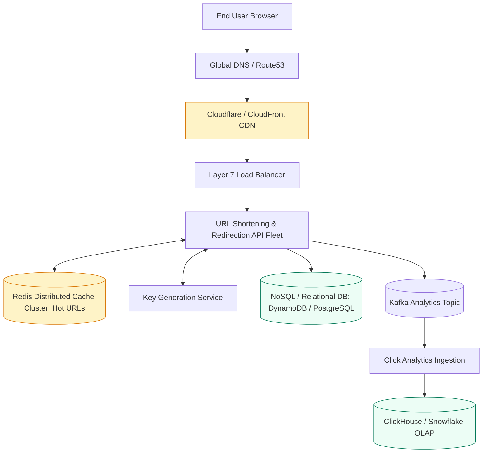
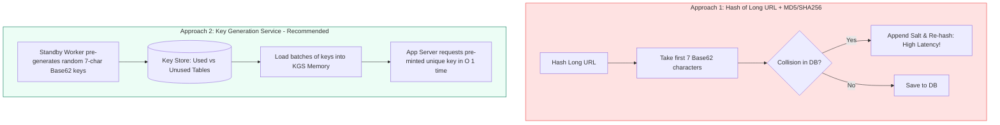
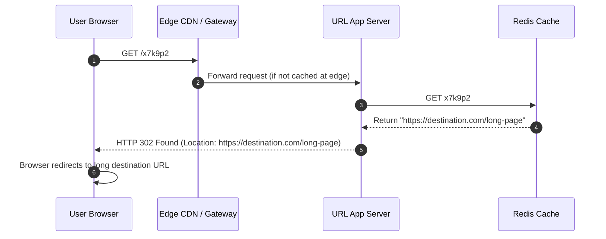

# Case Study 1: Designing a Global URL Shortener (TinyURL / Bitly)

A URL shortener converts long URLs into compact aliases (e.g. `https://tiny.url/x7k9p2`) and redirects users to the original destination. This classic problem tests a technical program manager's ability to handle high read-to-write ratios, evaluate hashing versus pre-generation, design caching layers, and plan capacity over multi-year horizons.

---

## 1. Requirements and Capacity Estimation

### Functional Requirements
1. **URL Shortening**: Given a long URL, generate a unique, short alias.
2. **Redirection**: Given a short alias, redirect the user to the original destination.
3. **Custom Aliases**: Optional user-defined short aliases (e.g. `https://tiny.url/tpm-guide`).
4. **Expiration & Analytics**: URLs expire after a default TTL; track click counts and geographic referrers.

### Non-Functional Requirements
- **High Availability**: 99.99% uptime (redirections must not fail).
- **Ultra-Low Latency**: Redirection lookup under 15ms.
- **Read-Heavy System**: Projected 10:1 to 100:1 read-to-write ratio.

### Back-of-the-Envelope Capacity Math

1. **Traffic Sizing**:
   - New URLs shortened: **500 Million per month**.
   - Write QPS: $500,000,000 / (2.5 \times 10^6\text{ sec}) \approx 200\text{ writes/sec}$. Peak: $400\text{ writes/sec}$.
   - Redirection clicks (100:1 ratio): **50 Billion per month**.
   - Read QPS: $50,000,000,000 / (2.5 \times 10^6\text{ sec}) \approx 20,000\text{ reads/sec}$. Peak: $40,000\text{ reads/sec}$.
2. **Storage Sizing (5 Years)**:
   - Total URLs over 5 years: $500\text{M/month} \times 12 \times 5 = 30\text{ Billion records}$.
   - Average record size (Short Key 7 bytes, Long URL 500 bytes, Created At 8 bytes, User ID 8 bytes) $\approx 600\text{ bytes}$.
   - Total 5-Year Storage: $30\text{ Billion} \times 600\text{ bytes} \approx 18\text{ Terabytes}$.
3. **Cache Memory Sizing (80/20 Rule)**:
   - Daily reads: $50\text{B} / 30 \approx 1.66\text{ Billion reads/day}$.
   - Top 20% hot URLs: $1.66\text{B} \times 0.20 = 332\text{ Million URLs}$.
   - Memory needed: $332\text{M} \times 600\text{ bytes} \approx 200\text{ GB RAM}$. A modest 2-node Redis cluster easily holds this.

---

## 2. High-Level Architecture

---

## 3. Short Key Generation: The Core Technical Decision

How do we generate a unique 7-character string?

Using **Base62 encoding** (`[a-z, A-Z, 0-9]`):
- A 7-character string provides $62^7 \approx 3.52\text{ Trillion}$ unique URLs, far exceeding our 30 Billion requirement.

### Approach Comparison

- **Why KGS Wins**: The Key Generation Service eliminates runtime collisions and expensive database lookup retries. Keys are pre-minted, validated for profanity, and handed out instantaneously ($O(1)$) to app servers in memory chunks.

---

## 4. Redirection Mechanics: HTTP 301 vs HTTP 302

When a user visits `https://tiny.url/x7k9p2`, the server issues an HTTP redirect. Choosing between 301 and 302 is a classic architectural trade-off:

### The 301 vs 302 Trade-off Matrix

| Status Code | Meaning | Browser Behavior | Impact on Analytics | Origin Server Load |
| :--- | :--- | :--- | :--- | :--- |
| **HTTP 301** | Moved Permanently | Browser caches redirect locally forever | **Fails to capture analytics**: Subsequent clicks bypass server completely | Lowest server load |
| **HTTP 302** | Found (Temporary) | Browser checks back with server on every click | **Accurate analytics**: Every single click hits edge/server for tracking | Higher server load |

> **Recommendation**: Use **HTTP 302 Found** (or HTTP 307 Temporary Redirect) so the platform can accurately track click metrics, geographic referrers, and device types.

---

## 5. Data Modeling

Given 30 Billion records and high read volume with simple primary key lookups, a distributed Key-Value / Document store like **AWS DynamoDB** or **Cassandra** is ideal.

### DynamoDB Table Schema: `url_mapping`
- **Partition Key (PK)**: `short_key` (String, e.g. `"x7k9p2"`)
- `original_url`: String (e.g. `"https://example.com/very/long/path"`)
- `user_id`: String (e.g. `"usr_98124"`)
- `created_at`: Unix Timestamp
- `expires_at`: Unix Timestamp (DynamoDB native TTL automatically deletes expired items)

---

## 6. TPM Execution Lens: Risks and Mitigation

| Program Risk | Impact | Engineering Mitigation |
| :--- | :--- | :--- |
| **Malicious Links & Phishing** | Brand damage, security blacklisting by Google Safe Browsing | Asynchronous security scanner checks target URLs against Google Safe Browsing API before activating alias |
| **KGS Server Crash** | Multiple servers assigning duplicate keys | KGS allocates exclusive key ranges (e.g. Server 1 gets keys 1-1,000,000; Server 2 gets 1,000,001-2,000,000) using Apache ZooKeeper |
| **Analytics Processing Lag** | Click count dashboards display stale data | Decouple click logging to Apache Kafka; process asynchronously without blocking the redirect thread |

---

## 7. TPM Review Checklist

- [ ] Has the team confirmed HTTP 302 vs 301 redirection based on business analytics requirements?
- [ ] Is the Key Generation Service isolated to prevent runtime collision delays?
- [ ] Are expired records automatically purged using native database TTL features?
- [ ] Is an abuse detection pipeline included to detect malware and phishing campaigns?
- [ ] Is the Redis cache sized to absorb 80% of daily read volume?
