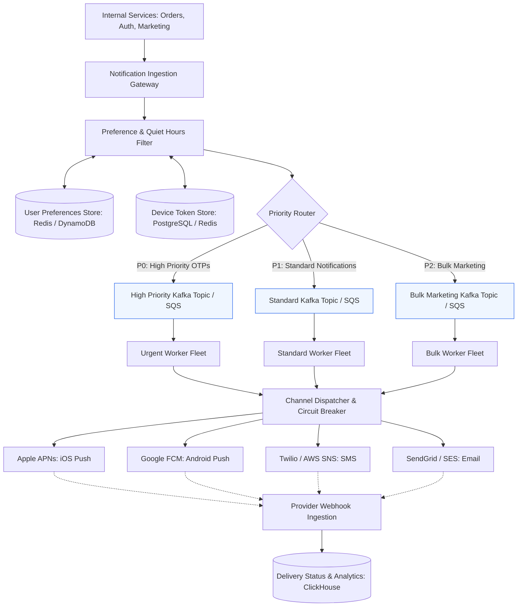
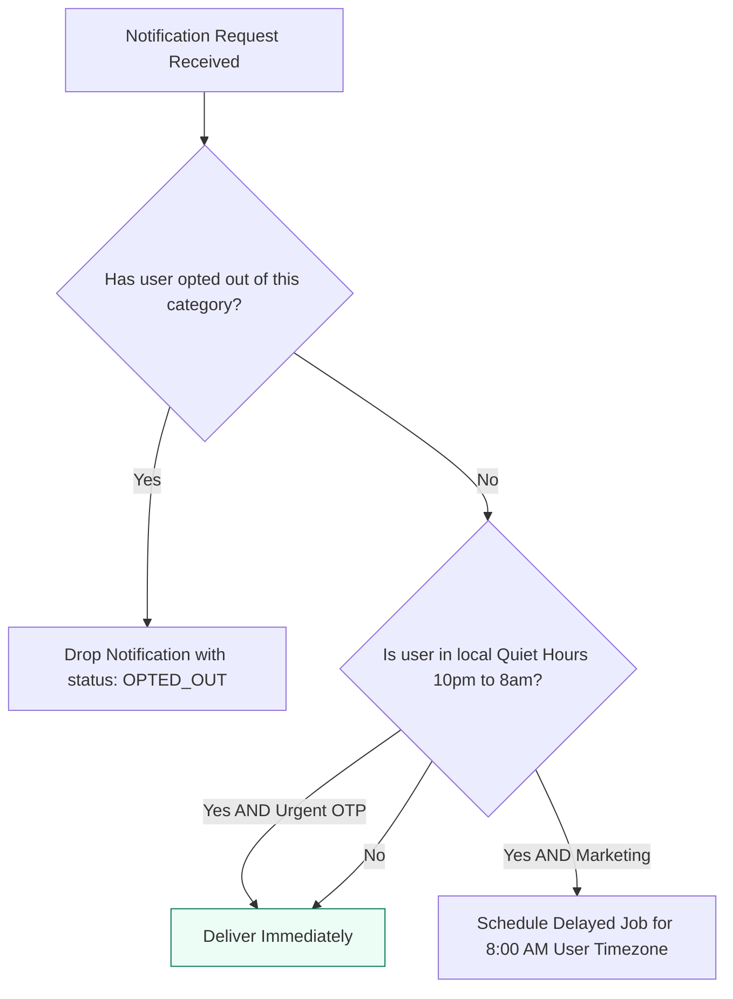
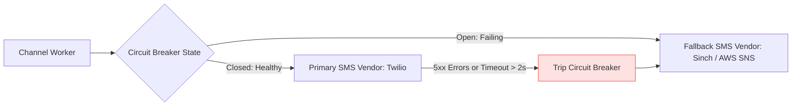

# Case Study 2: Scalable Multi-Channel Notification Engine

A global notification platform delivers transactional and marketing messages across multiple channels (iOS/Android Push, SMS, and Email). For a technical program manager, this architecture involves priority queuing, downstream third-party vendor management, customer quiet-hour compliance, and cost optimization.

---

## 1. Requirements and Capacity Estimation

### Functional Requirements
1. **Multi-Channel Dispatch**: Support Mobile Push (APNs / FCM), SMS (Twilio / Sinch), and Email (SendGrid / AWS SES).
2. **Priority Tiers**: Urgent transactional messages (e.g. 2-factor OTPs) must be delivered within 5 seconds. Bulk marketing blasts must not starve urgent messages.
3. **User Preferences & Quiet Hours**: Users can opt out of channels and define do-not-disturb hours.
4. **Delivery Status Tracking**: Track delivered, clicked, bounced, and failed notifications.

### Non-Functional Requirements
- **High Throughput**: Capable of sending 500 Million notifications daily.
- **Resilience**: Third-party vendor outages must not drop messages.
- **Cost Efficiency**: Minimize SMS costs by attempting push notifications first.

### Capacity Calculations
- **Daily Volume**: 500 Million notifications per day.
- **Average QPS**: $500,000,000 / 86,400 \approx 5,800\text{ notifications/sec}$.
- **Peak QPS**: Peak traffic occurs during major events (flash sales, breaking news). Sized for $4\times$ multiplier: **24,000 notifications/sec**.
- **Payload Size**: Average notification payload is $1\text{ KB}$.
- **Daily Ingestion Bandwidth**: $5,800 \times 1\text{ KB} \approx 5.8\text{ MB/s}$ (well within standard networking limits).

---

## 2. End-to-End Architecture

---

## 3. Core Architectural Mechanisms

### 1. Priority Queuing & Anti-Starvation
Without separate queues, a marketing team sending 10 million newsletter emails will fill the message broker, delaying a user's critical Two-Factor Authentication (OTP) SMS code by several minutes.

- **P0 (Urgent / OTP)**: Dedicated worker fleet with low latency SLAs (< 5 seconds delivery target).
- **P1 (Transactional)**: Order confirmations, flight delay alerts.
- **P2 (Bulk Marketing)**: Promotional discounts and weekly summaries. Processed during off-peak hours.

### 2. Preference and Quiet-Hour Filtering
Before enqueuing a notification, the engine verifies customer rules:

### 3. Deduplication and Frequency Capping
To prevent spamming users:
- **Deduplication Key**: A hash of `(user_id, template_id, target_entity)` stored in Redis with a 5-minute TTL prevents duplicate sends caused by client retry loops.
- **Frequency Capping**: Maximum 3 non-critical marketing notifications per user per 24 hours.

---

## 4. Vendor Management and Third-Party Resilience

External providers (Twilio, SendGrid, APNs) have hard rate limits and experience intermittent outages.

### Device Token Invalidation Lifecycle
When users uninstall an application, APNs and FCM return error codes (e.g. `BadDeviceToken` or `NotRegistered`).
- The worker must immediately update the `device_tokens` database to deactivate the token.
- Continuing to send push requests with dead tokens damages the organization's sender reputation with Apple and Google, leading to throttling.

---

## 5. TPM Execution Lens: Cost and Risk Management

### The SMS Cost Optimization Strategy
- **The Financial Problem**: Push notifications are virtually free ($0 per message). SMS messages cost $0.007 to $0.05 per message. At 500 million messages, sending SMS indiscriminately results in millions of dollars in monthly vendor bills.
- **The Smart Routing Cascade**:
  1. Check if user has an active registered device token for iOS/Android.
  2. If yes, send Mobile Push Notification.
  3. Wait 30 seconds for delivery receipt. If unconfirmed and the message is marked P0 (e.g. fraud alert), fall back to SMS.
  4. This cascade routinely saves enterprises 60% to 80% on messaging bills.

---

## 6. TPM Review Checklist

- [ ] Are urgent transactional OTPs separated from marketing blasts using isolated queues?
- [ ] Is fallback routing configured with secondary third-party providers for SMS and email?
- [ ] Are expired or invalid mobile push tokens cleaned up automatically upon receiving provider errors?
- [ ] Is frequency capping implemented to protect user retention and avoid spam fatigue?
- [ ] Has the team calculated the cost impact of SMS vs Push routing?
