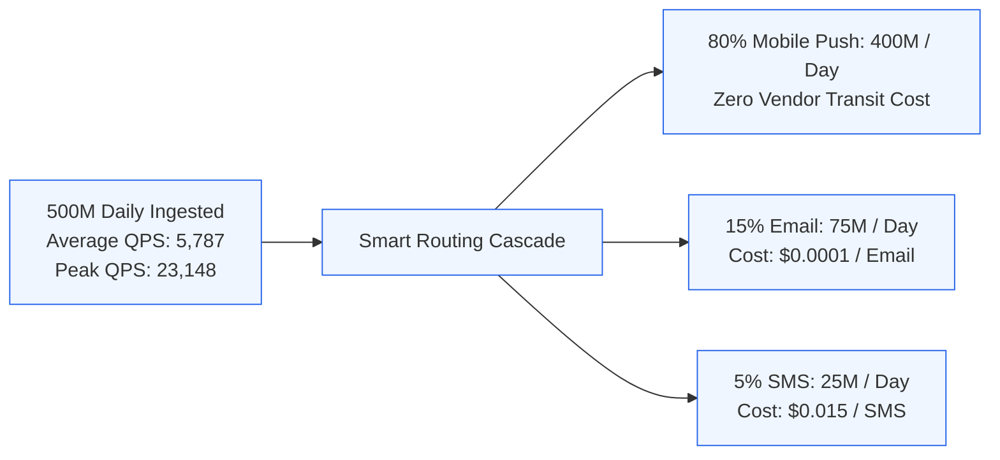
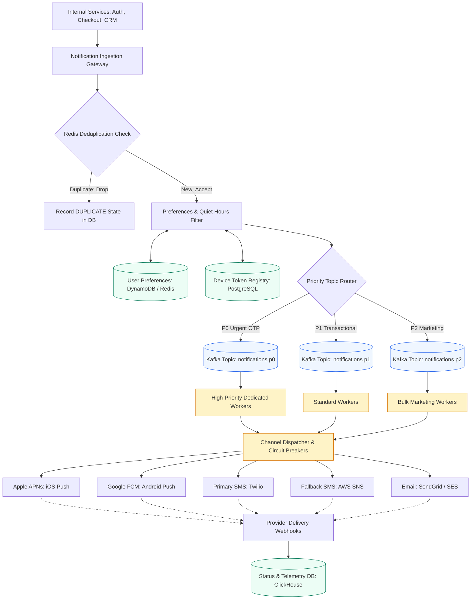
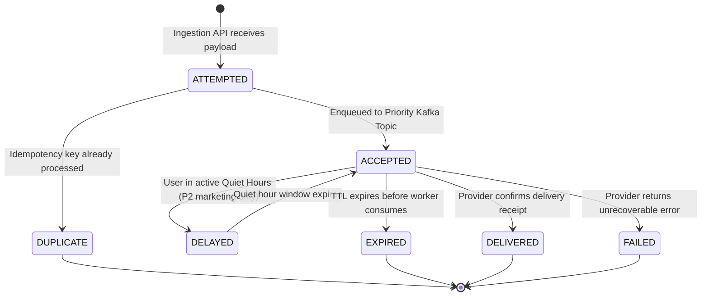
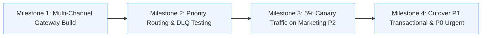

# Case Study 2: Scalable Multi-Channel Notification Engine

[Home](../README.md) > [Module 5: Real-World Case Studies](./README.md) > **Case Study 5.2: Notification Engine**

---

## 1. Problem Statement and Scope

A global notification platform delivers transactional and promotional messages across multiple channels: Mobile Push (Apple APNs, Google FCM), SMS (Twilio, Sinch, AWS SNS), and Email (SendGrid, AWS SES). For a Technical Program Manager, this system involves priority queuing, downstream third-party vendor management, customer quiet-hour compliance, and significant cost optimization.

### In-Scope Functional Capabilities
- Multi-channel delivery (iOS Push, Android Push, SMS, Email).
- Strict priority tiers (P0 urgent OTPs, P1 transactional, P2 bulk marketing).
- User notification preferences, channel opt-outs, and quiet-hour scheduling.
- Automated vendor circuit breaking and fallback routing.
- End-to-end delivery tracking across discrete lifecycle states: `ATTEMPTED`, `ACCEPTED`, `DELIVERED`, `FAILED`, `DUPLICATE`, `DELAYED`, and `EXPIRED`.

### Out-of-Scope (Explicit Boundaries)
- Rich email template HTML drag-and-drop authoring tools.
- Real-time customer support chat messaging.
- Mobile push token generation inside client operating systems.

---

## 2. Requirements and SLAs

### Functional Requirements
1. **Multi-Channel Dispatch**: Distribute messages via the cheapest viable channel that satisfies delivery speed requirements.
2. **Priority Isolation**: High-volume marketing campaigns must never delay or starve critical security OTPs.
3. **Deduplication**: Prevent sending duplicate notifications caused by client retry storms.

### Non-Functional Requirements & SLAs
- **P0 Delivery Latency**: 99.9% of P0 messages (Two-Factor OTPs) delivered in under **5 seconds**.
- **P1 Delivery Latency**: 99.0% of P1 messages (Order confirmations) delivered in under **60 seconds**.
- **P2 Delivery Latency**: Best effort; scheduled during off-peak hours (delivery within 2 hours).
- **Throughput**: Sized for **500 Million notifications per day**.
- **System Availability**: 99.99% uptime for message ingestion.

---

## 3. Capacity Planning and Calculations



### Ingestion Throughput Sizing
- **Daily Ingestion**: 500 Million notifications per day.
- **Average Ingestion QPS**:
  $$\text{Average QPS} = \frac{500,000,000}{86,400\text{ seconds}} \approx \mathbf{5,787\text{ notifications/sec}}$$
- **Peak Ingestion QPS (4x Multiplier for flash events)**:
  $$\text{Peak QPS} = 5,787 \times 4 \approx \mathbf{23,148\text{ notifications/sec}}$$
- **Average Ingestion Payload**: $1\text{ KB}$ (includes recipient IDs, template variables, metadata).
- **Ingestion Network Bandwidth**:
  $$\text{Bandwidth} = 23,148\text{ QPS} \times 1\text{ KB} \approx 23.1\text{ MB/s} = \mathbf{185\text{ Mbps ingress}}$$

### Storage Sizing (90-Day Operational Log Horizon)
- Daily storage for notification logs:
  $$\text{Daily Storage} = 500\text{M} \times 1\text{ KB} = 500\text{ GB/day}$$
- **90-Day Retention Storage**:
  $$\text{Storage} = 500\text{ GB/day} \times 90 \approx \mathbf{45\text{ Terabytes}}$$
- After 90 days, automated lifecycle policies compress and archive logs to Amazon S3 Glacier Flexible for statutory audit retention.

### Financial Cost Optimization Modeling: SMS vs Push
- **Unoptimized Strategy (Blind SMS fallback)**:
  - If 500M messages were sent indiscriminately via SMS at $\$0.015$ per SMS:
    $$\text{Annual Cost} = 500,000,000 \times \$0.015 \times 365 = \mathbf{\$2.73\text{ Billion / Year}}$$
- **Optimized Smart-Routing Cascade**:
  - 80% delivered via Mobile Push (APNs / FCM): $400\text{M} \times \$0.0000 = \$0$.
  - 15% delivered via Email (SendGrid / SES): $75\text{M} \times \$0.0001 \times 365 = \$2.73\text{M / Year}$.
  - 5% delivered via SMS (Critical OTPs or uninstalled app): $25\text{M} \times \$0.015 \times 365 = \$136.8\text{M / Year}$.
  - **Net Annual Savings**: Over **\$2.5 Billion** in carrier messaging fees.

---

## 4. End-to-End System Architecture



---

## 5. API Contracts and Core Data Model

### API Contracts

#### 1. Ingest Notification
- **Endpoint**: `POST /api/v1/notifications`
- **Headers**:
  - `Content-Type: application/json`
  - `Idempotency-Key: <UUID>`
- **Request Payload**:
  ```json
  {
    "recipient_user_id": "usr_892134",
    "priority": "P0",
    "category": "AUTH_OTP",
    "template_id": "tpl_2fa_sms_01",
    "template_params": {
      "code": "849201",
      "expiry_mins": 5
    },
    "preferred_channels": ["PUSH", "SMS"]
  }
  ```
- **Response Payload (HTTP 202 Accepted)**:
  ```json
  {
    "notification_id": "notif_98712345",
    "status": "ACCEPTED",
    "recipient_user_id": "usr_892134",
    "priority": "P0",
    "enqueued_at": "2026-10-19T14:15:00Z"
  }
  ```

### Discrete Notification Lifecycle States



### Core Data Model (PostgreSQL / DynamoDB)

Table Name: `device_tokens`

| Column | Type | Constraints | Description |
| :--- | :--- | :--- | :--- |
| `user_id` | UUID | Foreign Key | Owner account identifier |
| `device_token` | VARCHAR(255) | **Primary Key** | APNs or FCM push token |
| `platform` | VARCHAR(10) | `IOS` or `ANDROID` | Target operating system |
| `is_active` | BOOLEAN | Default: `TRUE` | Deactivated when APNs returns `BadDeviceToken` |
| `updated_at` | TIMESTAMP | Not Null | Timestamp of last token refresh |

Table Name: `notification_events` (ClickHouse / TimescaleDB)
- **Partition Key**: `toYYYYMM(event_time)`
- **Sorting Key**: `(tenant_id, priority, status, event_time)`
- **Columns**: `notification_id`, `recipient_id`, `channel`, `provider`, `status`, `retry_count`, `latency_ms`.

---

## 6. Architectural Decision Records (ADRs) and Alternatives

### Architectural Comparison Matrix

| Criteria | Alternative 1: Single Shared Queue | Alternative 2: Priority Partitioned Kafka - Recommended | Alternative 3: AWS SQS FIFO Queues |
| :--- | :--- | :--- | :--- |
| **P0 Starvation Risk** | High (Bulk marketing blasts block OTPs) | **Zero starvation** (Isolated worker fleets per topic) | Low (if priority queues separated) |
| **Throughput Ceiling** | Moderate (~10,000 msgs/sec) | **Extreme** (1,000,000+ msgs/sec via partitions) | Moderate (~3,000 msgs/sec batch limit) |
| **Ordering Guarantee** | Best effort | Strict chronological order per partition key | Strict total FIFO order |
| **Operational Cost** | Low | Moderate (Requires Kafka cluster maintenance) | High (Pay-per-request pricing at 500M msgs/day) |

### Decision Outcome
**Adopt Alternative 2 (Priority Partitioned Kafka Topics)**. Dedicating independent topics and worker fleets for P0, P1, and P2 guarantees that marketing campaigns never delay urgent security codes, while Kafka partition parallelism scales to peak flash sale volumes.

---

## 7. Failure-Mode and Recovery Matrix (FMEA)

| Failure Scenario | Detection Mechanism | Immediate System Behavior | Automated Recovery | Manual Runbook Action |
| :--- | :--- | :--- | :--- | :--- |
| **Twilio Primary SMS 5xx Outage** | Circuit Breaker trips (> 5% errors over 10s) | Worker immediately routes SMS traffic to secondary vendor (AWS SNS / Sinch) | Circuit breaker enters Half-Open state after 30s to test Twilio recovery | Check Twilio status page; notify vendor account manager |
| **APNs BadDeviceToken Error** | APNs returns HTTP 410 Gone | Worker marks notification as failed for push; falls back to SMS if P0 | Worker asynchronously updates `device_tokens` setting `is_active = FALSE` | Run weekly cron cleanup to purge tokens inactive > 90 days |
| **Redis Deduplication Cache Down** | Connection timeout to Redis cluster | System logs warning; bypasses deduplication to ensure P0 messages deliver | Redis Cluster Sentinel initiates replica failover in under 5 seconds | Verify Redis memory saturation and eviction metrics |
| **Downstream Webhook Flooding** | Provider webhook worker CPU > 85% | Ingestion rate temporarily exceeds database write capacity | Webhook receivers write directly to Kafka topic before ClickHouse ingestion | Increase webhook worker pod count via Kubernetes HPA |

---

## 8. Security, Privacy, and Regulatory Governance

1. **Quiet-Hour Enforcement**:
   - For all non-P0 marketing notifications, the engine calculates the user's local timezone.
   - If local time is between 10:00 PM and 8:00 AM, the notification transitions to `DELAYED` and is scheduled in a delay queue for 8:05 AM local delivery.
2. **PII and Financial Masking**:
   - Two-Factor OTP codes and financial account balances are omitted from persistent notification event logs. Logs store `template_id` and masked values (e.g. `******`).
3. **GDPR Right to be Forgotten**:
   - When a user deletes their account, device tokens and notification preferences are purged immediately. Historic delivery audit logs have `recipient_user_id` replaced with a cryptographic hash.

---

## 9. Observability and Monitoring Thresholds

| Metric Name | Telemetry Type | Target Baseline | P1 Critical Alert Threshold |
| :--- | :--- | :--- | :--- |
| **P0 End-to-End Delivery Latency** | Metric (Histogram) | $< 3.0\text{ seconds}$ | $> 5.0\text{ seconds}$ for 2 consecutive minutes |
| **P0 Kafka Consumer Lag** | Metric (Gauge) | $< 100\text{ messages}$ | $> 1,000\text{ messages}$ (Triggers auto-scaling) |
| **Third-Party Circuit Breaker State** | Metric (State / Enum) | `CLOSED` | `OPEN` (Triggers Slack / PagerDuty notification) |
| **APNs/FCM Invalid Token Rate** | Metric (Counter) | $< 1.0\%$ | $> 5.0\%$ (Indicates token sync corruption) |

---

## 10. Migration, Launch Gates, and TPM Execution Plan

### Phased Migration Milestones



### RACI Matrix

| Program Deliverable | Engineering Lead | Senior TPM | Security Architect | Vendor Lead (Twilio/SendGrid) |
| :--- | :--- | :--- | :--- | :--- |
| **Smart Routing Engine** | **Accountable** | Consulted | Informed | Informed |
| **Carrier Rate Limit Procurement** | Consulted | **Accountable** | Informed | Responsible |
| **Quiet Hours & GDPR Compliance** | Responsible | **Accountable** | Consulted | Informed |
| **Vendor Contract SLAs & Credits** | Informed | **Accountable** | Informed | Responsible |

---

## 11. Practice System Design Questions and Model Answers

### Question 1: How do you prevent a marketing blast from delaying a user's critical Two-Factor Authentication (OTP)?
**Model Answer**:
We enforce strict physical and logical queue segregation. Ingestion APIs evaluate the priority tag (`P0` vs `P2`). Critical OTPs enter an isolated Kafka topic (`notifications.p0`) served by a dedicated, pre-provisioned worker fleet with low concurrency limits and strict latency SLAs. Bulk marketing enters `notifications.p2` served by an elastic worker fleet that throttles consumption based on downstream provider rate limits, guaranteeing zero resource contention.

### Question 2: If a user uninstalls the mobile app, how does the system prevent wasting resources on dead push tokens?
**Model Answer**:
When APNs or FCM attempts delivery to an uninstalled device, the provider returns an explicit HTTP 410 Gone error with error codes like `BadDeviceToken` or `NotRegistered`. The channel worker captures this response, publishes an invalidation event to `tokens.invalidated`, and updates the `device_tokens` table to set `is_active = FALSE`. Subsequent notifications for that user automatically skip the push attempt and fall back to SMS/Email, protecting our sender reputation.

---

## 12. Primary Sources and Further Reading

- **Apple Push Notification Service Guide**: *Sending Notification Requests to APNs* (Apple Developer Documentation).
- **Firebase Cloud Messaging**: *FCM Architectural Overview* (Google Cloud Documentation).
- **Twilio SMS Architecture**: *Handling Rate Limits and High-Volume Messaging* (Twilio Docs).
- *Enterprise Integration Patterns* by Gregor Hohpe (Addison-Wesley, 2003) - Priority Queue Pattern.
