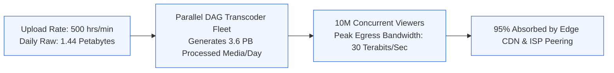
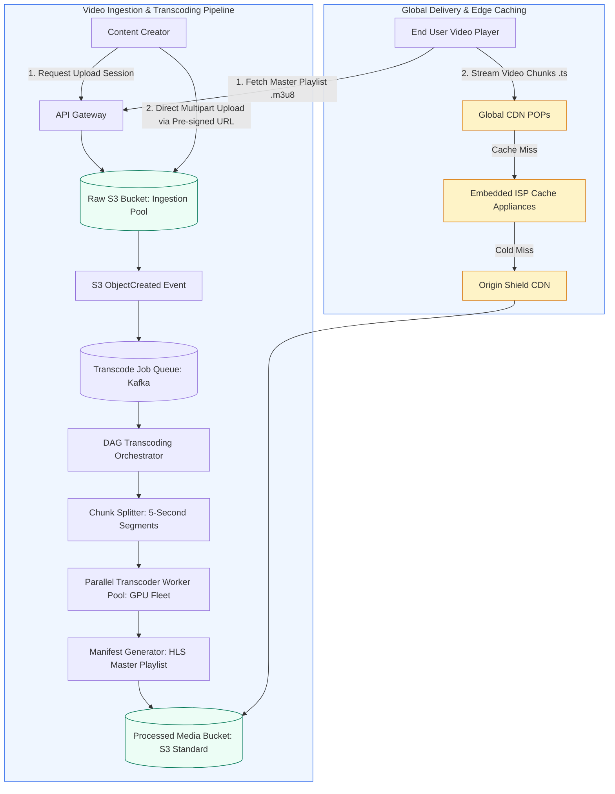
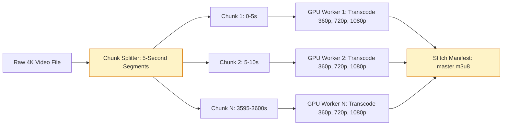
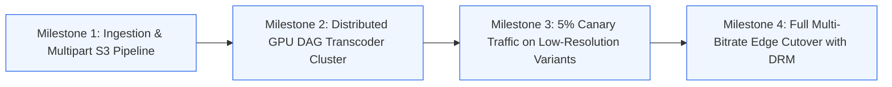

# Case Study 3: Global Video Streaming Platform (YouTube / Netflix)

[Home](../README.md) > [Module 5: Real-World Case Studies](./README.md) > **Case Study 5.3: Video Streaming Platform**

---

## 1. Problem Statement and Scope

Video streaming platforms distribute massive multimedia files across the globe with minimal buffering, sub-second start latency, and adaptive quality. For technical program managers, this system design tests your ability to orchestrate heavy asynchronous compute pipelines, manage multi-terabit bandwidth cost structures, and deploy edge content distribution networks.

### In-Scope Functional Capabilities
- Direct video upload via pre-signed object storage URLs.
- Video chunking and distributed Directed Acyclic Graph (DAG) transcoding.
- Multi-resolution encoding (360p, 720p, 1080p, 4K) using H.264 and AV1 codecs.
- Adaptive Bitrate Streaming (HLS and MPEG-DASH) via master playlist manifests.
- Multi-tier edge caching with Internet Service Provider (ISP) embedded CDN appliances.

### Out-of-Scope (Explicit Boundaries)
- Live interactive streaming with low-latency WebRTC (e.g. Twitch chat/stream sync).
- Real-time video recommendation algorithms and machine learning training pipelines.
- User comments and social reaction feeds.

---

## 2. Requirements and SLAs

### Functional Requirements
1. **Video Ingestion**: Creators upload raw video files of up to 50 GB.
2. **Transcoding Pipeline**: System converts uploaded videos into multiple resolutions and 5-second chunk segments.
3. **Smooth Playback**: Client players dynamically switch video resolutions without playback interruption based on fluctuating network bandwidth.

### Non-Functional Requirements & SLAs
- **Playback Availability**: **99.99% Uptime** (Users must not experience playback failure).
- **Video Start Time (VST)**: p95 under **1,000 milliseconds**.
- **Rebuffering Ratio**: Less than **0.5%** of total playback time spent buffering.
- **Transcoding Latency**: Processing time should not exceed $1.5\times$ the raw video duration (e.g. a 60-minute video transcode completes in under 90 minutes).

---

## 3. Capacity Planning and Calculations



### Video Ingestion Math (YouTube Scale)
- **Upload Rate**: **500 hours of video uploaded every minute**.
- **Daily Hours Uploaded**:
  $$\text{Daily Hours} = 500\text{ hrs/min} \times 60 \times 24 = \mathbf{720,000\text{ hours/day}}$$
- **Raw Storage Calculation**:
  - Compressed high-quality master copy ($2\text{ GB per hour}$):
    $$\text{Daily Raw Ingestion} = 720,000 \times 2\text{ GB} = \mathbf{1.44\text{ Petabytes/day}}$$
- **Transcoded Multi-Resolution Storage**:
  - Generating 360p ($0.4\text{ GB/hr}$), 720p ($1.0\text{ GB/hr}$), 1080p ($2.0\text{ GB/hr}$), and 4K ($4.0\text{ GB/hr}$) totals $\approx 7.4\text{ GB per hour}$ across all resolutions.
  - Total Daily Processed Storage: $720,000 \times 7.4\text{ GB} \approx \mathbf{5.33\text{ Petabytes/day}}$.
  - 5-Year Processed Media Storage: $5.33\text{ PB/day} \times 365 \times 5 \approx \mathbf{9.7\text{ Exabytes}}$.

### Playback Streaming Bandwidth Math
- **Active Viewers**: **100 Million Daily Active Viewers**.
- Average watch time: **30 minutes per viewer per day**.
- Average streaming bitrate across fleet: **3 Mbps** (Weighted average across 720p and 1080p).
- **Peak Concurrent Viewers**: 10% of daily active users streaming simultaneously during evening peak hours:
  $$\text{Peak Concurrent Viewers} = 100,000,000 \times 0.10 = \mathbf{10,000,000\text{ concurrent streams}}$$
- **Peak Egress Bandwidth**:
  $$\text{Peak Egress} = 10,000,000 \times 3\text{ Mbps} = 30,000,000\text{ Mbps} = \mathbf{30\text{ Terabits per second (Tbps)}}$$

### Financial Bandwidth Analysis: Why Edge CDNs and ISP Peering are Mandatory
- Standard public cloud egress (AWS CloudFront / GCP Egress) costs approximately $\$0.02$ to $\$0.05$ per GB.
- 30 Tbps streaming sustained for 4 hours of peak daily viewing generates:
  $$\text{Data Transferred} = \frac{30,000\text{ Gbps}}{8\text{ bits/byte}} \times 3,600 \times 4 \approx 54\text{ Petabytes/day}$$
- At $\$0.02$ per GB ($\$20,000$ per PB), un-peered cloud egress would cost **\$1.08 Million per day** (\$394 Million annually).
- **The Netflix Open Connect Architecture**: Deploying custom caching appliances inside local ISP datacenters offloads over **95%** of traffic, reducing public transit fees to near zero.

---

## 4. End-to-End System Architecture



---

## 5. API Contracts and Core Data Model

### API Contracts

#### 1. Initiate Upload Session
- **Endpoint**: `POST /api/v1/videos/upload-session`
- **Request Payload**:
  ```json
  {
    "creator_id": "usr_98124",
    "title": "Distributed Systems Handbook Walkthrough",
    "file_size_bytes": 4294967296,
    "file_format": "mp4",
    "duration_seconds": 3600
  }
  ```
- **Response Payload (HTTP 200 OK)**:
  ```json
  {
    "video_id": "vid_87213459",
    "upload_session_id": "sess_009988",
    "upload_url": "https://ingest.storage.com/raw/vid_87213459.mp4?X-Amz-Signature=...",
    "chunk_size_bytes": 10485760,
    "expires_at": "2026-10-19T18:00:00Z"
  }
  ```

#### 2. Fetch Master Playlist Manifest
- **Endpoint**: `GET /api/v1/videos/{video_id}/master.m3u8`
- **Response (HTTP 200 OK)**:
  ```m3u8
  #EXTM3U
  #EXT-X-VERSION:6
  #EXT-X-STREAM-INF:BANDWIDTH=800000,RESOLUTION=640x360,CODECS="avc1.4d401e,mp4a.40.2"
  360p/index.m3u8
  #EXT-X-STREAM-INF:BANDWIDTH=2500000,RESOLUTION=1280x720,CODECS="avc1.4d401f,mp4a.40.2"
  720p/index.m3u8
  #EXT-X-STREAM-INF:BANDWIDTH=5000000,RESOLUTION=1920x1080,CODECS="avc1.640028,mp4a.40.2"
  1080p/index.m3u8
  #EXT-X-STREAM-INF:BANDWIDTH=15000000,RESOLUTION=3840x2160,CODECS="av01.0.12M.08,mp4a.40.2"
  4k/index.m3u8
  ```

### Core Data Model (PostgreSQL / DynamoDB)

Table Name: `videos`
- **PK**: `video_id` (UUID)
- **Attributes**: `creator_id`, `title`, `duration_seconds`, `status` (`UPLOADING`, `TRANSCODING`, `READY`, `FAILED`), `manifest_url`, `created_at`.

Table Name: `transcoding_tasks`
- **PK**: `task_id` (UUID)
- **GSI**: `video_id`
- **Attributes**: `video_id`, `chunk_index`, `resolution`, `codec`, `status` (`PENDING`, `IN_PROGRESS`, `COMPLETED`, `FAILED`), `retry_count`, `worker_host`.

---

## 6. Architectural Decision Records (ADRs) and Alternatives



### Architectural Comparison Matrix

| Criteria | Alternative 1: Monolithic Transcoding | Alternative 2: Chunk-Based DAG Transcoding - Recommended |
| :--- | :--- | :--- |
| **Transcoding Latency** | Slow (A 2-hour 4K movie takes 3+ hours on a single machine) | **Ultra-fast** (Hundreds of workers process chunks in parallel in 5 mins) |
| **Worker Failure Blast Radius** | High (Worker crash at 99% forces full re-transcode of 2-hour file) | **Minimal** (Only the specific 5-second chunk is retried) |
| **Fast Seeking Support** | Difficult (Requires range-header parsing on monolithic file) | **Native** (Player simply fetches chunk corresponding to target timestamp) |
| **Compute Cost Profile** | Poor hardware utilization | High GPU efficiency through elastic batch worker fleets |

### Decision Outcome
**Adopt Alternative 2 (Chunk-Based DAG Transcoding)**. Splitting videos into discrete 5-second chunks parallelizes transcoding, isolates worker crashes, and supports seamless Adaptive Bitrate Streaming (HLS/DASH).

---

## 7. Failure-Mode and Recovery Matrix (FMEA)

| Failure Scenario | Detection Mechanism | Immediate System Behavior | Automated Recovery | Manual Runbook Action |
| :--- | :--- | :--- | :--- | :--- |
| **Transcoding GPU Worker Crashes** | Worker heartbeat timeout (> 15s) in DAG engine | Chunk status reverts from `IN_PROGRESS` to `PENDING` | Orchestrator reassigns chunk to alternative healthy GPU worker | If worker fleet crashes repeatedly, check for corrupted source video chunks |
| **Edge CDN POP Outage** | Synthetic latency probes fail from geographic region | Anycast BGP border routers withdraw route to impaired POP | Traffic automatically re-routes to nearest adjacent regional CDN POP | Open P1 ticket with CDN provider (Cloudflare / Fastly) |
| **Manifest Generation Corruption** | Validation worker verifies playlist syntax | Video status marked `FAILED_VALIDATION` before public indexing | Orchestrator re-runs manifest compilation step | Inspect manifest generator logs for missing chunk indices |
| **Storage Class Cost Overrun** | Monthly AWS S3 Cost Allocation Tag alarm | Budget alert triggered when storage exceeds monthly forecast | S3 Lifecycle policy automatically moves videos $> 30$ days old to S3 Infrequent Access | Audit video watch count metrics; adjust lifecycle transition windows |

---

## 8. Security, DRM, and Content Protection

1. **Digital Rights Management (DRM)**:
   - Video chunks are encrypted using AES-128 encryption.
   - Master playlist manifests deliver encryption key URIs guarded by DRM license servers (Apple FairPlay, Google Widevine, Microsoft PlayReady).
2. **Copyright & Content ID Fingerprinting**:
   - During chunking, an asynchronous worker extracts acoustic and visual perceptual hashes, comparing them against the global copyright registry before activating the public video link.
3. **Geo-Fencing and Signed Cookies**:
   - Streaming URLs are signed with short-lived HMAC tokens (15-minute expiration) and validated against client geographic location to enforce regional licensing boundaries.

---

## 9. Observability and Monitoring Thresholds

| Metric Name | Telemetry Type | Target Baseline | P1 Critical Alert Threshold |
| :--- | :--- | :--- | :--- |
| **Video Start Time (VST)** | Metric (Histogram) | $< 1,000\text{ms}$ | $> 2,500\text{ms}$ for 5 consecutive minutes |
| **Rebuffering Ratio** | Metric (Gauge) | $< 0.5\%$ | $> 1.5\%$ (Indicates widespread edge congestion) |
| **CDN Cache Hit Ratio (CHR)** | Metric (Gauge) | $> 95\%$ | $< 85\%$ (Causes origin egress cost spike) |
| **Transcoder Queue Lag** | Metric (Gauge) | $< 500\text{ chunks}$ | $> 10,000\text{ chunks}$ (Triggers GPU cluster auto-scale) |

---

## 10. Migration, Launch Gates, and TPM Execution Plan

### Phased Migration Milestones



### RACI Matrix

| Program Deliverable | Video Engineering Lead | Senior TPM | SRE / Infrastructure | Legal / Licensing |
| :--- | :--- | :--- | :--- | :--- |
| **DAG Chunking Architecture** | **Accountable** | Consulted | Informed | Informed |
| **ISP CDN Peering Negotiations** | Informed | **Accountable** | Responsible | Consulted |
| **DRM & Copyright Fingerprinting** | Responsible | Consulted | Informed | **Accountable** |
| **Egress Bandwidth Budget Governance** | Consulted | **Accountable** | Responsible | Informed |

---

## 11. Practice System Design Questions and Model Answers

### Question 1: How does Adaptive Bitrate Streaming (HLS) dynamically adjust resolution during a network drop?
**Model Answer**:
The client video player continuously measures the download duration and byte count of incoming 5-second video chunks. When a user enters poor cell coverage, the player calculates that chunk download time has exceeded playback buffer duration. The player reads the master playlist manifest (`master.m3u8`) and automatically requests the next chunk from the lower bitrate variant (e.g. dropping from `1080p/chunk_42.ts` to `360p/chunk_43.ts`). Because chunks are aligned at identical Key Frame (I-frame) intervals, the transition is seamless and prevents rebuffering.

### Question 2: How do you prevent long-tail videos from driving cloud storage bills into insolvency?
**Model Answer**:
We implement a tiered encoding and storage lifecycle strategy. Less than 20% of uploaded videos receive sustained views after 30 days. We encode newly uploaded videos in 360p and 720p immediately; 4K encoding is deferred until a video crosses 1,000 views within 24 hours. Furthermore, automated S3 Lifecycle policies transition raw source videos to S3 Glacier after 7 days, and move transcoded chunks with zero monthly views to S3 Infrequent Access or Archive Instant Access, slashing storage costs by 60% to 75%.

---

## 12. Primary Sources and Further Reading

- **Adaptive Streaming Protocol**: RFC 8216 - HTTP Live Streaming (Apple / IETF).
- **Netflix Open Connect Architecture**: *Open Connect Deployment Guide* (Netflix Partner Documentation).
- **Distributed Video Transcoding**: *Scaling Video Transcoding at YouTube* (Google Engineering Technical Presentation).
- **MPEG-DASH Specification**: ISO/IEC 23009-1: Dynamic Adaptive Streaming over HTTP.
