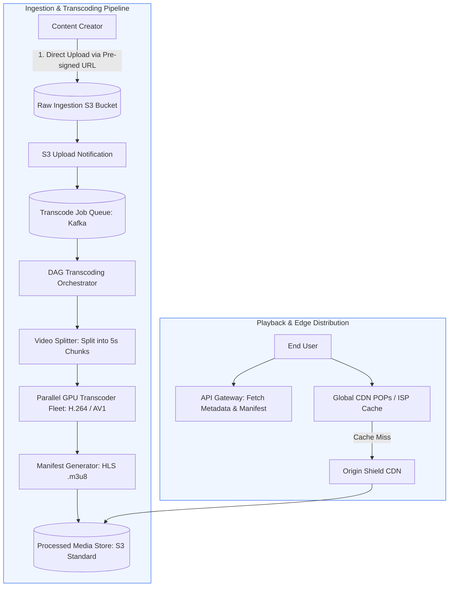
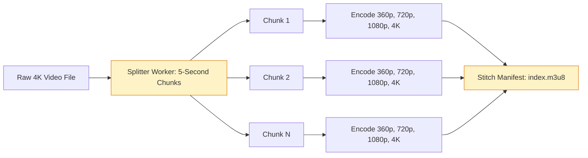
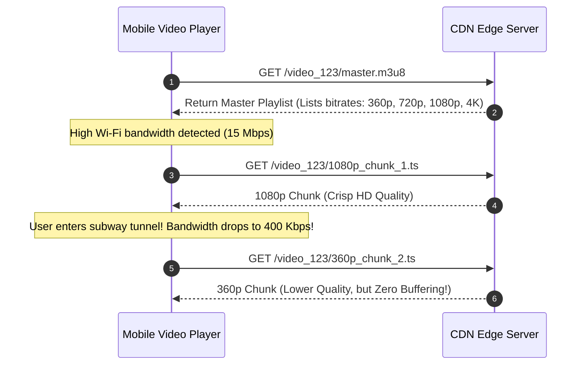
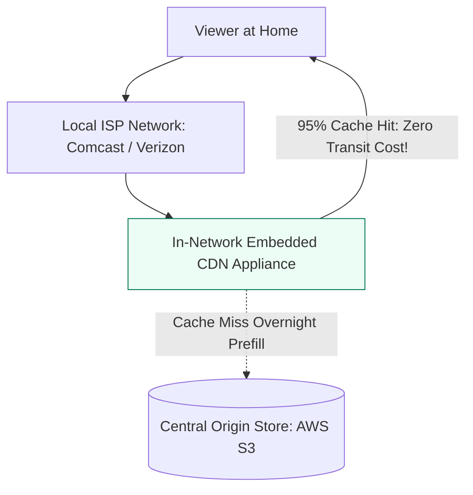

# Case Study 3: Global Video Streaming Platform (YouTube / Netflix)

Video streaming services distribute massive multimedia files across the globe with minimal buffering, high fidelity, and adaptive playback. For technical program managers, this system design tests your understanding of heavy asynchronous compute pipelines, multi-terabit bandwidth cost management, and edge content distribution networks.

---

## 1. Requirements and Capacity Estimation

### Functional Requirements
1. **Video Uploading**: Creators upload high-definition video files.
2. **Video Transcoding**: Convert uploaded raw videos into multiple resolutions (360p, 720p, 1080p, 4K) and formats.
3. **Adaptive Streaming**: Stream video smoothly across variable client bandwidths without buffering.
4. **Metadata & Search**: Support video titles, descriptions, view counts, and search indexing.

### Non-Functional Requirements
- **High Availability**: 99.99% uptime for playback.
- **Low Playback Start Latency**: Video starts playing within 1 second.
- **Global Scalability**: Capable of streaming to tens of millions of concurrent global viewers.

### Capacity Calculations (YouTube Scale)
- **Daily Active Viewers**: **100 Million**.
- **Upload Rate**: **500 hours of video uploaded every minute**.
- **Storage Math (Ingestion)**:
  - 1 hour of raw uncompressed video $\approx 30\text{ GB}$.
  - Daily raw uploaded: $500\text{ hrs/min} \times 60 \times 24 = 720,000\text{ hours/day}$.
  - Compressed master copy ($2\text{ GB/hour}$): $720,000 \times 2\text{ GB} \approx 1.44\text{ Petabytes/day}$.
  - Multi-resolution encoded copies (360p through 4K add $\approx 2.5\times$ storage): $1.44\text{ PB} \times 2.5 \approx 3.6\text{ PB/day}$.
- **Streaming Bandwidth Math (Egress)**:
  - Average user watches 30 minutes of video per day at an average bitrate of $3\text{ Mbps}$ (1080p).
  - Total concurrent streaming users at peak: **10 Million viewers**.
  - Peak Egress Bandwidth: $10,000,000 \times 3\text{ Mbps} = 30,000,000\text{ Mbps} = \mathbf{30\text{ Terabits per second (Tbps)}}$.
  - Egress of 30 Tbps requires a globally distributed Content Delivery Network (CDN) to prevent saturating cloud origin data centers.

---

## 2. End-to-End System Architecture

---

## 3. The Video Transcoding Pipeline

Videos cannot be stored as a single monolithic 50 GB file. They must be split, compressed, and encoded into chunks for distributed delivery.

### Why Chunk-Based Transcoding is Essential
1. **Parallel Speed**: Splitting a 2-hour movie into hundreds of 5-second chunks allows hundreds of GPU workers to transcode segments simultaneously in under 3 minutes.
2. **Failure Isolation**: If worker 14 crashes while encoding chunk 42, only that 5-second chunk is retried rather than restarting the entire 2-hour video.
3. **Fast Scrubbing**: When a viewer skips ahead to minute 45, the player only downloads chunk `chunk_0540.ts` without loading previous minutes.

---

## 4. Adaptive Bitrate Streaming (ABR)

Clients stream video using **HLS (HTTP Live Streaming)** or **MPEG-DASH**. These protocols dynamically adjust video quality in real time based on the user's available network speed.

### The Manifest File (`master.m3u8`)
The master playlist provides a catalog of resolution variants:
- `#EXT-X-STREAM-INF:BANDWIDTH=800000,RESOLUTION=640x360` $\rightarrow$ `360p.m3u8`
- `#EXT-X-STREAM-INF:BANDWIDTH=2500000,RESOLUTION=1280x720` $\rightarrow$ `720p.m3u8`
- `#EXT-X-STREAM-INF:BANDWIDTH=5000000,RESOLUTION=1920x1080` $\rightarrow$ `1080p.m3u8`

---

## 5. Multi-Tier CDN Strategy: Controlling Egress Bills

Transmitting 30 Tbps of traffic out of AWS or GCP standard network egress would incur millions of dollars per month.

### The Netflix Open Connect Model
To bypass public internet transit fees, major streaming platforms deploy dedicated hardware caching appliances (e.g. Netflix Open Connect) directly inside Internet Service Provider (ISP) data centers:

---

## 6. TPM Execution Lens: Technical Risks and Trade-offs

| Engineering Challenge | Impact | TPM Mitigation Strategy |
| :--- | :--- | :--- |
| **Transcoding Compute Cost** | GPU cloud instances are extremely costly | Implement tiered encoding: encode newly uploaded videos in 360p/720p immediately; only encode 4K if video exceeds 1,000 views within 24 hours |
| **Copyright & DMCA (Content ID)** | Legal liability for copyright infringement | Asynchronous worker computes audio/video fingerprints against copyright registry before publishing video public link |
| **Long-Tail Storage Costs** | 80% of uploaded videos are never watched again after 30 days | S3 Lifecycle policies automatically move videos with zero monthly views from S3 Standard to S3 Infrequent Access or Glacier Flexible |

---

## 7. TPM Review Checklist

- [ ] Does the upload architecture use pre-signed URLs to stream directly to object storage?
- [ ] Is video transcoding broken into parallel chunked DAG workflows?
- [ ] Does the player support Adaptive Bitrate Streaming (HLS / MPEG-DASH)?
- [ ] Are popular videos cached at CDN edge locations and ISP peering points?
- [ ] Is cold media automatically moved to cheaper cloud storage tiers via lifecycle rules?
