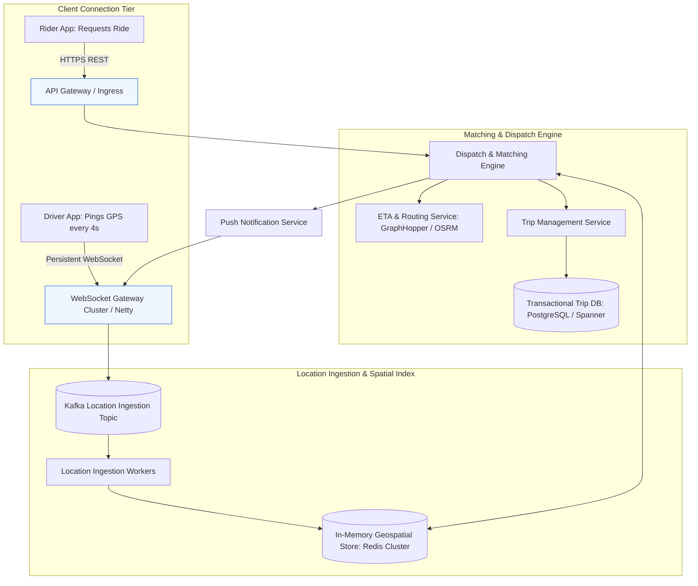
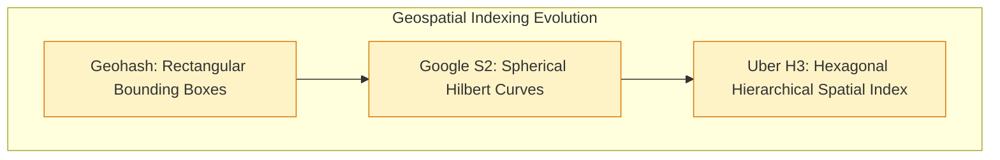
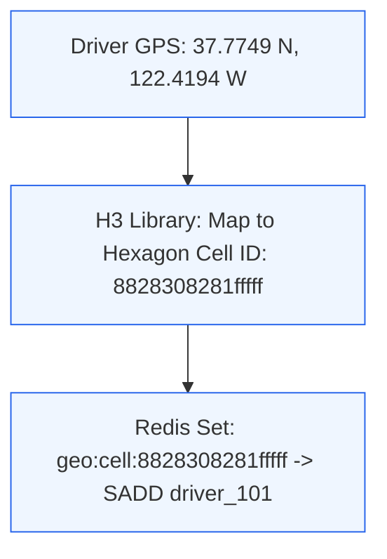
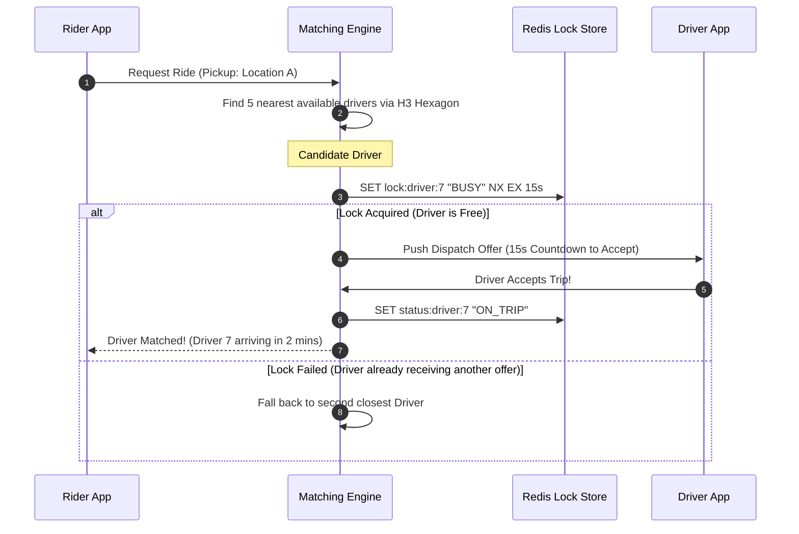
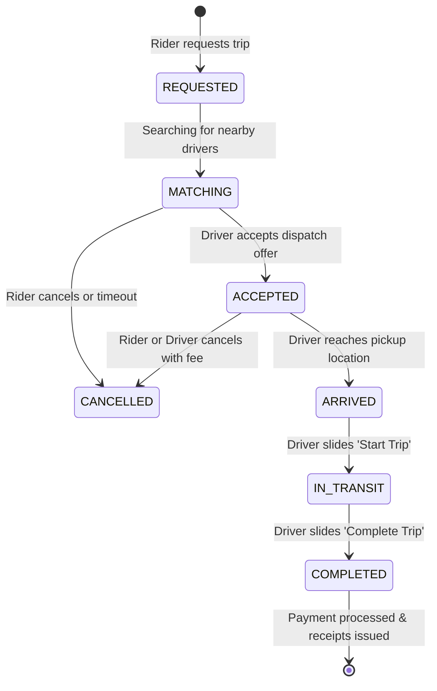

# Case Study 4: Real-Time Ride-Sharing Dispatch (Uber / Lyft)

A ride-sharing dispatch platform connects millions of passengers with nearby drivers in real time. For a technical program manager, this architecture presents intense challenges: handling millions of geospatial writes per second, managing stateful WebSocket connections from moving vehicles, and preventing distributed race conditions during trip matching.

---

## 1. Requirements and Capacity Estimation

### Functional Requirements
1. **Real-Time Location Tracking**: Drivers emit GPS coordinates every 4 seconds.
2. **Nearby Driver Discovery**: Riders open their app and view the top 10 available drivers within a 3-mile radius.
3. **Trip Request & Dispatch**: Rider requests a ride; matching algorithm selects the optimal driver based on proximity and ETA.
4. **Trip Lifecycle Management**: Real-time state transitions from pickup to drop-off.

### Non-Functional Requirements
- **High Concurrency & Low Latency**: Dispatch matching within 2 seconds; location latency < 1 second.
- **High Availability**: 99.99% availability (system failure strands riders and drivers).
- **Strong Consistency on Matching**: A driver must never be booked for two concurrent trips.

### Capacity Calculations
- **Active Fleet**: **5 Million active drivers**; **50 Million active riders**.
- **Location Ingestion QPS**:
  - 5 Million drivers ping GPS every 4 seconds.

$$\text{Location Write QPS} = \frac{5,000,000}{4} = \mathbf{1,250,000\text{ writes per second}}$$

- **Ingestion Payload**:
  - GPS payload: `driver_id` (8 bytes), `latitude` (8 bytes), `longitude` (8 bytes), `timestamp` (8 bytes), `bearing` (4 bytes) $\approx 36\text{ bytes}$.
  - Network Ingress: $1,250,000 \times 36\text{ bytes} \approx 45\text{ MB/s}$ (manageable via distributed Kafka/Redis clusters).
- **Transient Nature of Location Data**: Historical GPS pings do not need to be written synchronously to relational disk. Only the *latest* coordinate matters for real-time dispatch.

---

## 2. End-to-End System Architecture

---

## 3. Geospatial Indexing: Why Uber Uses H3 Hexagons

Searching through millions of latitude and longitude coordinates with standard database queries requires full table scans ($O(N)$), which collapses under 1.25M QPS.

### The Hexagonal Advantage (Uber H3)
1. **Equal Neighbor Distances**: In a square grid (Geohash), orthogonal neighbors are distance $D$ away, while diagonal neighbors are $\sqrt{2} D \approx 1.414 D$ away. In a hexagon, **all 6 neighboring cells are at the exact same distance**.
2. **Radial Radius Search**: Hexagons approximate circles far more accurately than squares, eliminating boundary distortion when calculating "find drivers within 2 miles".
3. **Hierarchical Sizing**: H3 supports 16 resolutions. Resolution 8 covers approximately $0.7\text{ km}^2$, ideal for city-center driver bucketing.

---

## 4. Ride Dispatch and Double-Booking Prevention

When a rider requests a trip, the matching engine must dispatch the ride to the closest available driver without allowing another concurrent trip to claim the same driver.

- **Distributed Mutex Lock**: Redis `SETNX` (Set if Not Exists) with a 15-second TTL ensures that Driver 7 is temporarily reserved while their phone displays the accept screen.

---

## 5. Trip Lifecycle State Machine

A distributed trip must follow a deterministic finite state machine to prevent illegal transitions (e.g. completing a ride before it starts):

---

## 6. TPM Execution Lens: Cross-Functional Risks

| Program Risk | Impact | TPM Mitigation Strategy |
| :--- | :--- | :--- |
| **Cellular Connection Flapping** | Moving vehicles constantly drop cellular connections under bridges and tunnels | WebSocket gateway implements automatic reconnection with heartbeat ping intervals; client caches coordinates offline and bulk-flushes upon reconnect |
| **Surge Pricing Latency** | Supply and demand imbalances cause local price volatility | Pre-compute surge multipliers per H3 hexagon cell in 30-second batch intervals; read multiplier instantly from Redis rather than calculating dynamically on each click |
| **Mobile Battery Drain** | Continuous GPS pinging drains driver smartphones | Implement adaptive location tracking: when vehicle is stationary in traffic, reduce GPS ping frequency to once every 10 seconds |

---

## 7. TPM Review Checklist

- [ ] Is raw location ingestion partitioned and processed in-memory (Redis / Kafka) to avoid disk saturation?
- [ ] Are geospatial queries powered by spatial indexes (H3 / S2) rather than relational bounding box queries?
- [ ] Is distributed locking implemented to prevent double-dispatching the same driver?
- [ ] Does the trip lifecycle enforce a strict, auditable state machine with optimistic locking?
- [ ] Are WebSocket connections managed behind a scalable connection tier with automated reconnection logic?
