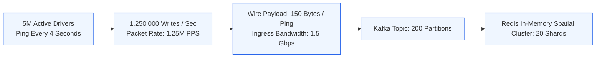
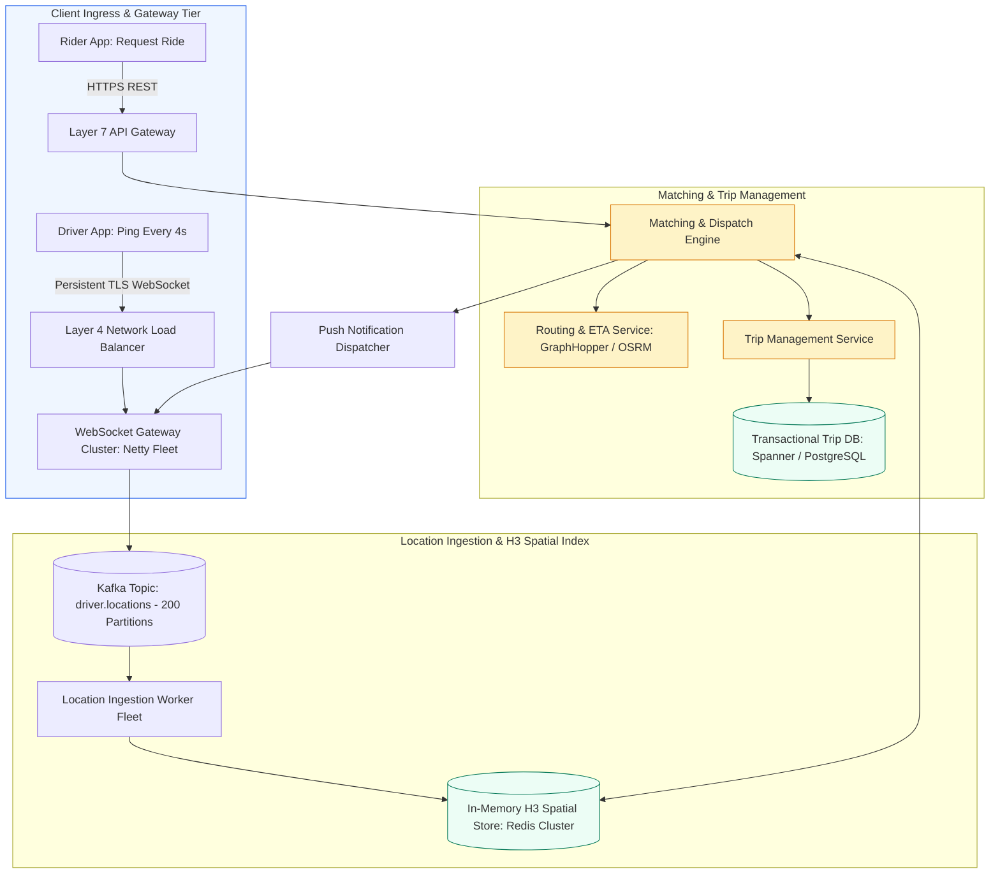
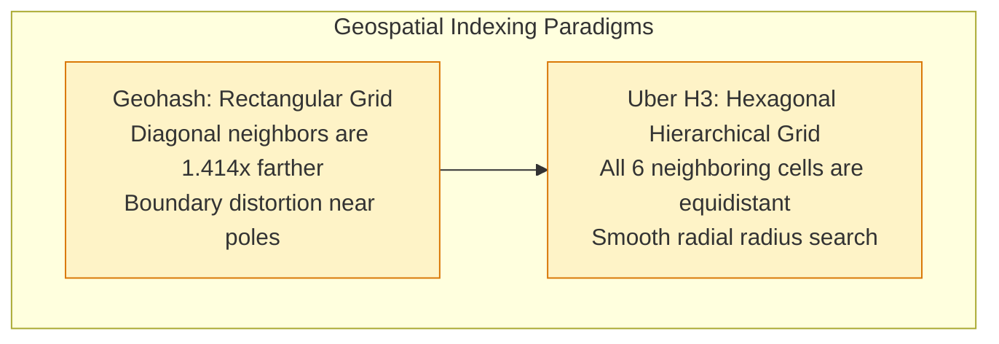
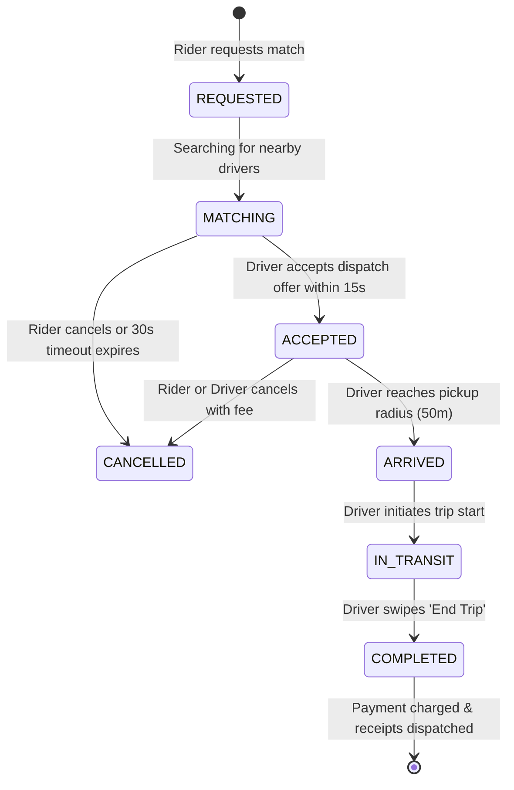
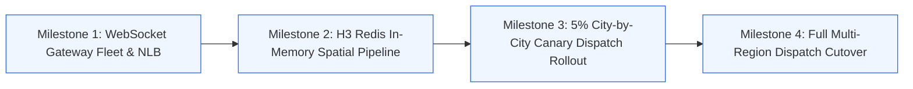

# Case Study 4: Real-Time Ride-Sharing Dispatch (Uber / Lyft)

[Home](../README.md) > [Module 5: Real-World Case Studies](./README.md) > **Case Study 5.4: Ride-Sharing Dispatch**

---

## 1. Problem Statement and Scope

A ride-sharing dispatch platform connects millions of passengers with nearby drivers in real time. For a Technical Program Manager, this architecture presents extreme concurrency challenges: handling 1.25 Million geospatial writes per second, managing stateful WebSocket connections from vehicles moving through cellular dead zones, eliminating distributed race conditions during trip matching, and resolving state drift.

### In-Scope Functional Capabilities
- Real-time GPS location ingestion from moving drivers every 4 seconds.
- Geospatial indexing using Uber H3 hexagonal spatial cells.
- Candidate driver proximity matching and ETA routing calculation.
- Distributed mutual-exclusion locking to prevent double-booking drivers.
- Complete trip state machine lifecycle management (`REQUESTED` to `COMPLETED`).
- Reconnection storm handling, stale GPS coordinate filtering, and hot-cell mitigation.

### Out-of-Scope (Explicit Boundaries)
- Turn-by-turn graphical navigation rendering on mobile devices.
- Dynamic surge-pricing econometric models (pricing ingestion is treated as an external dependency).
- Driver payroll disbursement and banking payouts.

---

## 2. Requirements and SLAs

### Functional Requirements
1. **Real-Time Tracking**: Drivers transmit GPS pings every 4 seconds while online.
2. **Nearby Driver Discovery**: Passenger app displays the top 10 available drivers within a 3-mile radius in under 1 second.
3. **Dispatch Matching**: System matches an incoming ride request with the optimal driver within 2 seconds.
4. **Single-Driver Guarantee**: A driver must never be booked for two concurrent trips.

### Non-Functional Requirements & SLAs
- **Availability Target**: **99.99% Uptime** (Service failure strands riders and drivers globally).
- **Location Ingestion Latency**: p99 under **1,000 milliseconds** from phone GPS broadcast to in-memory index availability.
- **Matching Latency**: p99 under **2.0 seconds**.
- **Fleet Scale**: **5 Million active drivers**; **50 Million active riders**; **1 Million concurrent trips**.

---

## 3. Capacity Planning and Wire-Protocol Overhead



### Ingestion Throughput and Packet Rate Sizing
- **Active Driver Count**: 5 Million online drivers.
- **Update Frequency**: 1 ping every 4 seconds per driver.
- **Total Ingestion Rate**:
  $$\text{Location Write QPS} = \frac{5,000,000}{4\text{ seconds}} = \mathbf{1,250,000\text{ writes per second}}$$
- **Packet Processing Rate (PPS)**: **1.25 Million Packets Per Second**.

### Protocol Overhead & True Wire Bandwidth Sizing
A common flaw in system design is only counting the raw 36-byte GPS application payload (`driver_id` 8B, `lat` 8B, `lng` 8B, `timestamp` 8B, `bearing` 4B). On physical networks, transport and encryption headers multiply packet size:
- Application Binary Payload: **36 bytes**
- WebSocket Framing: **4 bytes**
- TLS 1.3 Record Overhead: **29 bytes**
- TCP Header: **20 to 32 bytes**
- IP Header: **20 bytes**
- **Total Wire Payload per Ping**: $\approx \mathbf{120\text{ to }150\text{ bytes}}$.

$$\text{Total Ingress Bandwidth} = 1,250,000\text{ packets/sec} \times 150\text{ bytes} \approx 187,500,000\text{ bytes/sec} = \mathbf{187.5\text{ MB/s}}$$

$$\text{In Gigabits per second (8 bits = 1 byte)} = 187.5 \times 8 \approx \mathbf{1.5\text{ Gbps wire ingress}}$$

- *Hardware Requirement*: Sustaining 1.25M Packets Per Second (PPS) requires **AWS Network Load Balancers (NLBs)** operating at Layer 4, terminating TCP connections across a distributed fleet of 60 to 80 WebSocket gateway pods.

### Downstream Pipeline Sizing (Kafka & Redis)
- **Kafka Topic Sizing**: A single Kafka partition sustains 5,000 to 8,000 writes/sec without batch compression bottlenecks.
  $$\text{Required Partitions} = \frac{1,250,000\text{ msgs/sec}}{6,500\text{ msgs/partition}} \approx \mathbf{200\text{ Partitions}}$$
- **Redis In-Memory Sizing**:
  - Only the *latest* location matters for real-time dispatch; historic location pings are streamed to cold storage.
  - 5 Million active drivers $\times 200\text{ bytes}$ memory per key = **1.0 GB RAM**.
  - Sizing for throughput: A single Redis core handles ~80,000 writes/sec.
  - Sizing for 1.25M writes/sec requires at least:
    $$\text{Primary Shards} = \frac{1,250,000}{70,000} \approx \mathbf{18\text{ Primary Shards}}$$
  - Configured with 18 Primaries and 18 Replicas across 3 Availability Zones (Total: 36 nodes).

---

## 4. End-to-End System Architecture



---

## 5. API Contracts and Core Data Model

### API Contracts

#### 1. Ingest Driver Location Ping (WebSocket Binary Frame)
- **Protocol**: WebSocket (WSS) binary framing
- **Frame Payload Schema (Protobuf / Binary 36 Bytes)**:
  ```protobuf
  message DriverLocationUpdate {
    string driver_id = 1;      // UUID
    double latitude = 2;       // 64-bit float
    double longitude = 3;      // 64-bit float
    int64 timestamp_ms = 4;    // Milliseconds since epoch
    float bearing = 5;         // Compass heading 0-360 degrees
    enum DriverStatus status = 6; // AVAILABLE, ON_TRIP, OFFLINE
  }
  ```

#### 2. Request Ride Match
- **Endpoint**: `POST /api/v1/trips/request`
- **Headers**: `Idempotency-Key: <UUID>`
- **Request Payload**:
  ```json
  {
    "rider_id": "usr_48291",
    "pickup_lat": 37.774929,
    "pickup_lng": -122.419416,
    "dropoff_lat": 37.789172,
    "dropoff_lng": -122.401449,
    "tier": "STANDARD_SEDAN"
  }
  ```
- **Response Payload (HTTP 202 Accepted)**:
  ```json
  {
    "trip_id": "trip_98124892",
    "status": "MATCHING",
    "estimated_fare_cents": 1850,
    "search_radius_meters": 3000,
    "timeout_seconds": 30
  }
  ```

### Geospatial Index: Why Uber Uses H3 Hexagons



#### H3 Hexagon Implementation Details
1. **Equidistant Neighbors**: Every hexagon has exactly 6 neighbors at the exact same distance $D$. In square grids (Geohashes), diagonal neighbors are $\sqrt{2} D \approx 1.414 D$ away, distorting radius queries.
2. **Resolution Sizing**: Uber H3 Resolution 8 covers an area of approximately $0.737\text{ km}^2$ with an edge length of $461\text{ meters}$.
3. **Redis Data Structure**:
   - `HSET driver:locations <driver_id> "{lat, lng, timestamp, h3_cell_res8}"`
   - `SADD h3:cell:8828308281fffff <driver_id>` (Set of active drivers in that cell).

---

## 6. Architectural Decision Records (ADRs) and Alternatives

### Architectural Comparison Matrix

| Criteria | Alternative 1: PostGIS Relational Bounding Box | Alternative 2: In-Memory H3 Hexagonal Grid - Recommended | Alternative 3: Google S2 Spherical Curves |
| :--- | :--- | :--- | :--- |
| **Write Latency** | Slow (Disk index updates collapse under 1.25M QPS) | **Sub-millisecond** (In-memory Redis hash and set updates) | Sub-millisecond (In-memory) |
| **Radius Search Complexity** | High ($O(N)$ bounding box calculation) | **Low** (Inspect center cell + 6 immediate neighbors) | Moderate (Requires Hilbert curve range decomposition) |
| **Hot-Spot Mitigations** | Poor (Single database shard locks) | **Strong** (Sub-cell sharding via H3 resolution 9) | Strong |
| **Operational Overhead** | High database IOPS cost | Low (Ephemeral in-memory state) | Low |

### Decision Outcome
**Adopt Alternative 2 (In-Memory H3 Hexagonal Grid in Redis)**. Storing spatial buckets in Redis sets guarantees sub-millisecond proximity queries and sustains 1.25M writes/sec with predictable scaling.

---

## 7. Edge Cases and Operational Failure Modes (FMEA)

| Edge Case / Failure Scenario | Detection Mechanism | Immediate System Behavior | Engineering Mitigation |
| :--- | :--- | :--- | :--- |
| **Stale GPS Updates (Out-of-Order Pings)** | Packet timestamp $< \text{last\_recorded\_timestamp}$ | Network latency causes older ping to arrive after newer ping | GeoWorker discards pings if `timestamp_ms <= last_timestamp_ms` |
| **Hot Geographic Cell (Airport / Stadium)** | H3 cell driver count exceeds 5,000 drivers | Ingestion and match workers experience lock contention on a single Redis key | Dynamic Sub-Sharding: Partition hot cell into 7 child cells at H3 resolution 9 |
| **Cellular Reconnect Storm (Tunnel Exit)** | Thousands of vehicles reconnect simultaneously | Sudden 5x connection spike on WebSocket gateway | Gateway implements randomized exponential reconnect backoff with jitter |
| **Duplicate Dispatch Offers** | Concurrent ride requests claim same driver | Race condition during matching window | Distributed Lock: Matching engine executes `SET lock:driver:<id> "MATCHING" NX EX 15` in Redis |
| **Trip State Desynchronization** | Driver mobile app disconnects during transit | Rider app and backend out of sync on ride status | Background reconciler audits trip state machines against driver GPS telemetry |

---

## 8. Complete Trip Lifecycle State Machine



---

## 9. Security, Privacy, and Regulatory Governance

### 1. Location Privacy and Coordinate Fuzzing
- **In-Transit Coordinate Encryption**: Real-time driver and rider coordinates are transmitted exclusively over TLS 1.3 encrypted WebSockets with strict forward secrecy.
- **Coordinate Fuzzing**: Once a trip reaches `COMPLETED` state, rider pickup and dropoff coordinates displayed in driver historical trip logs are fuzzed to a 100-meter radius to prevent stalking or personal address disclosure.
- **Data Retention and Pruning**: Raw GPS breadcrumbs stored in telemetry event streams are automatically archived to cold storage after 30 days and permanently purged after 90 days in accordance with GDPR and CCPA privacy standards. Aggregated trip mileage and duration are retained for financial audit and tax compliance.

### 2. Ephemeral Contact Virtualization
- **Phone Number Masking**: Drivers and riders never exchange real cellular phone numbers or email addresses.
- **Virtual Proxy**: Voice calls and SMS messages between parties are routed through a telecommunications proxy using ephemeral virtual numbers that automatically expire 30 minutes after trip completion.

### 3. Mutual Authentication and Anti-Spoofing
- **mTLS on Internal Service Mesh**: All internal communication between API Gateways, Ingestion fleets, Kafka clusters, and Redis nodes enforces mutual TLS (mTLS) with cryptographically attested workload identities.
- **GPS Spoofing Detection**: The ingestion pipeline runs anomalous velocity heuristics (flagging location jumps exceeding 150 km/h between successive 4-second pings) to detect mock locations, GPS spoofing, or fraudulent driver mileage inflation.

---

## 10. Observability and Monitoring Thresholds

| Metric Name | Telemetry Type | Target Baseline | P1 Critical Alert Threshold |
| :--- | :--- | :--- | :--- |
| **Location Ingestion Latency (p99)** | Metric (Histogram) | $< 500\text{ms}$ | $> 2,000\text{ms}$ for 2 minutes |
| **WebSocket Connection Drops** | Metric (Counter) | $< 0.1\% \text{ per minute}$ | $> 2.0\%$ (Indicates gateway cluster impairment) |
| **Redis H3 Set Lock Contention** | Metric (Gauge) | $< 10\text{ms}$ | $> 50\text{ms}$ (Indicates hot-cell saturation) |
| **Trip Match Success Rate** | Metric (Gauge) | $> 98\%$ | $< 90\%$ (Triggers dispatch engine audit) |

---

## 11. Migration, Launch Gates, and TPM Execution Plan

### Phased Migration Milestones



### RACI Matrix

| Program Deliverable | Geospatial Team Lead | Senior TPM | Mobile Client Lead | Infrastructure Lead |
| :--- | :--- | :--- | :--- | :--- |
| **H3 Hexagonal Index Pipeline** | **Accountable** | Consulted | Informed | Informed |
| **WebSocket Wire Protocol Compression** | Responsible | Consulted | **Accountable** | Informed |
| **City-by-City Rollout Schedule** | Informed | **Accountable** | Responsible | Responsible |
| **Network NLB & PPS Scaling Governance** | Consulted | **Accountable** | Informed | Responsible |

---

## 12. Practice System Design Questions and Model Answers

### Question 1: How do you prevent two riders from being dispatched to the same driver simultaneously?
**Model Answer**:
We implement distributed mutual exclusion using Redis distributed locks. When the matching engine identifies Driver 42 as the optimal match, it attempts to acquire an exclusive lock: `SET lock:driver:42 <trip_id> NX EX 15`. If the lock is successfully acquired, Driver 42 is reserved and the offer is dispatched to their phone with a 15-second countdown timer. If a concurrent match engine instance tries to claim Driver 42 for another trip, the `SETNX` call fails, and the second engine immediately falls back to the next closest candidate driver.

### Question 2: Why not store historical GPS pings directly in a relational database like PostgreSQL?
**Model Answer**:
At 1.25 Million writes per second, writing pings directly to a relational disk store would generate billions of row inserts daily, exhaust database connection pools, and thrash B-Tree indexes with random page writes. Real-time dispatch only requires the driver's *current* coordinates. We update current coordinates in an in-memory Redis H3 store, while streaming the location updates to a Kafka topic. An asynchronous consumer batches these events, compresses them, and writes them in bulk to an analytical columnar store (ClickHouse / S3 Parquet) for offline trip receipts and dispute resolution, protecting transactional databases.

---

## 13. Primary Sources and Further Reading

- **Uber H3 Spatial Index**: *H3: A Hexagonal Hierarchical Spatial Index* (Uber Engineering Blog & Open Source Documentation, https://h3geo.org/).
- **Google S2 Geometry**: *Google S2 Spherical Geometry Library Documentation* (https://s2geometry.io/).
- **Redis Geospatial Architecture**: Redis In-Memory Geospatial Commands (`GEOADD`, `GEORADIUS`).
- *Designing Data-Intensive Applications* by Martin Kleppmann (O'Reilly Media, 2017) - Chapter 10 & 11: Stream Processing.
