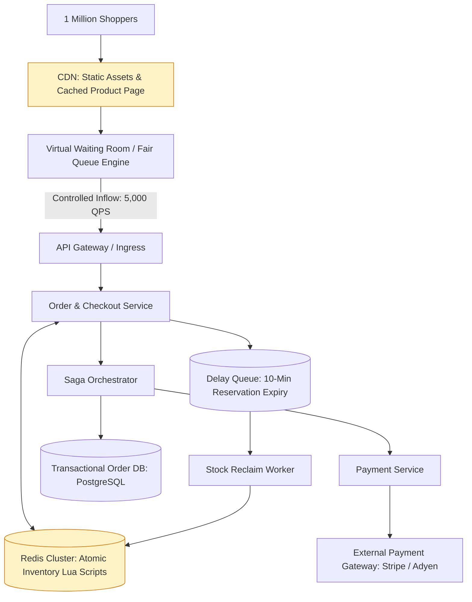
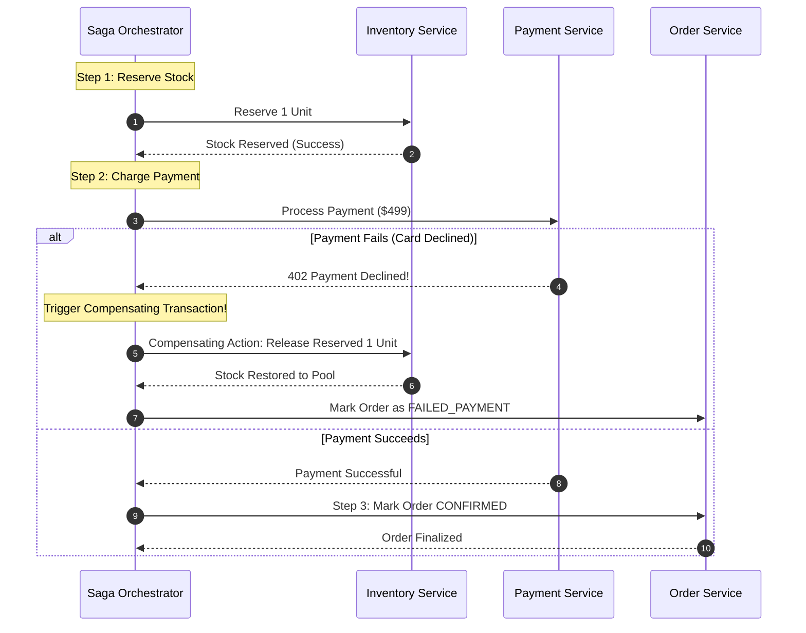
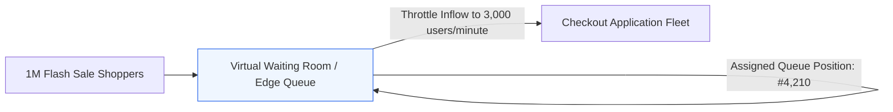

# Case Study 5: High-Concurrency Flash Sale and Distributed Checkout

An e-commerce flash sale involves releasing a limited quantity of highly anticipated inventory (e.g. 10,000 gaming consoles or concert tickets) to millions of concurrent buyers at a precise second. For technical program managers, this system design tests your ability to eliminate race conditions, avoid overselling, coordinate distributed transactions across microservices, and manage payment idempotency.

---

## 1. Requirements and Capacity Estimation

### Functional Requirements
1. **Flash Sale Catalog & Product Display**: Millions of users view product details simultaneously without degrading performance.
2. **Atomic Inventory Reservation**: Reserve an item for 10 minutes while the user completes payment.
3. **Zero Overselling**: Exactly 10,000 items sold: never 10,001.
4. **Checkout & Payment**: Securely charge payment methods with full idempotency.
5. **Auto-Release Expired Reservations**: If payment is not completed within 10 minutes, return stock to the available pool.

### Non-Functional Requirements
- **High Concurrency**: Withstand a spike of 1,000,000 concurrent shoppers at 12:00:00.
- **Strict Data Consistency**: Prevent inventory race conditions and double charges.
- **Fair Queuing**: Protect against bot networks and provide transparent customer feedback.

### Capacity Calculations
- **Total Stock Available**: **10,000 units**.
- **Concurrent Shoppers**: **1 Million users** at launch time.
- **Peak Checkout Write QPS**: Sized for **100,000 write attempts per second**.
- **Database Write Limit**: A traditional relational database (PostgreSQL/MySQL) saturates at 2,000 to 5,000 concurrent writes per second on a single master. Hitting a relational DB with 100,000 writes/sec will cause catastrophic thread starvation and connection timeouts.

---

## 2. End-to-End System Architecture



---

## 3. Inventory Reservation: Why Relational Locks Fail

Preventing overselling requires atomic inventory decrement. Let us examine how engineering approaches compare under 100,000 QPS.

```mermaid
flowchart TD
    subgraph PessimisticLock [Approach 1: SELECT FOR UPDATE on SQL DB]
        P1[100k threads attempt DB row lock] --> P2[Massive thread lock contention]
        P2 --> P3[DB connection pool exhausts, latency jumps to 30s, crash!]
    end

    subgraph OptimisticLock [Approach 2: Optimistic Version Checking]
        O1[100k threads read stock version = 1] --> O2[First thread commits version 2]
        O2 --> O3[99,999 threads fail with concurrency collision!]
    end

    subgraph RedisLua [Approach 3: In-Memory Redis Lua Script - Recommended]
        R1[Requests hit in-memory Redis cluster] --> R2[Atomic Lua script executes in sub-millisecond]
        R2 --> R3[Stock decremented safely; returns success or OUT_OF_STOCK]
    end

    classDef bad fill:#fee2e2,stroke:#ef4444,stroke-width:1px;
    classDef good fill:#ecfdf5,stroke:#047857,stroke-width:1px;
    class PessimisticLock,OptimisticLock bad;
    class RedisLua good;
```



### The Winning Implementation: Redis Atomic Lua Script
Because Redis executes Lua scripts as a single, atomic, single-threaded transaction, race conditions are mathematically impossible:

```lua
-- Atomic Inventory Reservation Script
local key = KEYS[1]
local requested = tonumber(ARGV[1])
local current_stock = tonumber(redis.call('get', key) or 0)

if current_stock >= requested then
    redis.call('decrby', key, requested)
    return 1 -- Success: Inventory Reserved
else
    return 0 -- Sold Out!
end
```

---

## 4. Distributed Transactions: The Saga Orchestration Pattern

A complete checkout transaction spans multiple microservices:
1. **Inventory Service**: Decrement stock.
2. **Payment Service**: Charge credit card.
3. **Order Service**: Create confirmed order record.

Traditional **Two-Phase Commit (2PC)** blocks database connections across all three services, making it extremely brittle in distributed environments. The modern standard is the **Saga Pattern**.



### Key Principles of Sagas
- **Local Transactions**: Each service only executes transactions inside its own local database.
- **Compensating Transactions**: If step 2 fails, the orchestrator executes undo operations (compensating transactions) for all previous steps in reverse order.

---

## 5. Virtual Waiting Rooms and Traffic Leveling

When 1,000,000 shoppers arrive at once, letting all requests hit application servers will take down the platform. 



- **Fairness**: Assigns cryptographically signed queue position tokens (FIFO).
- **Client Transparency**: The browser displays a countdown timer and queue position, keeping users informed instead of staring at broken 504 error screens.
- **Protection**: Acts as an elastic dam, releasing traffic at exactly the rate the payment and inventory tiers are sized to process.

---

## 6. TPM Execution Lens: Risk and Governance

| Program Risk | Impact | TPM Mitigation Strategy |
| :--- | :--- | :--- |
| **Payment Gateway Timeout** | User is charged, but order is never recorded | Payment requests include an **Idempotency Key** (`order_uuid`). Background reconciliation job checks gateway for pending authorizations every 60 seconds |
| **Abandoned Shopping Carts** | Inventory remains locked and unsold forever | Enqueue delayed messages to a Redis / SQS delay queue. If payment confirmation does not arrive within 10 minutes, automatically increment inventory back into the pool |
| **Bot Networks & Scalpers** | Automated bots buy out entire inventory in 200ms | Require reCAPTCHA Enterprise verification at waiting room ingress; limit purchases to 1 unit per verified phone number and credit card fingerprint |

---

## 7. TPM Review Checklist

- [ ] Is inventory decrement executed atomically in-memory (Redis Lua) to handle peak write bursts?
- [ ] Is the Saga pattern implemented with explicit compensating rollback transactions?
- [ ] Does the payment integration use strict idempotency keys to eliminate double charges?
- [ ] Is a 10-minute expiration delay queue configured to return abandoned inventory to stock?
- [ ] Is a Virtual Waiting Room deployed to buffer traffic and protect checkout microservices?
- [ ] Are bot mitigation rules enforced at the perimeter (rate limits, device fingerprinting)?
