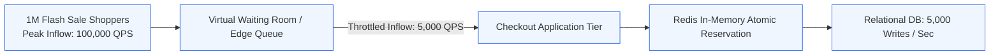
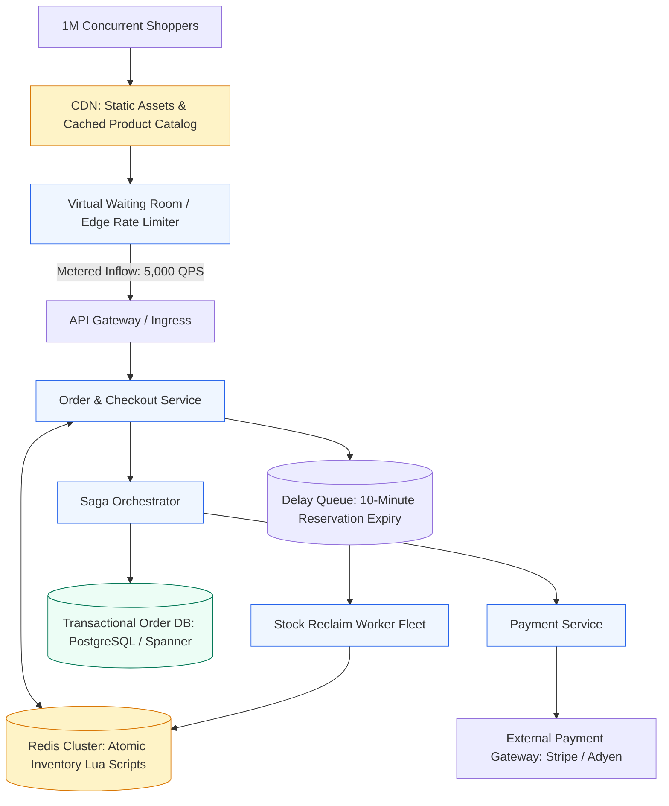
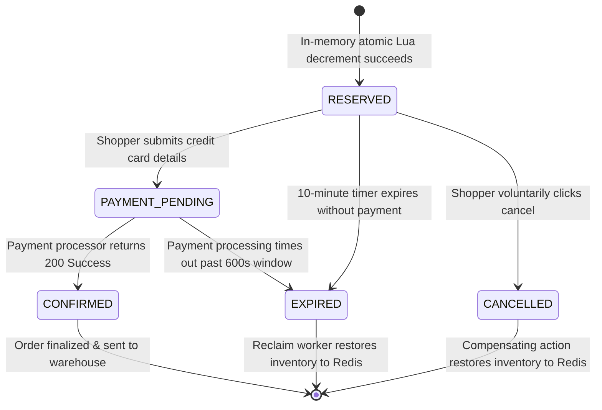
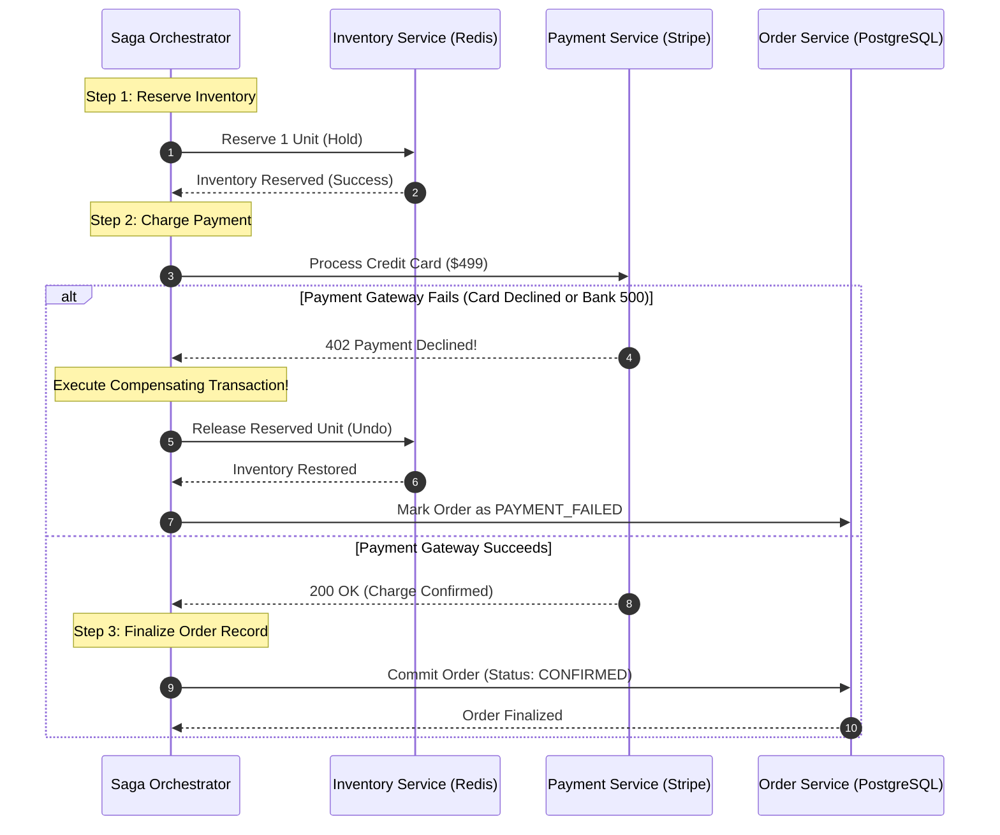
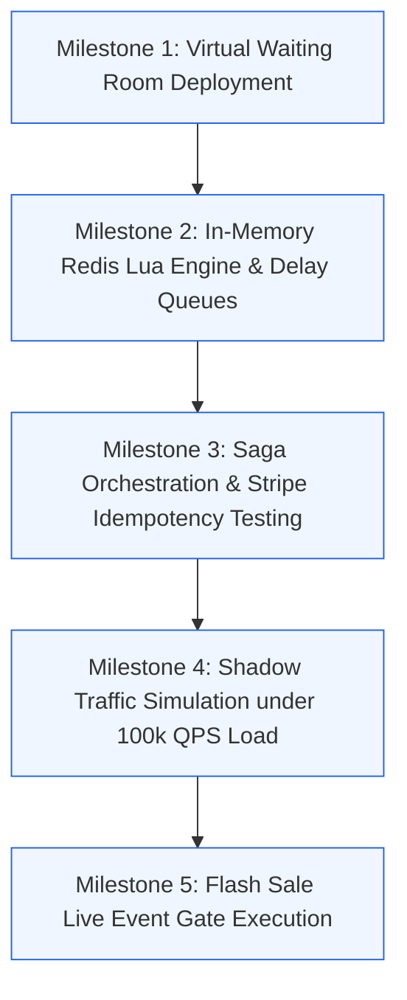

# Case Study 5: High-Concurrency Flash Sale and Distributed Checkout

[Home](../README.md) > [Module 5: Real-World Case Studies](./README.md) > **Case Study 5.5: Distributed E-Commerce Checkout**

---

## 1. Problem Statement and Scope

An e-commerce flash sale involves releasing a limited quantity of high-demand inventory (e.g. 10,000 gaming consoles or concert tickets) to millions of concurrent buyers at a precise second. For a Technical Program Manager, this system design tests your ability to eliminate race conditions, prevent overselling, orchestrate distributed transactions across microservices, handle ambiguous payment timeouts, and reconcile inventory state across database failovers.

### In-Scope Functional Capabilities
- Real-time catalog display under heavy cache offload.
- Atomic in-memory inventory reservation for a 10-minute payment checkout window.
- Distributed transaction orchestration across Inventory, Payment, and Order microservices via the Saga pattern.
- Payment uncertainty resolution, idempotency enforcement, and expiration race condition handling.
- Automated reconciliation between in-memory caches and relational source-of-truth databases.

### Out-of-Scope (Explicit Boundaries)
- Physical warehouse logistics, packing, and courier dispatch.
- Complex loyalty point redemption and gift card balance calculations.
- Post-delivery returns and warranty processing.

---

## 2. Requirements and SLAs

### Functional Requirements
1. **Zero Overselling**: Exactly 10,000 units sold: never 10,001.
2. **Atomic Reservation**: Reserving an item locks it exclusively for 10 minutes while the shopper completes payment.
3. **Automatic Inventory Release**: If payment is not completed within 10 minutes, the reserved item automatically returns to available stock.
4. **Idempotent Payment Charging**: Network timeouts or duplicate clicks must never charge a customer twice.

### Non-Functional Requirements & SLAs
- **Concurrency Peak**: Withstand a burst of **1,000,000 concurrent shoppers** at launch time.
- **Peak Write Throughput**: Ingestion sized for **100,000 reservation attempts per second**.
- **Checkout Response Latency**: p99 under **500 milliseconds**.
- **Data Consistency**: Strict consistency on inventory deduction; eventual consistency on order search indexing.

---

## 3. Capacity Planning and Inflow Leveling



### Inflow Traffic vs Database Write Limits
- **Total Available Inventory**: **10,000 units**.
- **Concurrent Shoppers**: **1,000,000 users** hitting the checkout endpoint at 12:00:00.
- **Uncontrolled Write Rate**: 100,000 requests/sec.
- **Relational Database Ceiling**: A single primary PostgreSQL or MySQL instance saturates at approximately 2,000 to 5,000 writes/sec before connection pool exhaustion and thread lock contention trigger cascading failures.
- **Traffic Leveling via Virtual Waiting Room**:
  - Directing 100,000 QPS straight to application servers will crash the backend.
  - A **Virtual Waiting Room** (e.g. Cloudflare Waiting Room or Queue-it) buffers the 1 Million shoppers at the edge, assigning cryptographically signed FIFO tokens.
  - Traffic is metered into the checkout application tier at a steady rate of **5,000 users per minute**, matching the exact capacity of downstream payment gateways.

---

## 4. End-to-End System Architecture



---

## 5. API Contracts and Core Data Model

### API Contracts

#### 1. Reserve Inventory (Atomic Hold)
- **Endpoint**: `POST /api/v1/checkout/reserve`
- **Headers**:
  - `Content-Type: application/json`
  - `Idempotency-Key: <UUID>`
- **Request Payload**:
  ```json
  {
    "shopper_id": "usr_998124",
    "item_id": "item_ps5_console",
    "quantity": 1,
    "waiting_room_token": "jwt_signed_token_abc"
  }
  ```
- **Response Payload (HTTP 201 Created)**:
  ```json
  {
    "reservation_id": "res_849102",
    "item_id": "item_ps5_console",
    "quantity": 1,
    "status": "RESERVED",
    "expires_at": "2026-10-19T12:10:00Z",
    "payment_window_seconds": 600
  }
  ```
- **Error Codes**: `400 Bad Request`, `409 Conflict` (Sold Out / `OUT_OF_STOCK`), `429 Too Many Requests`.

#### 2. Confirm Payment & Finalize Order
- **Endpoint**: `POST /api/v1/checkout/pay`
- **Headers**: `Idempotency-Key: <UUID>`
- **Request Payload**:
  ```json
  {
    "reservation_id": "res_849102",
    "payment_method_token": "pm_card_visa_4242",
    "amount_cents": 49900
  }
  ```
- **Response Payload (HTTP 200 OK)**:
  ```json
  {
    "order_id": "ord_771829",
    "status": "CONFIRMED",
    "transaction_id": "tx_stripe_881924",
    "amount_charged_cents": 49900
  }
  ```

### Discrete Reservation State Transitions



---

## 6. Architectural Decision Records (ADRs) and Reservation Mechanics

### ADR-0501: High-Concurrency Inventory Reservation Engine

| Decision Element | Specification |
| :--- | :--- |
| **Status** | Accepted |
| **Context** | 100,000 concurrent checkout requests per second contending for 10,000 high-demand SKU units. |
| **Alternatives Evaluated** | 1. Pessimistic Locking (`SELECT FOR UPDATE`) in PostgreSQL<br>2. Optimistic Concurrency Control (`version` column)<br>3. Distributed Redlock<br>4. In-Memory Redis Lua Scripts with Database Safety Constraints |
| **Chosen Architecture** | **Option 4: In-Memory Redis Lua Atomic Reservation** backed by a strict PostgreSQL relational safety check constraint (`CHECK (stock_count >= 0)`). |
| **Key Trade-off** | Sub-millisecond latency and 100k QPS throughput in exchange for managing asynchronous replication failover edge cases. |

### Evaluation of Architectural Alternatives

- **Pessimistic Locking (`SELECT FOR UPDATE`)**: 100,000 threads compete for the same row lock. Database CPU spikes to 100%, query latency jumps from 5ms to 30,000ms, and connection pools exhaust in seconds.
- **Optimistic Locking (`version` column)**: 100,000 threads read `version = 1`. The first thread updates to `version = 2`; the remaining 99,999 threads fail with concurrency collision exceptions, forcing massive client retry storms.
- **Distributed Redlock**: Multi-node consensus introduces network round-trips (5-15ms) and clock-drift hazards (Martin Kleppmann analysis), reducing checkout throughput.

### The In-Memory Lua Solution (With Operational Caveats)
Redis executes Lua scripts atomically in a single-threaded execution context:

```lua
-- Atomic Reservation Script
local stock_key = KEYS[1]
local reservation_set = KEYS[2]
local shopper_id = ARGV[1]
local requested = tonumber(ARGV[2])

local current_stock = tonumber(redis.call('get', stock_key) or 0)
if current_stock >= requested then
    redis.call('decrby', stock_key, requested)
    redis.call('hset', reservation_set, shopper_id, requested)
    return 1 -- Success
else
    return 0 -- Sold Out
end
```

### Critical Operational Caveat: Redis Asynchronous Replication & Failover
While a Lua script executes atomically on a single Redis primary node:
- **Asynchronous Replication Risk**: Redis replicates writes to read replicas asynchronously. If the primary node crashes after executing the reservation but before replicating to the replica, Sentinel/Cluster failover promotes a replica that still holds stale inventory counts.
- **Mitigation for Zero Overselling**:
  1. The Redis reservation is treated as a **provisional fast reservation**.
  2. The final source of truth is committed in the transactional relational database (PostgreSQL) using a strictly enforced database constraint: `CONSTRAINT positive_stock CHECK (stock_count >= 0)`.
  3. If an un-replicated Redis failover causes 10 extra reservations, the relational database constraint rejects the 10,001st transaction, triggering an immediate automated apology and refund workflow.

---

## 7. Distributed Transactions: The Saga Orchestration Pattern

A distributed checkout transaction spans three microservices: Inventory, Payment, and Order. Traditional **Two-Phase Commit (2PC)** blocks database connections across all three systems and stalls during network partitions. The production standard is **Saga Orchestration**.



---

## 8. Failure Modes, Expiration Races, and Reconciliations (FMEA)

| Failure Scenario | Detection Mechanism | Immediate System Behavior | Engineering Mitigation |
| :--- | :--- | :--- | :--- |
| **Payment Timeout Ambiguity** | HTTP call to Stripe times out after 10 seconds | Payment status is unknown (Did bank charge customer or drop request?) | Background Payment Poller checks gateway status using the original `Idempotency-Key` before initiating refund |
| **Expiration Race Condition** | Payment confirms at $T = 601\text{s}$ while reclaim worker expires at $T = 600\text{s}$ | Stock was returned to pool; payment succeeded late | The orchestrator checks lock status. If already expired and resold, triggers an automated refund and voucher |
| **Redis Primary Node Crash** | Sentinel detects heartbeat loss (> 3s) | Failover promotes replica; slight risk of un-replicated reservation drift | Reconciler script cross-audits Redis reservation set against confirmed orders in PostgreSQL every 60 seconds |
| **Compensating Action Fails** | Inventory release call to Redis times out during payment decline | Unit remains reserved in Redis despite payment failure | Reclaim worker processes delay queue message at 10-minute mark to purge orphaned hold |

---

## 9. Security, Bot Mitigation, and Anti-Scalping

1. **Bot & Scalper Mitigation**:
   - Require reCAPTCHA Enterprise verification at the Virtual Waiting Room boundary before issuing queue tokens.
   - Enforce a strict purchase ceiling of **1 unit per verified phone number and payment card fingerprint**.
2. **Waiting Room Cryptographic Proof**:
   - Tokens issued by the waiting room are signed JWTs containing a payload hash of the user ID and timestamp.
   - API Gateway verifies the JWT signature with public keys before routing requests to checkout pods.

---

## 10. Observability and Monitoring Thresholds

| Metric Name | Telemetry Type | Target Baseline | P1 Critical Alert Threshold |
| :--- | :--- | :--- | :--- |
| **Inventory Divergence Delta** | Metric (Gauge) | $0\text{ units}$ | $> 5\text{ units}$ between Redis and PostgreSQL |
| **Checkout API Latency (p99)** | Metric (Histogram) | $< 500\text{ms}$ | $> 1,500\text{ms}$ for 2 consecutive minutes |
| **Payment Gateway 5xx Rate** | Metric (Counter) | $< 0.1\%$ | $> 2.0\%$ (Triggers payment provider failover) |
| **Virtual Waiting Room Queue Depth** | Metric (Gauge) | Managed | Drops to 0 unexpectedly (Indicates gateway bypass) |

---

## 11. Migration, Launch Gates, and TPM Execution Plan

### Launch Phasing Schedule



### RACI Matrix

| Program Deliverable | Lead Architect | Senior TPM | Payment Lead | Security Lead |
| :--- | :--- | :--- | :--- | :--- |
| **Atomic Inventory Lua Engine** | **Accountable** | Consulted | Informed | Informed |
| **Payment Gateway Rate Limit Approval** | Consulted | **Accountable** | Responsible | Informed |
| **Bot Mitigation & Scalping Rules** | Responsible | Consulted | Informed | **Accountable** |
| **Flash Sale Go/No-Go Decision Gate** | Consulted | **Accountable** | Consulted | Consulted |

---

## 12. Practice System Design Questions and Model Answers

### Question 1: How do you handle an ambiguous payment timeout where the network drops before receiving a response?
**Model Answer**:
We never retry a payment without an **Idempotency Key**. When calling the payment processor (e.g. Stripe), our payment service passes a client-generated UUID `Idempotency-Key: idem_pay_9821`. If the network drops and the HTTP socket times out after 10 seconds, the Saga orchestrator does not assume failure or success. It queries the payment gateway using the exact same idempotency key. The gateway returns the recorded outcome if the card was charged, or processes the charge cleanly without double-billing if the initial packet never reached the gateway.

### Question 2: What happens if a Redis master node crashes in the middle of a flash sale?
**Model Answer**:
Redis Sentinel or Redis Cluster detects node failure via heartbeat loss and promotes an asynchronous read replica to primary in under 5 seconds. Because Redis replication is asynchronous, any reservation written in the last 50ms before the crash may be lost on the new primary, potentially causing the in-memory counter to over-allocate stock by a few units. We protect against overselling by enforcing a strict check constraint in the primary relational database (`CONSTRAINT stock_non_negative CHECK (stock >= 0)`). The relational database acts as the immutable source of truth: if an over-allocated reservation attempts to finalize in PostgreSQL, the constraint violation aborts the transaction, and the Saga orchestrator triggers an automatic refund.

---

## 13. Primary Sources and Further Reading

- **Saga Pattern Architecture**: *Pattern: Saga* by Chris Richardson (microservices.io/patterns/data/saga.html).
- **Stripe Idempotent Requests**: Stripe API Documentation on Idempotency Keys (https://stripe.com/docs/api/idempotent_requests).
- **Virtual Waiting Room Mechanisms**: Cloudflare Waiting Room Architectural Whitepaper.
- *Enterprise Integration Patterns* by Gregor Hohpe (Addison-Wesley, 2003) - Compensating Transaction Pattern.
