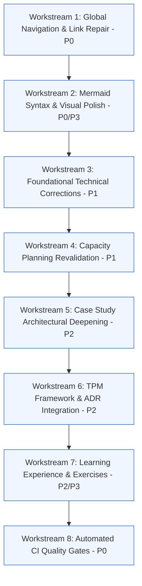

# System Design for Program Managers: Engineering Improvement Roadmap

**Status**: Active  
**Execution Branch**: `engineering-upgrade`  
**Target Milestone**: Version 2.0 (Book-Grade Reference Standard)

---

## 1. Roadmap Overview & Sequencing

This roadmap outlines the prioritized sequence of workstreams required to remediate all findings documented in `AUDIT_REPORT.md`. Work proceeds strictly from Critical (P0) to High (P1), Medium (P2), and Polish (P3).

---

## 2. Detailed Workstreams

### Workstream 1: Global Navigation, Module Indexes, and Relative Links
- **Goal**: Eliminate all machine-specific paths and ensure seamless GitHub navigation.
- **Tasks**:
  1. Replace all `file:///Users/...` absolute links in `README.md` with relative markdown links (e.g. `./01-foundations/01-client-server-networking.md`).
  2. Create dedicated `README.md` index files inside each module directory (`01-foundations/`, `02-data-architecture/`, `03-system-resilience-scale/`, `04-tpm-execution-framework/`, `05-real-world-case-studies/`).
  3. Add header breadcrumbs (e.g. `[Home](../README.md) > Module 1 > Chapter 1.1`) to all chapter documents.
- **Acceptance Criteria**:
  - Zero absolute filesystem paths anywhere in the repository.
  - Every relative link resolves successfully to a valid markdown file.

### Workstream 2: Mermaid Diagram Syntax and Visual Enhancement
- **Goal**: Fix broken class definitions and upgrade visual appeal across diagrams and tables.
- **Tasks**:
  1. Fix all `class Def...` statements to proper `classDef` definitions across the 7 flagged files.
  2. Implement an accessible, high-contrast, modern color palette across all Mermaid diagrams.
  3. Upgrade comparison tables with visual status badges (`Recommended`, `Trade-off`, `High`, `Low`, `Critical`).
- **Acceptance Criteria**:
  - 100% of Mermaid diagram blocks pass syntax validation with zero parse errors.
  - Tables format consistently with clear typographic hierarchy.

### Workstream 3: Foundational Technical Corrections and Primary Citations
- **Goal**: Remove absolute claims and add primary technical citations.
- **Tasks**:
  1. Audit and qualify absolute claims ("zero downtime", "100% available", "mathematically impossible") with precise architectural constraints.
  2. Add a "Primary Sources and Further Reading" section to every technical chapter citing RFCs, papers, and authoritative textbooks (e.g. Designing Data-Intensive Applications, Google SRE Book).
  3. Validate TCP, UDP, QUIC, Kafka, Redis, and consistency explanations against official documentation.
- **Acceptance Criteria**:
  - Every technical chapter contains at least 3 authoritative primary citations.
  - Zero ungrounded absolute assertions remain.

### Workstream 4: Capacity Planning and Numerical Revalidation
- **Goal**: Ensure 100% mathematical consistency, realistic assumptions, and protocol overhead modeling.
- **Tasks**:
  1. **Image Sharing Math**: Segregate CDN edge storage from Redis RAM metadata; recalculate using Pareto distributions.
  2. **URL Shortener Math**: Apply Zipfian power-law skew for the working set; account for Redis object memory overhead; size multi-AZ primary-replica cluster.
  3. **Ride-Sharing Ingestion Math**: Include TLS 1.3, TCP/IP, and WebSocket framing overhead; size network bandwidth (1.5 Gbps) and packet processing rates; calculate Kafka partitions and Redis shards.
  4. **Flash Sale Math**: Model inventory reservation under Redis async replication failover; introduce idempotency keys and virtual waiting room rates.
  5. Add sensitivity analysis for critical parameters in every worked example.
- **Acceptance Criteria**:
  - All arithmetic is verified with clear units, explicit assumptions, and protocol overheads.
  - Sensitivity analysis included in all capacity planning sections.

### Workstream 5: Deepening Case Study Architectures
- **Goal**: Elevate all 5 case studies to senior TPM production-grade rigor.
- **Tasks**:
  1. Add concrete OpenAPI/JSON request and response contracts for all core APIs.
  2. Add detailed database schemas with column types, primary/secondary indexes, partition keys, and TTL policies.
  3. Include at least two viable architectural alternatives with an Architectural Decision Record (ADR) evaluation table.
  4. Include a comprehensive Failure Mode and Effects Analysis (FMEA) table for distributed failure recovery.
  5. Add worked TPM Program Execution Plans with RACI matrices, launch gates, and rollback triggers.
  6. Add 3 to 4 interview practice questions with model rubric answers.
- **Acceptance Criteria**:
  - All 5 case studies contain all 14 required standard sections.

### Workstream 6: TPM Framework and Design Review Artifacts
- **Goal**: Provide practical templates and worked design review exercises for practicing TPMs.
- **Tasks**:
  1. Add formal ADR templates and guidelines for tracking architectural decisions.
  2. Include 3 worked design-review examples showcasing proposed architectures alongside the critical questions a strong TPM must ask.
  3. Add cross-team dependency mapping frameworks and risk-driven launch criteria.
- **Acceptance Criteria**:
  - Module 4 contains end-to-end ADR examples and design-review transcripts.

### Workstream 7: Learning Experience, Exercises, and Glossary
- **Goal**: Make the repository interactive and structured for all experience levels.
- **Tasks**:
  1. Create `GLOSSARY.md` with standardized definitions, formulas, and acronyms.
  2. Establish Beginner, Intermediate, and Advanced learning tracks with prerequisites.
  3. Add calculation drills and flawed architecture critique exercises with answer keys.
- **Acceptance Criteria**:
  - Complete glossary with 50+ core terms.
  - Practice exercises integrated into curriculum.

### Workstream 8: Automated Quality Gates and CI Workflow
- **Goal**: Enforce continuous automated validation for all documentation.
- **Tasks**:
  1. Create a Python-based documentation validation script (`scripts/validate_docs.py`) checking links, Mermaid syntax, machine paths, and case study structures.
  2. Create GitHub Actions workflow (`.github/workflows/docs-quality.yml`) executing on pull requests and pushes to `main`.
  3. Run the test suite locally and report pass/fail status.
- **Acceptance Criteria**:
  - Test suite runs in under 30 seconds and validates all markdown files.
  - Automated workflow configuration committed and functional.

---

## 3. Workstream Execution Matrix

| Workstream | Priority | Estimated Complexity | Dependencies | Output Deliverables |
| :--- | :--- | :--- | :--- | :--- |
| **WS1: Navigation & Links** | P0 | Medium | None | Updated `README.md`, 5 Module READMEs |
| **WS2: Mermaid & Visuals** | P0/P3 | Medium | WS1 | Corrected Mermaid blocks, enhanced tables |
| **WS3: Technical Corrections** | P1 | High | WS1 | Updated Modules 1 to 3, RFC citations |
| **WS4: Capacity Math** | P1 | High | WS3 | Recalculated Module 4.2 & Case Studies |
| **WS5: Case Study Upgrades** | P2 | Very High | WS2, WS4 | Full case study expansions (5 files) |
| **WS6: TPM Framework & ADRs** | P2 | High | WS1 | Updated Module 4, worked reviews |
| **WS7: Glossary & Exercises** | P2/P3 | Medium | WS5, WS6 | `GLOSSARY.md`, practice drills |
| **WS8: Quality Gates & CI** | P0 | Medium | All | `scripts/validate_docs.py`, GitHub Actions |

---

## 4. Verification and Governance Rules

1. **Zero Em Dashes**: Maintain strict typography without em dashes (`—` or `—`).
2. **Deterministic Arithmetic**: Every formula must state units, inputs, and intermediate steps.
3. **Primary Grounding**: All distributed systems claims must cite authoritative sources.
4. **Git Discipline**: Commit logical changes incrementally with descriptive commit messages.
