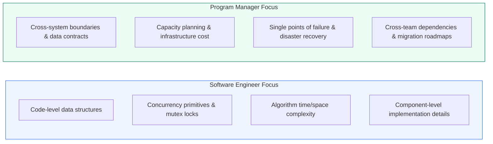
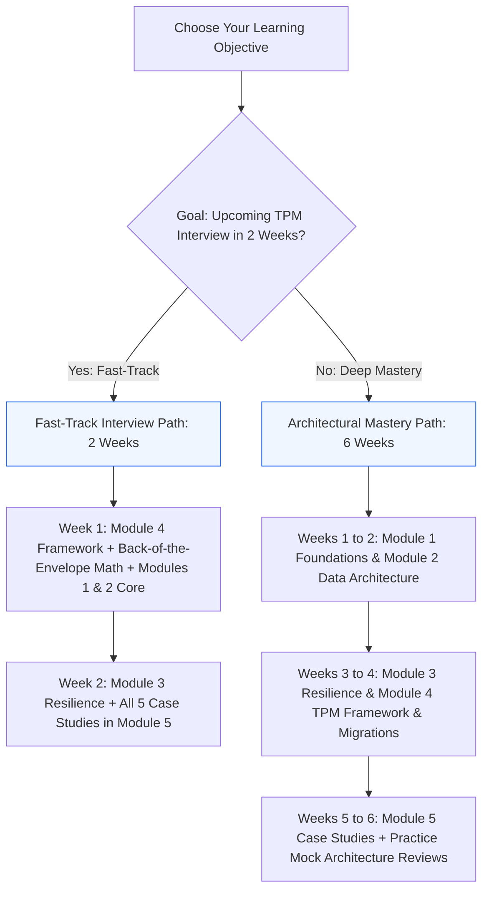
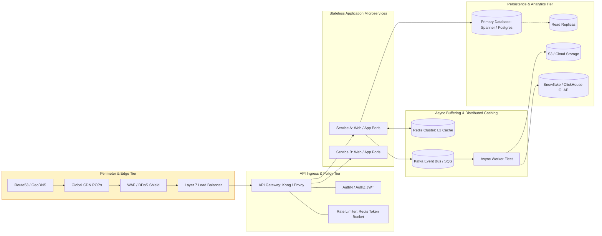

# System Design for Program Managers: The Architectural Handbook

A comprehensive, book-grade reference guide and curriculum designed specifically for **Technical Program Managers (TPMs)**, **Product Managers (PMs)**, and **Engineering Leaders**. 

Most system design resources are written by software engineers for software engineers: they dive deep into byte-level memory layouts, local thread locking, and specific programming language syntax. This repository bridges that gap by focusing on what Program Managers are actually evaluated on: **architectural breadth, trade-off analysis, high availability, cross-functional risk mitigation, capacity planning, and program execution roadmaps**.

---

## 1. The Core Philosophy: SWE vs TPM System Design

---

## 2. Master Table of Contents

### [Module 1: Distributed Systems Foundations](file:///Users/karthikeyavaibhav/.gemini/antigravity/scratch/system-design-for-program-managers/01-foundations/)
- [1.1 Client-Server Networking and Protocols](file:///Users/karthikeyavaibhav/.gemini/antigravity/scratch/system-design-for-program-managers/01-foundations/01-client-server-networking.md)
  TCP vs UDP, HTTP/1.1 through HTTP/3 (QUIC), REST vs gRPC vs WebSockets vs SSE, DNS resolution mechanics, and Content Delivery Networks (CDNs).
- [1.2 Load Balancing and API Gateways](file:///Users/karthikeyavaibhav/.gemini/antigravity/scratch/system-design-for-program-managers/01-foundations/02-load-balancing-gateways.md)
  Layer 4 vs Layer 7 load balancing, distribution algorithms, Active-Passive vs Active-Active topologies, reverse proxies, and API gateway policy offloading.
- [1.3 Distributed Caching Strategies](file:///Users/karthikeyavaibhav/.gemini/antigravity/scratch/system-design-for-program-managers/01-foundations/03-caching-strategies.md)
  Multi-tier caching, Cache-Aside vs Write-Through vs Write-Behind, eviction policies (LRU, LFU), Redis vs Memcached, and mitigation for Cache Stampede, Avalanche, and Penetration.

### [Module 2: Data Architecture and Storage](file:///Users/karthikeyavaibhav/.gemini/antigravity/scratch/system-design-for-program-managers/02-data-architecture/)
- [2.1 Databases: Relational vs NoSQL vs NewSQL](file:///Users/karthikeyavaibhav/.gemini/antigravity/scratch/system-design-for-program-managers/02-data-architecture/01-databases-sql-vs-nosql.md)
  ACID vs BASE, RDBMS vs Document vs Key-Value vs Wide-Column vs Graph, storage engine internals (B-Trees vs LSM-Trees), index penalties, and polyglot persistence.
- [2.2 Replication, Sharding, and Consistent Hashing](file:///Users/karthikeyavaibhav/.gemini/antigravity/scratch/system-design-for-program-managers/02-data-architecture/02-sharding-replication.md)
  Single-leader vs multi-leader vs leaderless replication, replication lag consistency patterns, horizontal sharding strategies, and consistent hashing rings with virtual nodes.
- [2.3 The CAP and PACELC Theorems](file:///Users/karthikeyavaibhav/.gemini/antigravity/scratch/system-design-for-program-managers/02-data-architecture/03-cap-pacelc-theorems.md)
  Why network partitions are unavoidable, CP vs AP trade-offs, the PACELC latency dimension, and matching business domains to distributed consistency models.
- [2.4 Asynchronous Messaging and Event Streaming](file:///Users/karthikeyavaibhav/.gemini/antigravity/scratch/system-design-for-program-managers/02-data-architecture/04-message-queues-streaming.md)
  Message queues (RabbitMQ, SQS) vs event streaming (Kafka, Kinesis), delivery semantics (at-least-once + idempotency), Dead Letter Queues (DLQ), and partition consumer groups.

### [Module 3: System Resilience, Scale, and NFRs](file:///Users/karthikeyavaibhav/.gemini/antigravity/scratch/system-design-for-program-managers/03-system-resilience-scale/)
- [3.1 Architectural Scalability Patterns](file:///Users/karthikeyavaibhav/.gemini/antigravity/scratch/system-design-for-program-managers/03-system-resilience-scale/01-scalability-patterns.md)
  Vertical vs horizontal scale limits, externalizing state to create stateless application fleets, CQRS read/write segregation, and auto-scaling cooldown policies.
- [3.2 Fault Tolerance, Resilience, and Rate Limiting](file:///Users/karthikeyavaibhav/.gemini/antigravity/scratch/system-design-for-program-managers/03-system-resilience-scale/02-fault-tolerance-patterns.md)
  Cascading failures, Circuit Breaker state machines, exponential backoff with full jitter, rate limiting algorithms (Token Bucket, Sliding Window), bulkheads, and idempotency keys.
- [3.3 High Availability, NFRs, and Disaster Recovery](file:///Users/karthikeyavaibhav/.gemini/antigravity/scratch/system-design-for-program-managers/03-system-resilience-scale/03-slas-slis-slos-nfrs.md)
  The SLI/SLO/SLA hierarchy, High Availability math ("The Nines"), error budgets, RPO and RTO metrics, and the disaster recovery continuum from Backup to Multi-Region Active-Active.

### [Module 4: The TPM Execution and Architecture Framework](file:///Users/karthikeyavaibhav/.gemini/antigravity/scratch/system-design-for-program-managers/04-tpm-execution-framework/)
- [4.1 The TPM System Design Framework](file:///Users/karthikeyavaibhav/.gemini/antigravity/scratch/system-design-for-program-managers/04-tpm-execution-framework/01-tpm-system-design-framework.md)
  The 5-stage blueprint for 45-minute interviews and design reviews, time management techniques, and common anti-patterns to avoid.
- [4.2 Back-of-the-Envelope Capacity Planning](file:///Users/karthikeyavaibhav/.gemini/antigravity/scratch/system-design-for-program-managers/04-tpm-execution-framework/02-back-of-the-envelope-math.md)
  Powers-of-two reference table, latency numbers every TPM should know, and formulas for calculating QPS, storage growth, network bandwidth, and memory sizing.
- [4.3 Migration and Safe Deployment Strategies](file:///Users/karthikeyavaibhav/.gemini/antigravity/scratch/system-design-for-program-managers/04-tpm-execution-framework/03-migration-deployment-strategies.md)
  The Strangler Fig pattern for monolith decommissioning, Rolling vs Blue-Green vs Canary deployments, Shadow Traffic (Dark Launching), feature flags, and automated rollback criteria.
- [4.4 Observability, Security, and Governance](file:///Users/karthikeyavaibhav/.gemini/antigravity/scratch/system-design-for-program-managers/04-tpm-execution-framework/04-observability-governance.md)
  Metrics vs Logs vs Distributed Tracing (OpenTelemetry), Google SRE Four Golden Signals, AuthN vs AuthZ (OAuth2, OIDC, JWT), envelope encryption, and regulatory compliance (GDPR, SOC 2).

### [Module 5: Real-World Architecture Case Studies](file:///Users/karthikeyavaibhav/.gemini/antigravity/scratch/system-design-for-program-managers/05-real-world-case-studies/)
- [5.1 Designing a Global URL Shortener (TinyURL / Bitly)](file:///Users/karthikeyavaibhav/.gemini/antigravity/scratch/system-design-for-program-managers/05-real-world-case-studies/01-url-shortener.md)
  Key Generation Service (KGS), Base62 hashing, HTTP 301 vs 302 analytics trade-offs, DynamoDB partitioning, and caching tiers.
- [5.2 Scalable Multi-Channel Notification Engine](file:///Users/karthikeyavaibhav/.gemini/antigravity/scratch/system-design-for-program-managers/05-real-world-case-studies/02-notification-engine.md)
  Multi-channel dispatch (Push, SMS, Email), priority queues (OTP vs Marketing), quiet-hour evaluation, vendor circuit breakers, and SMS cost routing cascades.
- [5.3 Global Video Streaming Platform (YouTube / Netflix)](file:///Users/karthikeyavaibhav/.gemini/antigravity/scratch/system-design-for-program-managers/05-real-world-case-studies/03-video-streaming-platform.md)
  Chunk-based DAG video transcoding, Adaptive Bitrate Streaming (HLS / MPEG-DASH), multi-terabit bandwidth cost management, and ISP edge caching appliances.
- [5.4 Real-Time Ride-Sharing Dispatch (Uber / Lyft)](file:///Users/karthikeyavaibhav/.gemini/antigravity/scratch/system-design-for-program-managers/05-real-world-case-studies/04-ride-sharing-dispatch.md)
  1.25M location writes/sec, Uber H3 hexagonal spatial indexing, distributed driver locking, WebSocket lifecycle management, and trip state machines.
- [5.5 High-Concurrency Flash Sale and Distributed Checkout](file:///Users/karthikeyavaibhav/.gemini/antigravity/scratch/system-design-for-program-managers/05-real-world-case-studies/05-distributed-ecommerce-checkout.md)
  Atomic in-memory inventory reservation (Redis Lua scripts), the Saga orchestration pattern with compensating transactions, payment idempotency, and virtual waiting rooms.

---

## 3. Recommended Study Paths

---

## 4. Visual Architecture Reference Map

---

## 5. TPM System Design Evaluation Rubric

Top technology companies assess TPM candidates across five primary dimensions:

| Evaluation Dimension | Expectations for Senior TPM |
| :--- | :--- |
| **1. Requirements & Scope Clarification** | Asks targeted questions to bound scope; separates functional from non-functional requirements; calculates quantitative scale targets (QPS, storage, bandwidth). |
| **2. Architectural Breadth & Component Selection** | Selects appropriate building blocks (load balancers, gateways, databases, caches, queues); justifies choices using technical and business trade-offs. |
| **3. Scalability & Resilience Depth** | Identifies single points of failure (SPOFs); designs for graceful degradation; applies rate limiting, circuit breakers, and consistent hashing. |
| **4. Data Modeling & Storage Strategy** | Chooses relational vs NoSQL vs NewSQL based on read/write patterns; designs partition keys; plans for replication lag and consistency models. |
| **5. Program Execution & Governance Lens** | Identifies cross-team dependencies; defines zero-downtime migration strategies (Strangler Fig, Canary); estimates cloud costs; defines rollback SLI triggers. |

---

## 6. How to Contribute

Contributions, corrections, and additional case studies from practicing TPMs and engineering leaders are welcome. Please open a pull request or issue following the standard GitHub markdown guidelines and style conventions.
